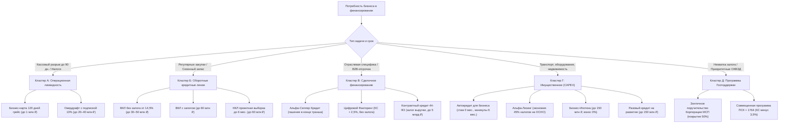

# Аналитический отчет: Полная продуктовая матрица кредитных линий и инструментов финансирования МСП АО «Альфа-Банк»

> [!IMPORTANT]
> Данный отчет систематизирует все актуальные кредитные линии, оборотные и инвестиционные инструменты финансирования малого и микробизнеса (МСП) в экосистеме **АО «Альфа-Банк»** (включая контур малого бизнеса, корпоративный блок и дочернюю компанию «Альфа-Лизинг»). Материал синхронизирован с ТЗ проекта [[Alfa_Hack_Smart_Credit_Cabinet_BRD_SRS_v3.3_Exact.docx](file:///c:/Users/Maken/Desktop/alpha/Alfa_Hack_Smart_Credit_Cabinet_BRD_SRS_v3.3_Exact.docx)] и служит эталонным описанием продуктового ядра для системы «Умный кредитный кабинет предпринимателя».



---

## 1. Архитектурная классификация: 11 кредитных продуктов в 5 кластерах

### Кластер А. Инструменты сверхкороткой и операционной ликвидности (до 90–120 дней)

#### 1. Кредитная карта «Альфа-Бизнес Кредит» (`PROD_BIZ_CARD`)
* **Целевое назначение:** Финансирование текущих хозяйственных расходов, ГСМ, командировок, мелких закупок инвентаря и рекламы с сохранением собственных оборотных средств на расчетном счете.
* **Лимит финансирования:** До 1 000 000 ₽ (суточный лимит на снятие наличных — до 300 000 ₽).
* **Срок договора / Грейс-период:** Договор на 36 месяцев; возобновляемый беспроцентный период (грейс) **до 120 календарных дней** на тарифе «Выгодный» (закрепляется на весь срок договора) и до 60 дней на тарифах «Базовый» и «Премиальный».
* **Ценообразование:** **0% годовых** при полном погашении задолженности в течение льготного периода и внесении ежемесячного минимального платежа. При несоблюдении грейса — стандартная ставка тарифа карты. Выпуск и обслуживание — 0 ₽.
* **Особенности и ограничения:** Кэшбэк **10%** на бизнес-расходы. Переводы на счета юрлиц и ИП облагаются комиссией 3,9%. Переводы на карты физлиц заблокированы (требования 115-ФЗ).
* **Обеспечение и стаж:** Без залога и поручителей. Доступна с 0–3 месяцев ведения счета.

#### 2. Овердрафт для малого бизнеса (включая «Овердрафт с подпиской») (`PROD_OVERDRAFT`)
* **Целевое назначение:** Автоматическое покрытие краткосрочных кассовых разрывов при проведении срочных платежей (налоги ЕНП 28-го числа, аренда, зарплата, оплата срочных счетов поставщиков при нулевом остатке).
* **Лимит финансирования:** От 50 000 ₽ до 20 000 000 ₽ (в корпоративном сегменте Экспресс-овердрафт — до 40–60 млн ₽ с учетом оборотов в сторонних банках). Рассчитывается индивидуально (до 70%–100% от среднемесячного кредитового оборота).
* **Срок договора / Срок транша:** Соглашение заключается на 12 месяцев с автоматической ежегодной пролонгацией. Максимальная длительность непрерывного нахождения счета «в минусе» (транш) — **до 60 дней** в базовом тарифе и **до 90 дней** при подключении подписки.
* **Ценообразование:** Базовая ставка — от **26,0%** годовых. При подключении фирменной опции «Подписка на овердрафт» ставка снижается ровно вдвое — до **13,0%** годовых, а лимит становится гарантированным.
* **Механика погашения:** Проценты начисляются строго за дни фактического использования. Если деньги поступили на счет в тот же день, переплата равна 0 ₽. Гашение происходит автоматически при любом поступлении выручки на расчетный счет.
* **Требования:** Срок фактического ведения бизнеса — **от 9 месяцев**. Для юрлиц (ООО) обязательно поручительство собственника.

---

### Кластер Б. Оборотное и траншевое финансирование (Кредитные линии ВКЛ и НКЛ)

#### 3. Возобновляемая кредитная линия без залога (`PROD_VKL_UNSEC`)
* **Целевое назначение:** Регулярные оптовые закупки партий сырья и товаров, внесение предоплаты поставщикам за 1–2 месяца до поставки, сглаживание сезонных спадов.
* **Лимит финансирования:** От 300 000 ₽ до 30 000 000 ₽ (на основной витрине — до 50 000 000 ₽; по спецпрограммам под поручительство собственника — до 100 000 000 ₽).
* **Срок договора / Срок транша:** Срок договора — 18 месяцев с ежегодным автопродлением. Сумма отдельного транша — от 50 000 ₽ до 30 000 000 ₽ на срок **от 1 до 6 месяцев** каждый.
* **Ценообразование:** Базовая ставка — от **23,5%** годовых. При подключении «Подписки на ВКЛ» (дисконт 3, 7, 9,5 или 11 п.п.) и опции «Защита бизнеса» (-4,5 п.п.) эффективная ставка снижается до **14,5%** годовых.
* **Механика использования:** Заемщик может выбирать новые транши в любой момент в пределах свободного остатка лимита. Комиссии за открытие лимита, неиспользование средств и досрочное погашение отсутствуют. По мере возврата средств лимит автоматически восстанавливается.
* **Требования:** Стаж бизнеса от **9 месяцев**.

#### 4. Возобновляемая кредитная линия с залогом (`PROD_VKL_SEC`)
* **Целевое назначение:** Крупномасштабное пополнение оборотного капитала торговых и производственных предприятий с многократной выборкой.
* **Лимит финансирования:** От 500 000 ₽ до 60 000 000 ₽ (транши от 50 тыс. до 30 млн ₽).
* **Срок договора / Период выборки:** Общий срок договора — до 36–60 месяцев. Период выборки траншей длится от открытия линии и заканчивается за 6 месяцев до конца договора. Срок использования каждого транша — до 6 месяцев.
* **Ценообразование:** От **23,0%** базовой ставки; со скидкой за «Защиту бизнеса» (-4,5 п.п.) — от **18,5%** годовых.
* **Обеспечение:** Залог ликвидной коммерческой недвижимости, легкового/грузового транспорта или спецтехники.

#### 5. Невозобновляемая кредитная линия с залогом (`PROD_NKL_SEC`)
* **Целевое назначение:** Финансирование поэтапных инвестиционных и строительно-монтажных проектов с жесткой сметой (ремонт помещения, запуск цеха, открытие новой точки).
* **Лимит финансирования:** От 500 000 ₽ до 60 000 000 ₽.
* **Срок договора / Структурное отличие:** Общий срок — до 60 месяцев. **Ключевое отличие от ВКЛ:** жесткое разделение на фазу выборки и фазу гашения. Выбирать транши разрешено только в первые **6 месяцев** с момента заключения договора. В оставшиеся 54 месяца лимит не возобновляется, а заемщик спокойно выплачивает накопленный долг по предсказуемому графику.
* **Ценообразование:** За счет сниженного риска амортизации ставка ниже, чем по ВКЛ: от **22,0%** базовой (от **17,5%** с «Защитой бизнеса»).
* **Экономическая выгода:** Бизнес не берет всю сумму кредита сразу в первый день (экономя на процентах за еще не освоенные этапы сметы).

---

### Кластер В. Специализированное отраслевое и сделочное финансирование

#### 6. «Альфа-Селлер Кредит» (`PROD_SELLER`)
* **Целевое назначение:** Специализированная возобновляемая кредитная линия для продавцов маркетплейсов (Wildberries, Ozon, Яндекс.Маркет, Мегамаркет).
* **Лимит финансирования:** До 20 000 000 ₽ без залога. Банк ежеквартально анализирует API-статистику продаж селлера и **автоматически увеличивает кредитный лимит** по мере масштабирования оборотов.
* **Срок транша:** Выборка траншей на срок от 1 до 12 месяцев.
* **Уникальный график погашения:** В отличие от стандартных кредитов, селлер может выбрать опцию **«Погашение основного долга в конце срока транша»** (bullet payment). Это снимает кассовое давление на период, пока товар находится в пути, на складах маркетплейса или на стадии выкупа покупателями.
* **Ценообразование:** Базовая переплата от 1,2% в месяц. В годовом исчислении с Подпиской и Защитой бизнеса — от **10,9%–14,5%** годовых. «Подписка на Альфа-Селлер» дает скидку до 10% на ставку и полностью аннулирует штрафную комиссию 0,2% за снижение оборотов.

#### 7. Цифровой Факторинг (`PROD_FACTORING`)
* **Целевое назначение:** Ликвидация кассовых разрывов у производителей и оптовых поставщиков, работающих с крупными B2B-покупателями и торговыми сетями на условиях отсрочки платежа.
* **Лимит финансирования:** До **100% от суммы товарной накладной** или акта (до 500 млн ₽ в онлайн-контуре).
* **Срок финансирования:** На срок отсрочки платежа по контракту — от 7 до 365 дней.
* **Ключевое преимущество:** Финансирование выдается **без залога имущества и без поручительства**. Банк оценивает платежеспособность покупателя (дебитора). Погашение осуществляет сам дебитор напрямую на счет в банке.
* **Ценообразование:** Комиссия от 1,5% в месяц, а в рамках партнерских акций для МСП — ставка по формуле $\text{Ключевая ставка ЦБ} + 2,5\%$.
* **Порог входа:** Требуемый стаж работы поставщика снижен **до 6 месяцев**.

#### 8. Кредит на исполнение контракта + Экспресс-гарантии (`PROD_CONTRACT`)
* **Целевое назначение:** Финансирование расходов победителей государственных и корпоративных закупок по 44-ФЗ, 223-ФЗ, 185-ФЗ и 615-ПП (закупка материалов, ГСМ, субподряд, зарплата рабочих).
* **Лимит финансирования:** До 5 000 000 000 ₽ на один контракт (до 10 млрд ₽ совокупно). Онлайн экспресс-гарантии — от 600 тыс. до 30 млн ₽.
* **Срок финансирования:** До 6 лет (под фактический срок исполнения госконтракта).
* **Обеспечение:** Не требуется залог недвижимости, складов или оборудования. Единственное обеспечение — **залог права требования выручки по контракту**.
* **Ценообразование:** Льготная ставка (ниже обычных оборотных кредитов благодаря надежности государственного заказчика).

---

### Кластер Г. Инвестиционное, имущественное и залоговое финансирование (CAPEX)

#### 9. Разовый кредит на развитие бизнеса (`PROD_TERM_LOAN`)
* **Модификация 1 (Без залога):** От 300 000 ₽ до 30 000 000 ₽ (действующим ИП онлайн до 10 млн ₽ без посещения офиса). Срок от 1 до 5 лет. Ставка от 23,5% базовой (со скидками по Подписке и Защите бизнеса — от **14,0%**).
* **Модификация 2 (С залогом):** От 500 000 ₽ до 150 000 000 ₽ на срок от 1 до 10 лет. Необеспеченная залогом часть может достигать 50% суммы кредита. Ставка от 21,5% базовой (от 14,0% со скидками).
* **Модификация 3 («Кредит на открытие бизнеса с нуля»):** От 1 000 000 ₽ до 150 000 000 ₽ для вновь созданных компаний со сроком регистрации **от 0 месяцев** под залог ликвидной коммерческой недвижимости (до 10 лет) или транспорта/спецтехники (до 5 лет).

#### 10. «Автокредит для бизнеса» и «Альфа-Лизинг» (`PROD_AUTO` / `PROD_LEASING`)
Система проводит арбитраж между двумя инструментами приобретения колесной техники и оборудования:
* **Автокредит для бизнеса:**
  - Лимит до 50 000 000 ₽ на срок до 10 лет. Ставка от 14,0%–17,5%.
  - Снимает все классические барьеры: доступен с **0 месяцев регистрации** без предоставления бухгалтерской отчетности, с **первоначальным взносом 0%**, без поручителей и с **отсрочкой погашения основного долга на 6 месяцев**. Автомобиль оформляется в собственность клиента сразу.
* **Альфа-Лизинг:**
  - Оптимален для юридических лиц на общей системе налогообложения (ОСНО).
  - Обеспечивает налоговую экономию до **45%–47%** за счет зачета входящего НДС и уменьшения базы налога на прибыль.
  - Аванс от 0% до 49%, скидки от автопроизводителей до 20%–25%, субсидии Минпромторга РФ (до 2 млн ₽) и программа льготного лизинга белорусской техники (субсидирование до 75% ставки). Доступен механизм **возвратного лизинга** (продажа банку своего парка техники с получением до 80% стоимости живыми деньгами в оборот).

#### 11. «Бизнес-Ипотека» (`PROD_MORTGAGE`)
* **Целевое назначение:** Покупка коммерческой недвижимости (офисы, склады, торговые площади стрит-ритейла, производственные цеха).
* **Параметры:** Лимит до 150 000 000 ₽ на срок до 10 лет (в рамках партнерских ипотечных программ для ИП — до 30 лет).
* **Флагманское преимущество:** **Первоначальный взнос — 0%** (необязателен). Комиссия за проведение расчетов через аккредитив — 0 ₽.
* **Ставка:** Базовая ставка от 22,0%–23,0%; при подключении «Защиты бизнеса» снижается до **18,5%** годовых.

---

### Кластер Д. Программы государственной поддержки и поручительств

#### 12. Зонтичное поручительство Корпорации МСП (`PROD_GOS_UMBRELLA`)
* **Механика:** Государственный гарантийный механизм для заемщиков, у которых не хватает собственного залогового обеспечения.
* **Условия покрытия:** Корпорация МСП берет на себя **до 50% риска по кредиту** (при совместном поручительстве с ВЭБ.РФ — по 25% каждый).
* **Выгода для заемщика:** Комиссия за поручительство составляет **0 ₽**. Экспресс-кредиты до 50 000 000 ₽ одобряются за 1 рабочий день без сбора дополнительных документов.

#### 13. Совмещенная программа «ПСК + 1764» (`PROD_GOS_1764`)
* **Суть программы:** Объединение субсидии Минэкономразвития РФ (Постановление № 1764) и льготного фондирования Банка России (ПСК) под поручительство Корпорации МСП.
* **Лимиты и сроки:** От 30 000 000 ₽ до 500 000 000 ₽ (для средних предприятий — до 2 млрд ₽) на срок до 10 лет с льготным периодом субсидирования ставки до 5 лет. До 20% суммы инвестиционного кредита разрешается направить на оборотные расходы.
* **Формула процентной ставки:** Жестко привязана к Ключевой ставке Банка России:
  $$\text{Ставка}_{\text{ПСК+1764}} = \begin{cases} \text{КС} - 3,5\%, & \text{если } \text{КС} > 12\% \\ \text{КС} - 2,5\%, & \text{если } \text{КС} \le 12\% \end{cases}$$
* **Отраслевой ценз:** Заемщик должен вести деятельность не менее 12 месяцев в приоритетных отраслях ОКВЭД: обрабатывающее производство (10–19), логистика и складское хозяйство (52), общепит и гостиницы (55, 56.10.1), ИТ и разработка ПО (62.01, 63), научные исследования (72).

---

## 2. Сводная параметрическая таблица продуктовой матрицы

| Код продукта | Название продукта в Альфа-Банке | Лимит финансирования | Срок договора / транша | Базовая ставка | Ставка со скидкой | Обеспечение | Мин. стаж бизнеса |
|---|---|---|---|---|---|---|---|
| `PROD_BIZ_CARD` | Карта «Альфа-Бизнес Кредит» | До 1 млн ₽ | 36 мес. / грейс до 120 дн. | Тариф карты | **0% в грейс** | Без залога | От 0–3 мес. |
| `PROD_OVERDRAFT` | Овердрафт для бизнеса | От 50 тыс. до 20 млн ₽ | 12 мес. / транш до 60–90 дн. | 26,0% | **13,0%** (Подписка) | Без залога (поруч. ООО) | От 9 мес. |
| `PROD_VKL_UNSEC` | ВКЛ без залога | От 300 тыс. до 50 млн ₽ | 18 мес. / транш 1–6 мес. | 23,5% | **14,5%** (Подписка) | Без залога (поруч. ООО) | От 9 мес. |
| `PROD_VKL_SEC` | ВКЛ с залогом | От 500 тыс. до 60 млн ₽ | До 60 мес. / транш 6 мес. | 23,0% | **18,5%** (Защита) | Залог имущества | От 9 мес. |
| `PROD_NKL_SEC` | НКЛ с залогом | От 500 тыс. до 60 млн ₽ | До 60 мес. / выборка 6 мес. | 22,0% | **17,5%** (Защита) | Залог имущества | От 9 мес. |
| `PROD_SELLER` | Альфа-Селлер Кредит | До 20 млн ₽ (авторост) | До 12 мес. транш | От 1,2%/мес. | **10,9%–14,5%** | Без залога | По оборотам на МП |
| `PROD_FACTORING` | Цифровой Факторинг | До 100% накладной (до 500 млн) | 7–365 дней отсрочки | 1,5%/мес. | **КС + 2,5%** | Без залога (дебитор) | От 6 мес. |
| `PROD_CONTRACT` | Кредит под 44-ФЗ / 223-ФЗ | До 5 млрд ₽ на контракт | До 6 лет | Льготная | Индивидуально | Залог выручки контракта | Спецсчет + победа |
| `PROD_TERM_LOAN` | Кредит на развитие бизнеса | До 30 млн (без залога) / 150 млн | От 1 до 10 лет | 21,5%–23,5% | **14,0%** (Подписка) | Залог от 50% / без залога | От 9 мес. (с 0 под залог) |
| `PROD_AUTO` | Автокредит для бизнеса | До 50 млн ₽ | До 10 лет | 17,5% | **14,0%** (каникулы 6 мес.) | Приобретаемое ТС (ПВ 0%) | **От 0 месяцев** |
| `PROD_LEASING` | Альфа-Лизинг | Без жесткого потолка | 12–84 месяцев | По графику | **Экономия до 45%** | Предмет лизинга | От 6–12 мес. |
| `PROD_MORTGAGE` | Бизнес-Ипотека | До 150 млн ₽ | До 10 лет (до 30 лет) | 23,0% | **18,5%** (взнос 0%) | Приобретаемый объект | От 9 мес. |
| `PROD_GOS_1764` | Программа ПСК + 1764 | От 30 до 500 млн ₽ | До 10 лет | Рыночная | **КС минус 3,5%** | Зонтик МСП + залог | От 12 мес. (приоритет) |

---

## 3. Математика фирменных дисконтов Альфа-Банка

Ключевое преимущество кредитного конвейера Альфа-Банка — отказ от негибкой плоской ставки. В системе реализован модульный расчет дисконтов:

### Механика «Подписки на кредит / ВКЛ / Овердрафт / Селлер»
* **Суть:** Предприниматель оплачивает фиксированную разовую комиссию (или ежемесячную подписку) и получает гарантированное снижение ставки на весь период финансирования.
* **Величина дисконта:**
  - В Овердрафте: снижение ставки в 2 раза — с **26,0% до 13,0%** годовых + продление транша с 60 до 90 дней.
  - В ВКЛ и кредитах на развитие: скидка **3, 7, 9,5 или 11 процентных пунктов** (снижение ставки до **14,5%–14,0%** годовых).
  - В Селлер-кредите: скидка до 10% на ставку + отмена комиссии 0,2% за неподдержание оборотов.

### Механика «Защиты бизнеса»
* **Суть:** Подключение полиса страхования имущественных рисков и непредвиденных расходов.
* **Величина дисконта:** Прямое снижение ставки на **4,5 процентных пункта** по залоговым ВКЛ/НКЛ, Бизнес-Ипотеке и кредитам с господдержкой.

> [!TIP]
> **Алгоритм экономической целесообразности:**
> Конвейер рассчитывает чистую приведенную выгоду заемщика:
> $$\Delta R_{\text{discount}} \times S_{\text{loan}} \times \frac{T_{\text{months}}}{12} > C_{\text{subscription}} + C_{\text{protection}}$$
> Если выгода положительна, система автоматически рекомендует пакет с дисконтом и выводит точный расчет чистой прибыли: *«Подписка сэкономит вам 142 000 ₽ за 12 месяцев»*.

---

## 4. Ситуационный движок маршрутизации: какой продукт и когда предлагает система

Система сопоставляет входящее бизнес-событие с профилем компании (360°-ДНК) и подбирает наиболее маржинальный для клиента и безопасный для банка инструмент:

```
[Поисковый запрос / PDF-счет / Событие в кассе]
                        │
                        ▼
           Проверка остатка кассы на 60 дней
                        │
        ┌───────────────┴───────────────┐
        ▼                               ▼
Касса в норме, разрыва нет      Прогноз кассового разрыва
        │                               │
        ▼                               ▼
 [РЕЖИМ ТИШИНЫ]                 [ОВЕРДРАФТ 13%]
Депозит овернайт 16%           Переплата 1 260 ₽ за 7 дней
(кредит не навязывается)       (в 9 раз выгоднее годового займа)

                        │
                        ▼
     Потребность в развитии / закупках (CAPEX / OPEX)
        │
        ├─► Оптовая партия сырья/товара ──► [ВКЛ без залога от 14,5%]
        ├─► B2B-отсрочка по накладным   ──► [Цифровой Факторинг КС+2,5%]
        ├─► Победа в тендере 44-ФЗ      ──► [Кредит под залог выручки контракта]
        ├─► Транспорт на ОСНО           ──► [Альфа-Лизинг: возврат НДС 45%]
        ├─► Транспорт на УСН / стаж 0 м ──► [Автокредит для бизнеса: каникулы 6 мес.]
        └─► Нехватка залога при FCF > 0 ──► [Зонтичное поручительство МСП 50%]
```

1. **Кассовый разрыв на 7–14 дней перед налогами ЕНП / зарплатой:**  
   Предлагается **Овердрафт с подпиской под 13%**. Переплата за 7 дней на сумму 180 000 ₽ составит всего **1 260 ₽** по базовой ставке (или **449 ₽** с подпиской) вместо **11 340 ₽** по годовому кредиту.
2. **Оптовая закупка партии сырья / рост цен на сырье:**  
   Предлагается **ВКЛ без залога** с выборкой траншей на 1–6 месяцев под 14,5% годовых. Проценты платятся только за дни пользования траншем, после сбыта продукции лимит восстанавливается.
3. **Строительно-монтажные работы с поэтапными актами:**  
   Предлагается **НКЛ с залогом**: выборка траншей строго в первые 6 месяцев под акты, затем 54 месяца планомерного погашения по сниженной ставке от 17,5%.
4. **Торговля на маркетплейсах (Wildberries, Ozon):**  
   Предлагается **Альфа-Селлер Кредит** с погашением основного долга в конце срока транша и автоматическим увеличением лимита при росте выручки.
5. **Поставка крупному контрагенту с отсрочкой 30–120 дней:**  
   Предлагается **Цифровой Факторинг** (финансирование до 100% поставки без залога, оценка покупателя, стаж поставщика от 6 месяцев).
6. **Выигрыш тендера по 44-ФЗ / 223-ФЗ:**  
   Предлагается целевой **Кредит на исполнение контракта** до 5 млрд ₽ под залог права требования выручки без имущественного залога.
7. **Покупка автотранспорта / спецтехники:**  
   - Для компаний на **ОСНО**: **«Альфа-Лизинг»** (налоговая выгода до 45% за счет зачета НДС и налога на прибыль).
   - Для компаний на **УСН** или молодых бизнесов (стаж **0–8 месяцев**): **«Автокредит для бизнеса»** (одобрение с 0 месяцев без финотчетности, взнос 0%, 6 месяцев каникул).
8. **Покупка коммерческого помещения (офис, склад, кафе):**  
   Предлагается **«Бизнес-Ипотека»** с первоначальным взносом **0%** и заменой арендных платежей на выплату собственного актива.
9. **Нехватка собственного залога при достаточном FCF:**  
   Автоматически подключается **«Зонтичное поручительство Корпорации МСП»** (покрывает до 50% залога без комиссий за 1 день).
10. **Стабильный остаток на счете (кассовый профицит):**  
    Активируется **«Режим тишины»** (баннеры кредитов блокируются, предлагается размещение остатка на депозит овернайт под 16% годовых).

---

## 5. Интеграция в архитектуру конвейера (BRD v3.3)

В базе данных цифрового конвейера продуктовая матрица зафиксирована в отдельной сущности:

```sql
CREATE TABLE alfa_credit_products (
    product_code VARCHAR(32) PRIMARY KEY,
    display_name VARCHAR(128) NOT NULL,
    intent_category VARCHAR(32) NOT NULL,
    min_amount_rub BIGINT NOT NULL,
    max_amount_rub BIGINT NOT NULL,
    min_term_days INT NOT NULL,
    max_term_days INT NOT NULL,
    base_rate_pct NUMERIC(5,2) NOT NULL,
    min_discounted_rate_pct NUMERIC(5,2) NOT NULL,
    subscription_discount_pct NUMERIC(5,2) DEFAULT 0.0,
    protection_discount_pct NUMERIC(5,2) DEFAULT 0.0,
    grace_period_days INT DEFAULT 0,
    min_business_age_months INT DEFAULT 9,
    collateral_type VARCHAR(32) NOT NULL,
    allowed_okved_clusters TEXT[] DEFAULT ARRAY['ALL']
);
```

Такая структура позволяет:
* за 50 мс подбирать оптимальный продукт в эндпоинте `POST /api/v1/companies/{id}/smart-search`;
* в 1 клик рассчитывать переплату в рублях и экономию от опций «Подписка» и «Защита бизнеса»;
* автоматически формировать **4 типа контр-офферов** при попадании заявки в «Желтый коридор» андеррайтинга вместо выставления слепого отказа.
