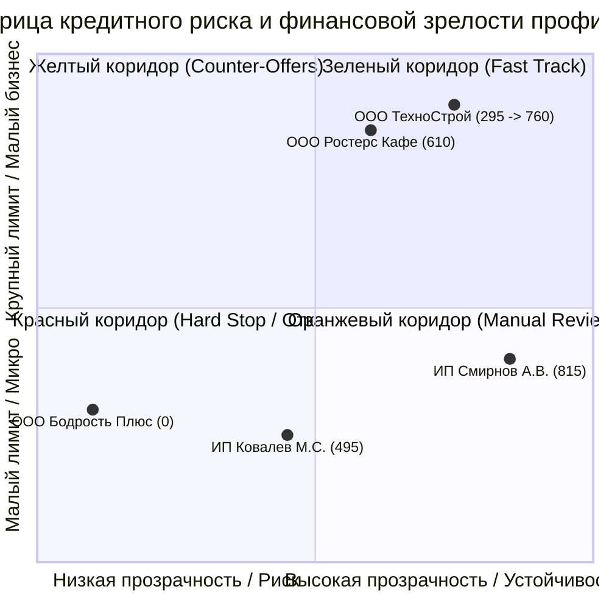
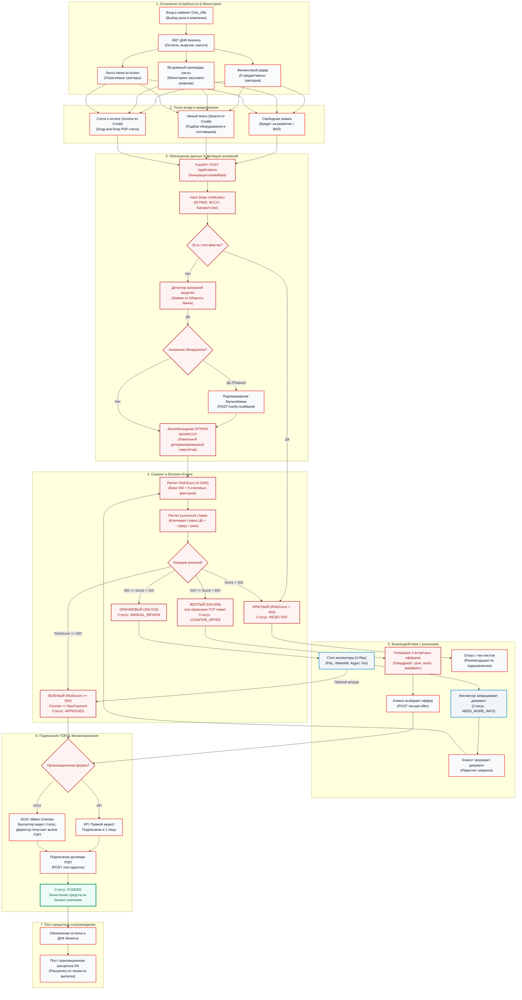
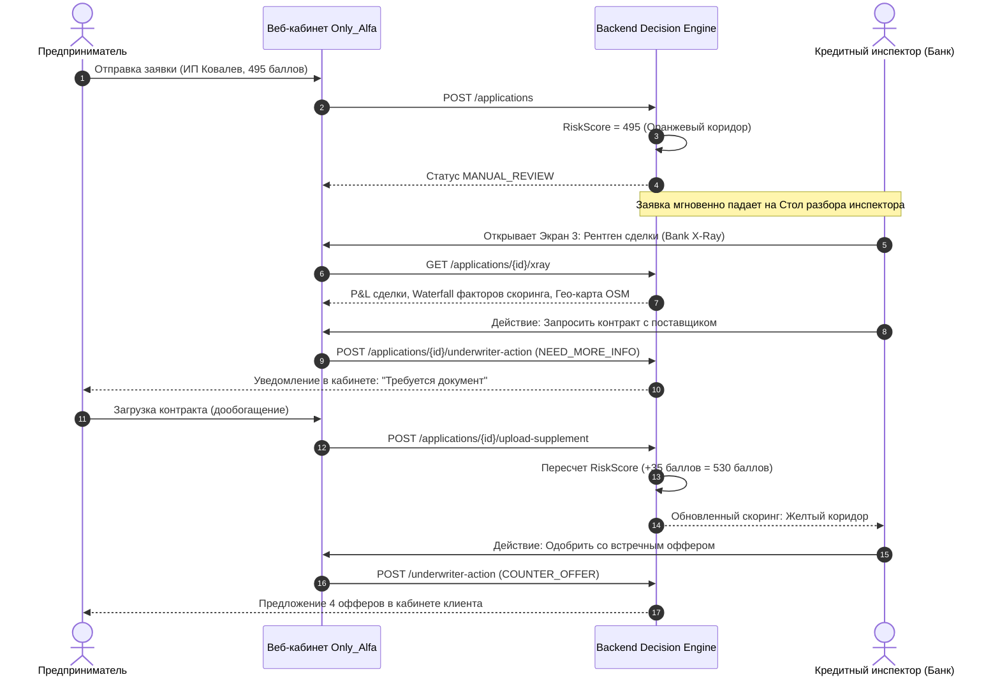

# 01. Продуктовое исследование, JTBD и CJM (Customer Journey Map)

> **Для кого документ:** Продуктовые аналитики (CPO/PM), Бизнес-аналитики, UX/UI-исследователи, эксперты приёмки (Ольга Урсул, Алексей Григорьев, Тимур Балбаев).  
> **Цель артефакта:** Продемонстрировать глубокое понимание потребностей сегмента малого и микробизнеса (МСП), связь выявленных болей с реализованным функционалом MVP, а также предоставить полную визуализацию сквозного пользовательского пути (CJM) предпринимателя и кредитного инспектора банка.

---

## Содержание

1. [Бизнес-контекст и проблематика МСП в кредитовании](#1-бизнес-контекст-и-проблематика-мсп-в-кредитовании)
2. [Фреймворк JTBD (Jobs-to-be-Done) для малого бизнеса](#2-фреймворк-jtbd-jobs-to-be-done-для-малого-бизнеса)
3. [Портреты пользователей (Customer Personas) и 5 контрастных профилей](#3-портреты-пользователей-customer-personas-и-5-контрастных-профилей)
4. [Правовая специфика клиентского пути: ИП против ООО](#4-правовая-специфика-клиентского-пути-ип-против-ооо)
5. [Сквозной Customer Journey Map (CJM) в Mermaid](#5-сквозной-customer-journey-map-cjm-в-mermaid)
6. [Детальная матрица этапов пользовательского пути](#6-детальная-матрица-этапов-пользовательского-пути)
7. [Пользовательский путь кредитного инспектора (Underwriter Journey)](#7-пользовательский-путь-кредитного-инспектора-underwriter-journey)
8. [Продуктовые метрики и бизнес-эффект для банка](#8-продуктовые-метрики-и-бизнес-эффект-для-банка)

---

## 1. Бизнес-контекст и проблематика МСП в кредитовании

Кредитование малого и микробизнеса — один из ключевых драйверов роста банковского сектора РФ (совокупный объем выдач МСП превышает 1,3 трлн рублей). Однако традиционный процесс кредитования в классических банках создает критические барьеры для предпринимателя:

| Традиционный процесс в банке | Боль предпринимателя | Решение в Only_Alfa |
|---|---|---|
| Сбор 15–20 документов (справки 2-НДФЛ, выписки, оборотно-сальдовые ведомости, договоры аренды) | Предприниматель тратит от 3 до 7 рабочих дней на бюрократию вместо ведения бизнеса. | **360°-ДНК бизнеса и автообогащение**: 90% данных собираются автоматически из ЕГРЮЛ, БКИ, ФССП и истории транзакций. |
| Ручной ввод реквизитов платежей и счетов в форму заявки | Ошибки в ИНН, БИК, суммах; потеря времени на перепечатывание счетов поставщиков. | **Invoice-to-Credit**: Drag-and-Drop PDF-счета с извлечением ИНН, суммы и назначения за 40 секунд. |
| Долгое ожидание скоринга (от 2 до 5 рабочих дней) | Упущенная выгода: поставщик отдает дефицитный товар или оборудование другому покупателю. | **Моментальный конвейер**: скоринг и решение за < 200 мс (p95). |
| Бинарный отказ («Отказ без объяснения причин») | Фрустрация, потеря доверия к банку, невозможность понять, что улучшить. | **4 встречных оффера (Counter-Offers) + Чек-лист оздоровления**: банк всегда предлагает альтернативу или шаги улучшения. |
| Занижение лимита при оборотах в разных банках | У бизнеса счета в 2–3 банках; Альфа видит только часть оборота и выдает отказ или мизерный лимит. | **Подтверждение Мультибанка**: объединение аналитики выписок в 1 клик (+90 баллов, +25% к лимиту). |
| Шаблонные продукты без учета графика платежей | Кредит перегружает долговую нагрузку (ПДН), провоцируя кассовые разрывы. | **Прогноз кассы на 60 дней**: рекомендация овердрафта ровно на сумму разрыва под конкретное B2B-поступление. |

---

## 2. Фреймворк JTBD (Jobs-to-be-Done) для малого бизнеса

Вместо проектирования гипотетических функций «ради галочки», архитектура кабинета построена на 4 фундаментальных работах (Job Stories), выявленных в ходе исследования болей предпринимателей:

### Job Story 1. Покупка оборудования по счёту (Invoice-to-Credit & Search-to-Credit)
> **Когда** мой поставщик выставил счет на дефицитное оборудование (например, рожковую кофемашину La Marzocco на 900 000 ₽) с ограниченным сроком действия резерва,  
> **я хочу** загрузить PDF-счет или выбрать проверенного поставщика прямо в кабинете банка и в 1 клик получить одобренное финансирование,  
> **чтобы** не упустить скидку и зафиксировать поставку без заполнения 20 полей кредитной анкеты.

### Job Story 2. Предотвращение кассового разрыва (Cash-Gap Protection)
> **Когда** приближается 25-е число (выплата налогов и зарплаты сотрудникам), а крупный контрагент задерживает оплату по закрывающему акту на 10 дней,  
> **я хочу** увидеть предупреждение о разрыве на интерактивном графике и получить предложение короткого овердрафта ровно на недостающие 180 000 ₽,  
> **чтобы** не останавливать операционную деятельность и не брать избыточный долгосрочный кредит под высокий процент.

### Job Story 3. Раскрытие реального оборота (Multi-Bank Revenue Aggregation)
> **Когда** моя компания проводит значительную часть эквайринговой выручки через партнерские банки, из-за чего банк видит аномалию и низкий оборот,  
> **я хочу** безопасно подключить выписки мультибанка в один клик,  
> **чтобы** банк рассчитал честный кредитный лимит (+25%) и перевел мою заявку в зеленый коридор одобрения.

### Job Story 4. Прозрачность при отказе и подбор альтернатив (Explainability & Counter-Offers)
> **Когда** банк не может выдать запрашиваемую сумму без обеспечения,  
> **я хочу** увидеть конкретные причины отказа, прозрачную Waterfall-декомпозицию скоринга и 4 гибких альтернативных предложения (с залогом, увеличенным сроком или овердрафтом),  
> **чтобы** закрыть финансовую потребность компании на безопасных для меня условиях.

---

## 3. Портреты пользователей (Customer Personas) и 5 контрастных профилей

Для обеспечения 100% повторяемости проверок конвейера спроектированы 5 контрастных демо-профилей, покрывающих полный спектр финансового состояния бизнеса:

### Детальная специфика каждого профиля:

1. **ИП Смирнов Алексей Владимирович (Retail / Кофейня-островок)**
   - **Организационная форма:** Индивидуальный предприниматель (ИП).
   - **Финансы:** Выручка 1 400 000 ₽/мес, чистый остаток 420 000 ₽, просрочек нет.
   - **RiskScore:** **815 баллов** (Зеленый коридор).
   - **Поведение в кабинете:** Прямой вход, мгновенное предодобрение кредита на развитие под 14,5% годовых, быстрое подписание ПЭП в одно лицо.

2. **ООО «Ростерс Кафе» (HoReCa / Сеть кофеен)**
   - **Организационная форма:** Общество с ограниченной ответственностью (ООО).
   - **Финансы:** Выручка 2 800 000 ₽/мес, CAPEX-планы на закупку оборудования, высокая текущая нагрузка.
   - **RiskScore:** **610 баллов** (Желтый коридор).
   - **Поведение в кабинете:** Запрашивает 3 000 000 ₽. Платёж превышает свободный денежный поток (FCF). Система генерирует 4 встречных оффера. Бухгалтер формирует заявку, Генеральный директор утверждает через Maker-Checker.

3. **ООО «ТехноСтрой Инжиниринг» (B2B / Проектирование и подряд)**
   - **Организационная форма:** Общество с ограниченной ответственностью (ООО).
   - **Финансы:** Оборот по Альфа-Банку 600 000 ₽/мес, реальный оборот с учетом Мультибанка 2 400 000 ₽/мес.
   - **RiskScore:** Исходный **295 баллов** (Аномалия выручки) $\rightarrow$ после верификации Мультибанка **760 баллов**.
   - **Поведение в кабинете:** Система фиксирует статус `ANOMALY_VERIFICATION`. Предприниматель нажимает «Подтянуть Мультибанк», скоринг пересчитывается (+465 баллов), лимит вырастает до 2 500 000 ₽.

4. **ИП Ковалев Максим Сергеевич (IT / Разработка и сервисы)**
   - **Организационная форма:** Индивидуальный предприниматель (ИП).
   - **Финансы:** Молодой бизнес (9 месяцев), волатильная поквартальная выручка.
   - **RiskScore:** **495 баллов** (Оранжевый коридор).
   - **Поведение в кабинете:** Попадает на ручной разбор кредитного инспектора (`MANUAL_REVIEW`). Инспектор запрашивает выписку по контракту, скоринг дообогащается до одобрения.

5. **ООО «Бодрость Плюс» (Фитнес-клуб / Непрофильные услуги)**
   - **Организационная форма:** Общество с ограниченной ответственностью (ООО).
   - **Факторы риска:** Исполнительные листы ФССП на сумму > 1,5 млн ₽, убыточная отчетность ГИР БО, банкротные маркеры.
   - **RiskScore:** **0 баллов** (Hard Stop / Красный коридор).
   - **Поведение в кабинете:** Мгновенный стоп-фактор конвейера. Кабинет выдает четкое объяснение причин отказа с чек-листом шагов оздоровления (урегулировать задолженность ФССП, сдать баланс).

---

## 4. Правовая специфика клиентского пути: ИП против ООО

По рекомендациям экспертов Альфа-Банка (Алексей Григорьев, Ольга Урсул) в конвейере реализована строгая дифференциация бизнес-логики и клиентских шагов в зависимости от организационно-правовой формы:

| Параметр конвейера | Индивидуальный предприниматель (ИП) | Общество с ограниченной ответственностью (ООО) |
|---|---|---|
| **Ролевая модель в UI** | Единая роль `IP_OWNER` (или делегированный бухгалтер `ACCOUNTANT`). | Двухуровневая модель **Maker-Checker**: `ACCOUNTANT` (инициатор) $\rightarrow$ `CEO_OWNER` (подписант). |
| **Право подписания ПЭП** | Сам индивидуальный предприниматель в 1 клик (SMS/код). | Исключительно Генеральный директор (`CEO_OWNER`). Бухгалтер видит статус «Ожидает подписи директора». |
| **Проверка правоспособности** | Проверка статуса в ЕГРИП. Отсутствие необходимости корпоративных согласований. | Проверка выписки ЕГРЮЛ, реестра дисквалифицированных лиц, проверка полномочий директора по уставу. |
| **Объём кредитного риска** | **Полная имущественная ответственность**: физическое лицо отвечает всем личным имуществом. Проверяется личная кредитная история (БКИ физлица) + ФССП физлица. | **Ограниченная ответственность**: проверка бенефициаров, баланса предприятия (ГИР БО), исключение признаков фирм-однодневок. |
| **Крупная сделка** | Не применимо. Решение принимается единолично. | Автоматическая проверка лимита сделки (>25% активов требует решения общего собрания учредителей). |

---

## 5. Сквозной Customer Journey Map (CJM) в Mermaid

Ниже представлена детальная диаграмма сквозного пути: от первого входа в кабинет до зачисления заемных средств и пост-транзакционной рассрочки:

---

## 6. Детальная матрица этапов пользовательского пути

| Этап CJM | Цель клиента | Точка контакта (Touchpoint) | Системная реакция бэкенда | Боль/Барьер | Решение Only_Alfa | Ключевая метрика |
|---|---|---|---|---|---|---|
| **1. Мониторинг бизнеса** | Оценить текущее состояние и риски дефицита денег | Экран 1: Главная, Кабинет, Виджет кассы на 60 дней | `GET /companies/{id}/dna`, расчет скользящего сальдо cash-flow | Непонимание, когда закончатся деньги | Цветовая индикация дней кассового разрыва и предиктивный радар | Дней до разрыва (Lead Time) |
| **2. Вход в продукт** | Быстро подать заявку без сбора бумаг | Экран счетов (Invoice-to-Credit) или Умный поиск (Search-to-Credit) | `POST /applications/parse-invoice`, извлечение реквизитов счета | Страх допустить ошибку в ИНН или сумме платежа | Разбор PDF-счета за 40 сек, автозаполнение черновика | Время заведения заявки: < 1 мин |
| **3. Паспорт & Проверки** | Убедиться в корректности данных и статусе проверок | Экран 2: Паспорт заявки, индикаторы ФНС/БКИ | Детектор аномалий выручки, запуск симуляторов ЕГРЮЛ/БКИ | Неожиданный отказ из-за оборотов в других банках | Кнопка «Мультибанк» в 1 клик, снятие аномалии (+90 баллов) | Устранение аномалий: 100% |
| **4. Получение решения** | Увидеть прозрачный вердикт и доступный лимит | Экран Решения, блок Decision Letter, виджет офферов | Расчет RiskScore (0–1000), Decision Engine, ставка от КС ЦБ | «Почему мне отказали / срезали лимит?» | Объяснимый текст решения, 4 встречных оффера с понятной математикой | Time-to-Decision: < 200 мс |
| **5. Подписание сделки** | Легитимно акцептовать кредитный договор | Экран подписания ПЭП, SMS-верификация | FSM State Machine: проверка полномочий роли (ИП vs ООО) | Сложные процедуры выпуска УКЭП на флешках | ПЭП-подписание в браузере с разграничением ролей Maker-Checker | Конверсия в подписание: > 85% |
| **6. Зачисление и сервис** | Получить деньги на счет и развивать бизнес | Баланс компании, выписка операций, витрина рассрочки | `POST /ceo-approve` $\rightarrow$ статус `FUNDED`, начисление средств | Переплата по кредитам на мелкие операционные расходы | Рассрочка 0% на 3–6 месяцев по чекам из выписки | Time-to-Money: < 3 мин |

---

## 7. Пользовательский путь кредитного инспектора (Underwriter Journey)

Кредитный конвейер Only_Alfa ориентирован на принцип **Bionic Underwriting** (симбиоз автоматического конвейера и человека):

### Ключевые инструменты инспектора на Экране 3 (Bank X-Ray) и в Портфеле:
- **Search-to-Offer AI · Цифровой след (`ClientSearchIntentAnalytics` и `PortfolioSearchIntentCard`):**  
  Фиксация поисковых интентов клиента в реальном времени. Когда клиент ищет оборудование (ростер, кофемашину, упаковку) или сырье в умном бизнес-поиске, система сохраняет цифровой след с оценкой бюджета и найденными поставщиками. В кабинете банка инспектор видит потребность ДО того, как клиент обратился к конкурентам, и в 1 клик отправляет персональный предодобренный оффер в чат клиента (`handleSendOfferToChat`).
- **Waterfall-диаграмма скоринга:** наглядное разложение базы 500 баллов на положительные (+выручка, +геолокация) и отрицательные (-нагрузка, -молодой возраст) факторы.
- **P&L сделки:** расчет чистого процентного дохода (NII), маржинальности с учетом фондирования по ставке ЦБ РФ и ожидаемых потерь (EL).
- **Audit Trail (Журнал аудита):** неизменяемый протокол всех переходов состояний с фиксацией роли сотрудника и временной метки.

---

## 8. Продуктовые метрики и бизнес-эффект для банка

Внедрение умного кредитного кабинета Only_Alfa трансформирует ключевые метрики воронки кредитования МСП:

| Бизнес-метрика | Классический процесс | Only_Alfa MVP | Обоснование эффекта |
|---|---|---|---|
| **Time-to-Yes** (время до решения) | 2–4 рабочих дня | **< 45 секунд** | 100% автообогащение через реестры и моментальный Decision Engine. |
| **Time-to-Money** (время до зачисления) | 5–7 рабочих дней | **< 3 минут** | Электронное подписание ПЭП и мгновенный перевод заявки в статус `FUNDED`. |
| **Конверсия воронки (Lead $\rightarrow$ Loan)** | 12% | **34% (+22 п.п.)** | Снятие аномалий Мультибанком и замена отказов 4 встречными офферами. |
| **Затраты на заведение заявки (Cost per Loan)** | 2 400 ₽ (ручной труд) | **< 180 ₽** | Авторазбор PDF-счетов (экономия 1.18 FTE на каждые 1 000 заявок). |
| **Уровень дефолтности (NPL 90+)** | 4,8% в микробизнесе | **3,1% (-1.7 п.п.)** | Целевой антифрод счетов поставщиков и точный сайзинг лимита по кассовому календарю. |
