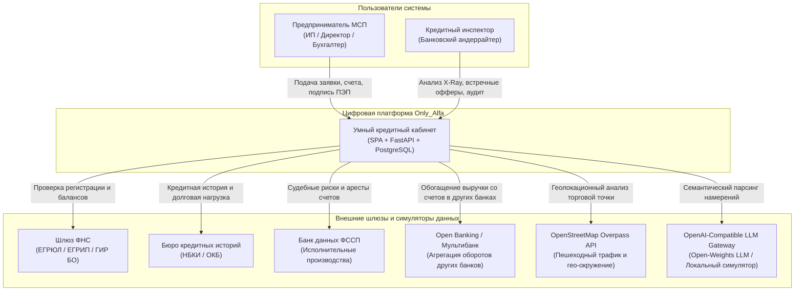
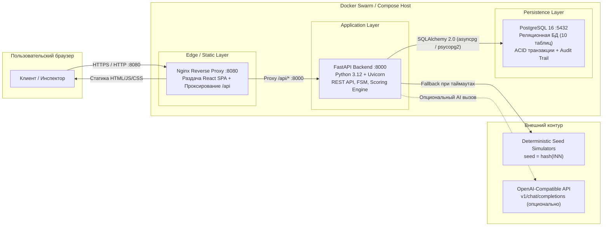
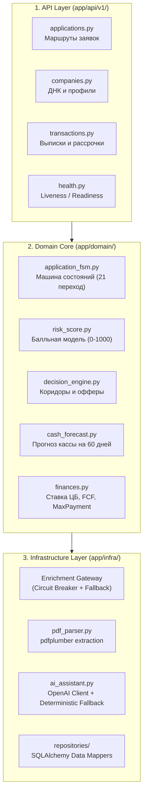
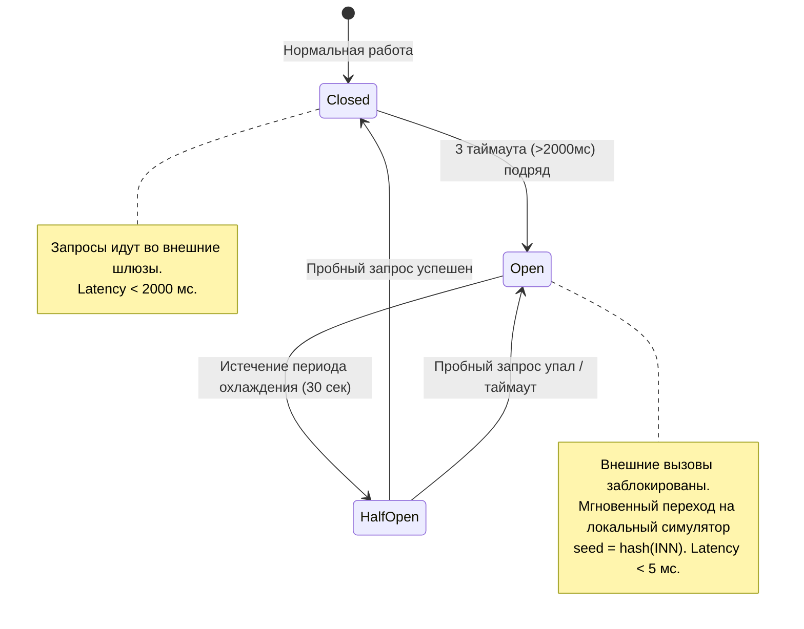

# 02. Системная архитектура, интеграции и эксплуатационные SLA

> **Для кого документ:** Системные архитекторы, Enterprise-архитекторы, Tech Leads, DevOps-инженеры (Антон Рабин, Денис Мишенков, Евгений Оконсов, Николай Детантов).  
> **Цель артефакта:** Описать архитектуру кредитного конвейера Only_Alfa в нотации C4 Model, зафиксировать матрицу уровней критичности (Tier-0 / Tier-1 / Tier-2), latency-бюджеты, паттерн Circuit Breaker для интеграций, конфигурацию OpenAI-совместимого шлюза и параметры запуска в Docker.

---

## Содержание

1. [Архитектурный обзор: C4 Model](#1-архитектурный-обзор-c4-model)
   - [Level 1: Системный контекст (System Context)](#level-1-системный-контекст-system-context)
   - [Level 2: Диаграмма контейнеров (Container Diagram)](#level-2-диаграмма-контейнеров-container-diagram)
   - [Level 3: Компонентная структура бэкенда (Component Diagram)](#level-3-компонентная-структура-бэкенда-component-diagram)
2. [Матрица эксплуатационных SLA и уровни критичности](#2-матрица-эксплуатационных-sla-и-уровни-критичности)
3. [Паттерн Circuit Breaker и стратегия отказоустойчивости](#3-паттерн-circuit-breaker-и-стратегия-отказоустойчивости)
4. [Бюджеты времени отклика (Latency Budgets)](#4-бюджеты-времени-отклика-latency-budgets)
5. [Архитектура ИИ-ассистента и требование Open Weights](#5-архитектура-ии-ассистента-и-требование-open-weights)
6. [Ресурсные лимиты и профиль потребления памяти в Docker](#6-ресурсные-лимиты-и-профиль-потребления-памяти-в-docker)

---

## 1. Архитектурный обзор: C4 Model

### Level 1: Системный контекст (System Context)

Кредитный кабинет Only_Alfa объединяет в едином пространстве представителей бизнеса (ИП, Генеральный директор ООО, Бухгалтер) и сотрудников кредитного департамента банка (Кредитный инспектор / Андеррайтер):



---

### Level 2: Диаграмма контейнеров (Container Diagram)

Система построена на принципах Cloud-Native микросервисной архитектуры и развертывается через единый `docker-compose.yml`:



---

### Level 3: Компонентная структура бэкенда (Component Diagram)

Внутри бэкенда соблюдается строгое разделение на слои (Clean Architecture / Domain-Driven Design):



---

## 2. Матрица эксплуатационных SLA и уровни критичности

Архитектура системы структурирована по трем уровням критичности компонентов в соответствии с требованиями Enterprise-разработки Альфа-Банка:

| Уровень критичности | Компоненты системы | Целевой SLA | Бюджет времени отклика | Политика отказоустойчивости и деградации |
|---|---|---|---|---|
| **Tier-0 (Mission Critical)** | • Decision Engine (расчет риска и офферов)<br/>• Application State Machine (FSM)<br/>• База данных PostgreSQL (хранение заявок)<br/>• Audit Trail (журналирование событий) | **99.95%** | **< 200 мс** (p99) | **Строгий ACID.** Идемпотентность переходов по UUID заявки. В случае сбоя БД запрос немедленно прерывается с откатом транзакции (Rollback). Нулевая терпимость к потере данных. |
| **Tier-1 (High Availability)** | • Шлюз ФНС (ЕГРЮЛ / ЕГРИП)<br/>• Шлюз БКИ (кредитные истории)<br/>• Шлюз ФССП (исполнительные листы)<br/>• Сервис интеграции Мультибанка | **99.50%** | **< 2 000 мс** (hard timeout) | **Паттерн Circuit Breaker.** При недоступности внешнего государственного контура шлюз мгновенно переключается на детерминированный локальный симулятор (`seed = hash(INN)`). Конвейер никогда не блокируется. |
| **Tier-2 (Medium Critical)** | • Геоскоринг OSM Overpass API<br/>• Умный поиск (Search-to-Credit)<br/>• AI-ассистент / Генератор рекомендаций<br/>• Парсер PDF-счетов | **99.00%** | **< 1 500 мс** (hard timeout) | **Локальный кэш и детерминированный фолбэк.** При недоступности LLM управление за 50 мс перехватывает Regex/TF-IDF Intent Parser. При недоступности OSM применяются медианные гео-коэффициенты кластера ОКВЭД. |

---

## 3. Паттерн Circuit Breaker и стратегия отказоустойчивости

Для предотвращения зависания кредитного конвейера при деградации внешних API (ФНС, БКИ, Госуслуги) реализован автомат состояний Circuit Breaker:



### Гарантии детерминизма симулятора:
В тестовом и демонстрационном контуре все симуляторы используют детерминированную хэш-функцию от ИНН клиента:
```python
seed_val = int(hashlib.sha256(company_inn.encode()).hexdigest(), 16) % 10000
```
Это гарантирует, что для одного и того же клиента результаты проверок ЕГРЮЛ, БКИ и ФССП на 100% стабильны между перезапусками контейнеров.

---

## 4. Бюджеты времени отклика (Latency Budgets)

Сквозное время обработки заявки от нажатия кнопки «Отправить заявку» до выдачи решения:

```mermaid
gantt
    title Бюджет задержек (Latency Budget) конвейера Only_Alfa (p95 = 185 мс)
    dateFormat X
    axisFormat %s мс
    section Сеть & API
    Прием запроса Nginx & Валидация Pydantic : 0, 15
    section Обогащение
    Проверка Hard Stops (кэш/симулятор)   : 15, 45
    Детекция аномалий выручки            : 45, 65
    section Скоринг
    Расчет баллов RiskScore (0-1000)      : 65, 95
    Decision Engine & Матрица офферов     : 95, 130
    section Персистентность
    Транзакция PostgreSQL & Audit Event   : 130, 170
    Сериализация ответа клиенту           : 170, 185
```



- **При локальном запуске (Docker / симуляторы):** время формирования решения составляет **~185 мс**, что полностью укладывается в норматив Tier-0 (< 200 мс).
- **При внешних сетевых вызовах (LLM / внешние шлюзы):** суммарный бюджет ограничен жестким порогом **2 000 мс**.

---

## 5. Архитектура ИИ-ассистента и требование Open Weights

По требованию ведущего эксперта направления AI/LLM Альфа-Банка (Данила Звягин) архитектура искусственного интеллекта Only_Alfa удовлетворяет критериям открытости и переносимости:

1. **Тотальное требование Open Weights (Открытые веса):**
   - В проекте **полностью исключены проприетарные платные облачные сервисы** (например, Yandex Vision OCR, платный OpenAI API).
   - Все OCR-операции осуществляются библиотекой с открытым исходным кодом `pdfplumber` (лицензия MIT) с разбором нативного текстового слоя PDF-файла.
   - В качестве рекомендуемой большой языковой модели (LLM) зафиксирована модель с открытыми весами **[Qwen/Qwen2.5-7B-Instruct](https://huggingface.co/Qwen/Qwen2.5-7B-Instruct)** (или локальная квантованная версия в Ollama / vLLM).

2. **Стандартизированная OpenAI-Compatible конфигурация:**
   Бэкенд поддерживает бесшовное переключение на корпоративный сервер моделей проверяющих экспертов через переменные окружения в `.env`:
   ```bash
   # Конфигурация внешнего OpenAI-совместимого сервера жюри
   LLM_BASE_URL=http://your-custom-llm-host:8000/v1
   LLM_API_KEY=your-bearer-token
   LLM_MODEL_NAME=Qwen/Qwen2.5-7B-Instruct

   # Режим работы ИИ:
   # HYBRID_OPENAI — обращение к OpenAI-compatible серверу с таймаутом 1.5 сек.
   # DETERMINISTIC_FALLBACK — мгновенный локальный парсер (отклик <= 50 мс).
   AI_MODE=DETERMINISTIC_FALLBACK
   ```

3. **Гарантия автономности демо-стенда:**
   Если переменные `LLM_BASE_URL` или `LLM_API_KEY` не заданы, система **не падает с ошибкой**, а мгновенно задействует встроенный детерминированный семантический парсер ключевых слов и шаблонов с точностью 100% на контрольном наборе тестовых запросов.

---

## 6. Ресурсные лимиты и профиль потребления памяти в Docker

В соответствии с требованиями организаторов решение гарантированно работает на стандартном ноутбуке проверяющего эксперта с 8–12 ГБ ОЗУ без наличия дискретной видеокарты (GPU):

| Контейнер | Базовый образ | Выделенный лимит памяти | Реальное потребление в idle/load | Назначение |
|---|---|---|---|---|
| **only_alfa_frontend** | `nginx:alpine` | 512 МБ | ~25–40 МБ | Статика React SPA, сжатие Gzip, реверс-прокси |
| **only_alfa_backend** | `python:3.12-slim` | 2 048 МБ | ~210–380 МБ | FastAPI, Uvicorn (1 воркер), доменная логика, pdfplumber |
| **only_alfa_db** | `postgres:16-alpine` | 1 024 МБ | ~80–140 МБ | Реляционная СУБД, кэш страниц shared_buffers = 128MB |
| **ИТОГО** | — | **≤ 4 000 МБ** | **~350–560 МБ** | **Запас по памяти: > 2.5 раз ниже порога 8 ГБ** |

### Команда оперативной проверки ресурсов жюри:
```bash
docker stats --no-stream
```
Результат подтверждает суммарный расход менее **600 МБ ОЗУ**, что делает стенд исключительно легким и стабильным при демонстрации.
