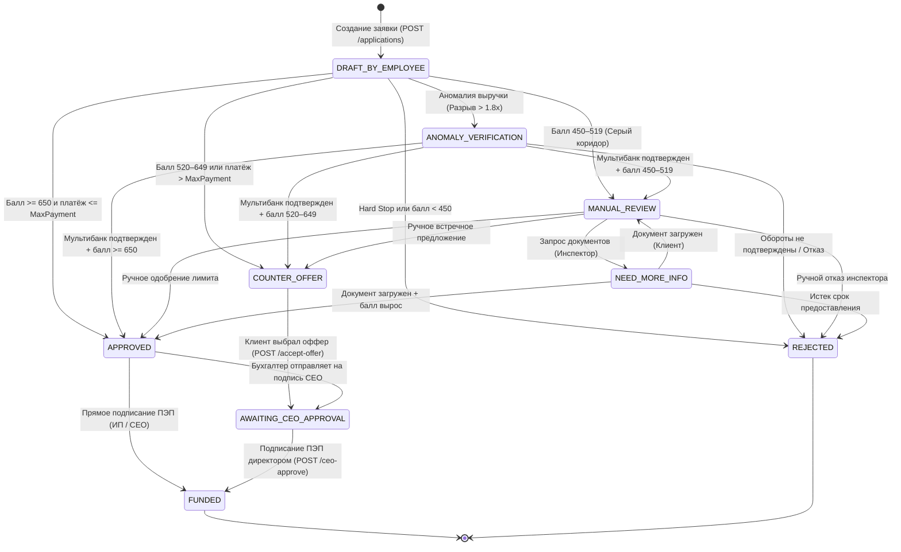
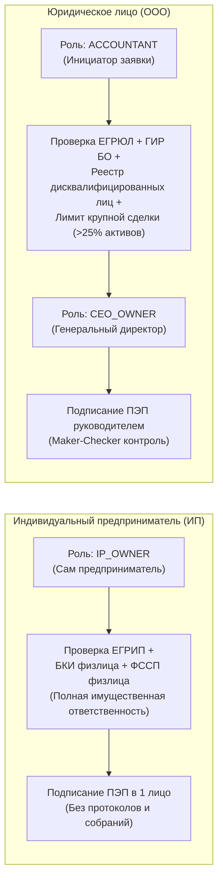
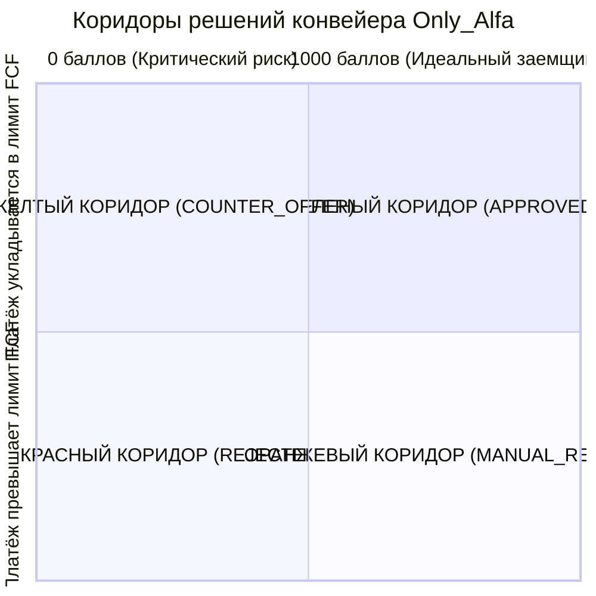

# 03. Машина состояний (FSM) и математика скоринга

> **Для кого документ:** Системные аналитики, Бизнес-аналитики, Риск-офицеры, Скоринг-разработчики.  
> **Цель артефакта:** Детально специфицировать жизненный цикл заявки (State Machine на 21 переход), правила ролевого доступа (Maker-Checker, ИП vs ООО), двухступенчатую модель кредитного скоринга (Hard Stops + RiskScore 0–1000) и прозрачную формулу рыночной процентной ставки от Ключевой ставки ЦБ РФ.

---

## Содержание

1. [Архитектура машины состояний (FSM)](#1-архитектура-машины-состояний-fsm)
2. [Mermaid-диаграмма состояний и переходов](#2-mermaid-диаграмма-состояний-и-переходов)
3. [Сводная матрица всех 21 переходов конвейера](#3-сводная-матрица-всех-21-переходов-конвейера)
4. [Правовая специфика: ИП против ООО в кредитном процессе](#4-правовая-специфика-ип-против-ооо-в-кредитном-процессе)
5. [Двухступенчатая модель скоринга: Hard Stops и RiskScore](#5-двухступенчатая-модель-скоринга-hard-stops-и-riskscore)
6. [Четыре коридора решений (Decision Corridors)](#6-четыре-коридора-решений-decision-corridors)
7. [Формула процентной ставки от Ключевой ставки ЦБ РФ](#7-формула-процентной-ставки-от-ключевой-ставки-цб-рф)
8. [Механика детекции аномалий и интеграция с Мультибанком](#8-механика-детекции-аномалий-и-интеграция-с-мультибанком)

---

## 1. Архитектура машины состояний (FSM)

В кредитном кабинете Only_Alfa соблюдается фундаментальный банковский принцип: **Frontend не вычисляет статусы, баллы и не принимает решений.**

Единственным источником истины для жизненного цикла заявки является модуль `backend/app/domain/state_machine/application_fsm.py`. Любое изменение состояния строго контролируется:
- Попытка выполнить неразрешенный переход статуса $\rightarrow$ исключение `InvalidTransition` (**HTTP 409 Conflict**).
- Попытка подписать договор или выполнить действие неавторизованной ролью $\rightarrow$ исключение `RoleViolation` (**HTTP 403 Forbidden**).
- Все переходы фиксируются в неизменяемом журнале аудита (`application_events`).

### Список зарегистрированных статусов заявки:

| Статус в API | Описание бизнес-смысла | Группа статуса |
|---|---|---|
| `DRAFT_BY_EMPLOYEE` | Черновик заявки, заведенный сотрудником или из PDF-счета | Начальный |
| `ANOMALY_VERIFICATION` | Обнаружен разрыв между заявленной выручкой и оборотом в банке | Обогащение / Проверка |
| `APPROVED` | Заявка одобрена конвейером на запрашиваемых условиях | Финальное решение |
| `COUNTER_OFFER` | Сформированы 4 встречных предложения (срок, залог, овердрафт) | Финальное решение |
| `MANUAL_REVIEW` | Заявка передана на ручной разбор кредитному инспектору | Разбор андеррайтером |
| `NEED_MORE_INFO` | Инспектор запросил дополнительные подтверждающие документы | Дозапрос документов |
| `REJECTED` | Автоматический отказ (Hard Stop или балл < 450) с чек-листом | **Терминальный** |
| `AWAITING_CEO_APPROVAL` | Условия согласованы; заявка ожидает подписания директором | Ожидание ПЭП |
| `FUNDED` | Договор подписан ПЭП; кредитные средства зачислены на счет | **Терминальный** |

---

## 2. Mermaid-диаграмма состояний и переходов

Диаграмма наглядно демонстрирует все допустимые ветвления конвейера:



---

## 3. Сводная матрица всех 21 переходов конвейера

| № | Исходный статус | Целевой статус | Разрешенные роли | Триггер / Условие перехода | Код при ошибке |
|---|---|---|---|---|---|
| 1 | `DRAFT_BY_EMPLOYEE` | `ANOMALY_VERIFICATION` | *System* | Декларируемая выручка > 1.8x оборота в Альфа-Банке | 409 Conflict |
| 2 | `DRAFT_BY_EMPLOYEE` | `APPROVED` | *System* | RiskScore $\ge 650$ и ежемесячный платёж $\le \text{MaxPayment}$ | 409 Conflict |
| 3 | `DRAFT_BY_EMPLOYEE` | `COUNTER_OFFER` | *System* | $520 \le \text{RiskScore} < 650$ ИЛИ платёж превышает лимит FCF | 409 Conflict |
| 4 | `DRAFT_BY_EMPLOYEE` | `MANUAL_REVIEW` | *System* | $450 \le \text{RiskScore} < 520$ (пограничная зона риска) | 409 Conflict |
| 5 | `DRAFT_BY_EMPLOYEE` | `REJECTED` | *System* | Сработал Hard Stop или RiskScore $< 450$ | 409 Conflict |
| 6 | `ANOMALY_VERIFICATION` | `APPROVED` | *System* | Верификация Мультибанка: пересчет балла $\ge 650$ | 409 Conflict |
| 7 | `ANOMALY_VERIFICATION` | `COUNTER_OFFER` | *System* | Верификация Мультибанка: пересчет балла $520–649$ | 409 Conflict |
| 8 | `ANOMALY_VERIFICATION` | `MANUAL_REVIEW` | *System* | Верификация Мультибанка: пересчет балла $450–519$ | 409 Conflict |
| 9 | `ANOMALY_VERIFICATION` | `REJECTED` | *System* | Отказ от верификации или скоринг после выписки $< 450$ | 409 Conflict |
| 10 | `APPROVED` | `AWAITING_CEO_APPROVAL` | `CEO_OWNER`, `IP_OWNER`, `ACCOUNTANT` | Бухгалтер направляет заявку на утверждение руководителю | 403 Forbidden |
| 11 | `APPROVED` | `FUNDED` | `CEO_OWNER`, `IP_OWNER` | Прямое подписание договора ПЭП в 1 клик | 403 Forbidden |
| 12 | `COUNTER_OFFER` | `AWAITING_CEO_APPROVAL` | `CEO_OWNER`, `IP_OWNER`, `ACCOUNTANT` | Клиент выбрал 1 из 4 встречных офферов (`/accept-offer`) | 403 Forbidden |
| 13 | `AWAITING_CEO_APPROVAL` | `FUNDED` | `CEO_OWNER`, `IP_OWNER` | Генеральный директор акцептовал договор ключом ПЭП | 403 Forbidden |
| 14 | `MANUAL_REVIEW` | `NEED_MORE_INFO` | `UNDERWRITER` | Инспектор выставил запрос дополнительных документов | 403 Forbidden |
| 15 | `MANUAL_REVIEW` | `APPROVED` | `UNDERWRITER` | Инспектор согласовал сделку на ручном комитете | 403 Forbidden |
| 16 | `MANUAL_REVIEW` | `COUNTER_OFFER` | `UNDERWRITER` | Инспектор скорректировал сумму/срок вручную | 403 Forbidden |
| 17 | `MANUAL_REVIEW` | `REJECTED` | `UNDERWRITER` | Инспектор отклонил заявку по стоп-факторам | 403 Forbidden |
| 18 | `NEED_MORE_INFO` | `MANUAL_REVIEW` | `UNDERWRITER` | Документы получены; возврат на стол инспектора | 403 Forbidden |
| 19 | `NEED_MORE_INFO` | `APPROVED` | `UNDERWRITER` | Дозагруженный документ автоматически повысил балл | 403 Forbidden |
| 20 | `NEED_MORE_INFO` | `REJECTED` | `UNDERWRITER` | Клиент не предоставил документы в течение срока | 403 Forbidden |
| 21 | Любой статус | `FUNDED` / `REJECTED` | *Unauthorized* | Попытка повторной модификации терминального статуса | 409 Conflict |

---

## 4. Правовая специфика: ИП против ООО в кредитном процессе

Конвейер реализует дифференцированный подход к проверке правоспособности и полномочий заемщиков в зависимости от формы собственности:



### Защита от ошибок ролей в коде:
```python
def ensure_signing_authority(actor_role: UserRole, legal_form: LegalForm) -> None:
    """ООО подписывает только CEO_OWNER, ИП — только сам предприниматель."""
    required = UserRole.CEO_OWNER if legal_form == LegalForm.OOO else UserRole.IP_OWNER
    if actor_role != required:
        raise RoleViolation(
            f"Подписание ПЭП для {legal_form.value} доступно только роли {required.value}"
        )
```
Если бухгалтер ООО (`ACCOUNTANT`) попытается вызвать `/ceo-approve`, система вернет строго типизированный ответ `HTTP 403 Forbidden`.

---

## 5. Двухступенчатая модель скоринга: Hard Stops и RiskScore

Кредитный риск оценивается в 2 последовательных этапа:

### Ступень 1: Hard Stops (Безусловные стоп-факторы)
Если выполняется хотя бы одно из условий, заявка немедленно переводится в статус `REJECTED` с обнулением RiskScore ($= 0$):
1. **Недействующий бизнес:** `is_egrul_active == False` (компания ликвидирована или исключена из ЕГРЮЛ/ЕГРИП).
2. **Критическая задолженность ФССП:** Сумма открытых исполнительных производств $> 1\,500\,000$ ₽.
3. **Глубокая просрочка в БКИ:** Текущая просрочка $> 90$ дней по действующим кредитам.
4. **Срок жизни бизнеса:** Возраст компании $< 3$ месяцев со дня регистрации.

### Ступень 2: Балльная модель RiskScore (0–1000 баллов)
При отсутствии стоп-факторов расчет начинается с **базового уровня 500 баллов**:

$$\text{RiskScore} = \text{SCORE\_BASE}\,(500) + \sum \Delta \text{FactorPoints}$$

| Код фактора | Описание фактора скоринга | Вес в баллах | Влияние на скоринг |
|---|---|---|---|
| `FIN_GROWTH_STRONG` | Темп прироста выручки год к году $> +20\%$ | **+40** | Высокая динамика развития бизнеса |
| `FIN_GROWTH_NEGATIVE` | Падение выручки год к году $< -15\%$ | **-40** | Тренд на сокращение масштабов деятельности |
| `BKI_CLEAN_HISTORY` | Безупречная кредитная история (срок $> 12$ мес, 0 дней просрочки) | **+60** | Высокая платежная дисциплина |
| `BKI_HAS_OVERDUE` | Наличие текущей просрочки до 30 дней | **-80** | Кредитный риск задержки платежей |
| `BURDEN_LOW` | Долговая нагрузка (платежи по кредитам / чистая выручка) $< 20\%$ | **+40** | Низкая закредитованность |
| `BURDEN_HIGH` | Долговая нагрузка $> 50\%$ от чистой прибыли | **-60** | Высокий риск дефолта при стрессе |
| `GEO_STRONG` | Геолокация (пешеходный трафик, проходимость, отсутствие конкурентов) $\ge 75$ | **+35** | Высокий потенциал коммерческой локации |
| `BUYER_STRONG` | Диверсификация базы покупателей (BuyerScore $\ge 75$) | **+30** | Независимость от единственного заказчика |
| `CF_ALFA_TENURE_LONG` | Обслуживание расчетного счета в Альфа-Банке $> 12$ месяцев | **+30** | Прозрачная история взаимоотношений с банком |
| `CF_MULTIBANK_VERIFIED` | Успешная верификация выписок Мультибанка | **+90** | Раскрытие реальных масштабов выручки |

---

## 6. Четыре коридора решений (Decision Corridors)

На основе рассчитанного RiskScore и доступного денежного потока (FCF) Decision Engine распределяет заявку в один из четырех коридоров:



1. **Зеленый коридор (Fast-Track Approval):**
   - **Условие:** $\text{RiskScore} \ge 650$ и ежемесячный аннуитетный платёж $\le \text{MaxPayment}$.
   - **Результат:** Статус `APPROVED`. Предложение запрашиваемой суммы по минимальной ставке.
2. **Желтый коридор (Smart Counter-Offers):**
   - **Условие:** $520 \le \text{RiskScore} < 650$ ИЛИ $\text{RiskScore} \ge 650$, но платёж превышает свободный денежный поток.
   - **Результат:** Статус `COUNTER_OFFER`. Генерация **4 встречных предложений**:
     * *Оффер 1 (Снижение суммы):* сумма корректируется под безопасный ежемесячный платёж $\text{MaxPayment}$.
     * *Оффер 2 (Увеличение срока):* растягивание срока кредита до 36–48 месяцев для снижения ежемесячной нагрузки.
     * *Оффер 3 (Кредит под залог):* предоставление дисконта по ставке при обеспечении оборудованием/недвижимостью.
     * *Оффер 4 (Овердрафт / Оборотный):* короткий транш под будущие поступления эквайринга.
3. **Оранжевый коридор (Manual Review / Bionic Underwriting):**
   - **Условие:** $450 \le \text{RiskScore} < 520$.
   - **Результат:** Статус `MANUAL_REVIEW`. Передача на Стол разбора кредитному инспектору. Возможность дозапроса документов (`NEED_MORE_INFO`).
4. **Красный коридор (Decline & Healing):**
   - **Условие:** $\text{RiskScore} < 450$ или срабатывание Hard Stop.
   - **Результат:** Статус `REJECTED`. Формирование понятного ответа и пошагового чек-листа финансового оздоровления.

---

## 7. Формула процентной ставки от Ключевой ставки ЦБ РФ

Для обеспечения финансовой реалистичности и исключения искусственных ставок в модуле `finances.py` реализована формула детерминированного ценообразования:

$$\text{FinalRate} = \text{CBR\_KEY\_RATE} + \text{ProductSpread} + \text{RiskAdjustment}$$

### Компоненты формулы:
1. **$\text{CBR\_KEY\_RATE}$ (Базовая ключевая ставка ЦБ РФ):**
   Задается в конфигурации (по умолчанию $14.0\%$ или текущая ставка ЦБ $16.0\% - 21.0\%$).
2. **$\text{ProductSpread}$ (Спред кредитного продукта):**
   - Инвестиционный кредит / Лизинг (`INVEST_LEASING`): **$+1.5\%$**
   - Возобновляемая кредитная линия (`VKL`): **$+2.5\%$**
   - Кредитная линия под залог имущества (`VKL_SEC`): **$+4.5\%$**
   - Овердрафт на покрытие разрыва (`OVERDRAFT`): **$+3.5\%$**
3. **$\text{RiskAdjustment}$ (Премия / Скидка за кредитный риск заемщика):**
   - Высокий скоринг ($\text{RiskScore} \ge 750$): **$-1.0\%$** (дисконт надежному заемщику).
   - Средний скоринг ($650 \le \text{RiskScore} < 750$): **$0.0\%$** (рыночная ставка).
   - Умеренный риск ($520 \le \text{RiskScore} < 650$): **$+2.5\%$** (компенсация повышенной дефолтности).

### Примеры расчета ставок в демо-профилях:
- **ИП Смирнов (Score 815, Инвест. кредит):**  
  $\text{FinalRate} = 14.0\% + 1.5\% - 1.0\% = \mathbf{14.5\%}$ (нижняя граница рынка).
- **ООО «Ростерс Кафе» (Score 610, ВКЛ):**  
  $\text{FinalRate} = 14.0\% + 2.5\% + 2.5\% = \mathbf{19.0\%}$ (с учетом премии за риск).

---

## 8. Механика детекции аномалий и интеграция с Мультибанком

Если клиент заявляет ежемесячную выручку 2 400 000 ₽, а обороты по счету в Альфа-Банке составляют всего 600 000 ₽ (разрыв в 4 раза), конвейер регистрирует расхождение:

```mermaid
sequenceDiagram
    autonumber
    Client as Предприниматель (ТехноСтрой)
    API as FastAPI Backend
    Detector as Детектор аномалий
    Sim as Симулятор Open Banking

    Client->>API: Отправка заявки: Выручка 2.4 млн ₽
    API->>Detector: Сравнить с оборотами Альфа-Банка (0.6 млн ₽)
    Detector-->>API: Разрыв > 1.8x! Флаг AnomalyDetected
    API-->>Client: Статус ANOMALY_VERIFICATION (Балл = 295)

    Note over Client: В UI загорается кнопка "Подтвердить Мультибанк"
    Client->>API: POST /applications/{id}/verify-multibank
    API->>Sim: Запрос оборотов партнерских банков
    Sim-->>API: Подтвержден совокупный оборот 2.4 млн ₽
    API->>API: Добавление фактора CF_MULTIBANK_VERIFIED (+90 баллов)
    API->>API: Увеличение кредитного лимита на +25%
    API-->>Client: Статус APPROVED / COUNTER_OFFER (Балл = 760)
```

В результате верификации скоринговый балл скачкообразно вырастает с **295 до 760 баллов**, а клиент получает доступ к финансированию без необходимости открывать новые счета или собирать бумажные выписки.
