# 04. Модель данных (ERD) и архитектура персистентности

> **Для кого документ:** Системные аналитики, Администраторы баз данных (DBA), Бэкенд-инженеры.  
> **Цель артефакта:** Предоставить полную диаграмму сущностей и связей (ERD), исчерпывающий словарь данных (Data Dictionary) для всех 10 реляционных таблиц PostgreSQL, спецификацию индексов, правила ссылочной целостности и устройство журнала аудита решений (Audit Trail).

---

## Содержание

1. [Обзор модели данных](#1-обзор-модели-данных)
2. [Mermaid ERD-диаграмма сущностей и связей](#2-mermaid-erd-диаграмма-сущностей-и-связей)
3. [Словарь данных (Data Dictionary)](#3-словарь-данных-data-dictionary)
   - [Таблица companies (Компании и профиль риска)](#таблица-companies-компании-и-профиль-риска)
   - [Таблица company_users (Пользователи и ролевая модель)](#таблица-company_users-пользователи-и-ролевая-модель)
   - [Таблица applications (Кредитные заявки)](#таблица-applications-кредитные-заявки)
   - [Таблица application_checks (Результаты проверок конвейера)](#таблица-application_checks-результаты-проверок-конвейера)
   - [Таблица application_events (Неизменяемый журнал аудита / Audit Trail)](#таблица-application_events-неизменяемый-журнал-аудита--audit-trail)
   - [Таблица transactions (История расчетных операций и рассрочки)](#таблица-transactions-история-расчетных-операций-и-рассрочки)
   - [Таблица company_profiles (Снимки ДНК бизнеса)](#таблица-company_profiles-снимки-днк-бизнеса)
   - [Таблица system_actions (Проактивные действия системы)](#таблица-system_actions-проактивные-действия-системы)
   - [Таблица search_catalog (Каталог умного поиска оборудования)](#таблица-search_catalog-каталог-умного-поиска-оборудования)
   - [Таблица news_feed (Персонализированная лента News-to-Action)](#таблица-news_feed-персонализированная-лента-news-to-action)
4. [Индексы и ссылочная целостность (Foreign Keys)](#4-индексы-и-ссылочная-целостность-foreign-keys)
5. [Архитектура аудита и прослеживаемости решений (Audit Trail)](#5-архитектура-аудита-и-прослеживаемости-решений-audit-trail)

---

## 1. Обзор модели данных

Схема базы данных Only_Alfa разработана на базе **PostgreSQL 16** с использованием ORM **SQLAlchemy 2.0** (Declarative Base). Архитектура базы данных оптимизирована под требования Enterprise-разработки:
- **Строгая типизация и ссылочная целостность:** все связи поддержаны внешними ключами (`ForeignKey`) с правилами каскадного удаления (`ON DELETE CASCADE`).
- **Audit Trail:** ключевые изменения статусов заявок и скоринговых параметров логируются в неизменяемую таблицу событий `application_events`.
- **Идемпотентный сидер:** при первом запуске контейнера база автоматически создает 10 таблиц и заполняет их синтетическими данными для 5 контрастных компаний. Повторные запуски не приводят к дублированию записей.

---

## 2. Mermaid ERD-диаграмма сущностей и связей

```mermaid
erDiagram
    COMPANIES ||--o{ COMPANY_USERS : "сотрудники (1:N)"
    COMPANIES ||--o{ TRANSACTIONS : "операции счета (1:N)"
    COMPANIES ||--o{ APPLICATIONS : "кредитные заявки (1:N)"
    COMPANIES ||--o{ NEWS_FEED : "лента новостей (1:N)"
    COMPANIES ||--o{ SYSTEM_ACTIONS : "проактивные действия (1:N)"
    COMPANIES ||--|| COMPANY_PROFILES : "ДНК профиль (1:1)"

    APPLICATIONS ||--o{ APPLICATION_CHECKS : "проверки рисков (1:N)"
    APPLICATIONS ||--o{ APPLICATION_EVENTS : "аудит-события (1:N)"

    COMPANIES {
        string id PK "UUID"
        string inn UK "ИНН компании (10 или 12 цифр)"
        string name "Наименование организации"
        string legal_form "IP или OOO"
        string okved_code "Основной код ОКВЭД"
        string okved_cluster "Отраслевой кластер"
        string director_name "ФИО руководителя"
        float monthly_revenue_alfa "Выручка по Альфа-Банку"
        float monthly_revenue_multibank "Выручка по другим банкам"
        float account_balance "Текущий остаток на счете"
        int geo_score "Гео-балл локации (0-100)"
        int buyer_score "Балл диверсификации покупателей"
        boolean is_multibank_verified "Флаг подтверждения Мультибанка"
    }

    COMPANY_USERS {
        string id PK "UUID"
        string company_id FK "Ссылка на компанию"
        string full_name "ФИО сотрудника"
        string role "IP_OWNER | CEO_OWNER | ACCOUNTANT | UNDERWRITER"
        string role_label "Человекочитаемое название роли"
    }

    APPLICATIONS {
        string id PK "UUID"
        string company_id FK "Ссылка на компанию"
        string status "Текущий статус по FSM"
        string product_type "INVEST_LEASING | VKL | VKL_SEC | OVERDRAFT"
        float requested_amount_rub "Запрашиваемая сумма"
        int term_months "Срок кредита в месяцах"
        int risk_score "Итоговый скоринг (0-1000)"
        boolean is_hard_stop "Флаг стоп-фактора"
        string outcome "APPROVED | COUNTER_OFFER | MANUAL_REVIEW | REJECTED"
        float approved_amount_rub "Одобренный кредитный лимит"
        float final_rate_pct "Итоговая процентная ставка"
        float monthly_payment_rub "Ежемесячный платеж"
        json factors_breakdown_json "Декомпозиция факторов скоринга"
        json counter_offers_json "Массив 4 встречных предложений"
        json invoice_json "Реквизиты распознанного PDF-счета"
    }

    APPLICATION_CHECKS {
        string id PK "UUID"
        string application_id FK "Ссылка на заявку"
        string check_code "EGRUL_CHECK | BKI_CHECK | FSSP_CHECK и др."
        string status "PASSED | WARNING | FAILED"
        string message "Пояснение результата проверки"
        json details_json "Параметры проверки"
    }

    APPLICATION_EVENTS {
        string id PK "UUID"
        string application_id FK "Ссылка на заявку"
        string company_id "ID компании"
        string event_type "FSM_TRANSITION | SCORING_CALCULATED и др."
        string actor_role "Роль инициатора действия"
        string previous_status "Предыдущий статус FSM"
        string new_status "Новый статус FSM"
        string details "Текстовое описание события"
        datetime created_at "Временная метка (UTC)"
    }

    TRANSACTIONS {
        string id PK "UUID"
        string company_id FK "Ссылка на компанию"
        datetime occurred_at "Дата и время проводки"
        string description "Назначение платежа"
        float amount_rub "Сумма операции"
        string direction "INCOME (приход) или EXPENSE (расход)"
        string category "TAXES | RENT | SUPPLIES | REVENUE | SALARY"
        boolean can_installment "Доступна ли рассрочка 0%"
        boolean installment_taken "Оформлена ли рассрочка"
    }

    COMPANY_PROFILES {
        string id PK "UUID"
        string company_id FK "Ссылка на компанию"
        json dna_json "360-градусный снимок ДНК бизнеса"
        datetime updated_at "Время последнего обновления"
    }

    SYSTEM_ACTIONS {
        string id PK "UUID"
        string company_id FK "Ссылка на компанию"
        string application_id "Ссылка на заявку (опционально)"
        string rule_code "Код правила триггера"
        string title "Заголовок проактивного действия"
        string status "PENDING | APPROVED_BY_PILOT | DELIVERED"
        string target_screen "Целевой экран в SPA"
    }

    SEARCH_CATALOG {
        string id PK "UUID"
        string item_name "Название товара / оборудования"
        float amount_rub "Стоимость оборудования"
        string supplier_name "Наименование поставщика"
        string supplier_inn "ИНН поставщика"
        boolean fssp_clean "Чистота поставщика по ФССП"
        string keywords "Ключевые слова для поиска"
    }

    NEWS_FEED {
        string id PK "UUID"
        string company_id FK "Ссылка на компанию"
        string title "Заголовок новости"
        string text "Текст с аналитикой и советом"
        string cta "Текст кнопки действия"
        string cluster "Отраслевой кластер"
    }
```



---

## 3. Словарь данных (Data Dictionary)

### Таблица `companies` (Компании и профиль риска)
Хранит базовые реквизиты юридического лица или ИП, агрегированные финансовые метрики, показатели кредитной нагрузки и гео-аналитики.

| Атрибут | Тип PostgreSQL | Nullable | Бизнес-описание |
|---|---|---|---|
| `id` | `VARCHAR(36)` | NO | Первичный ключ (UUID v4) |
| `inn` | `VARCHAR(12)` | NO | ИНН (10 цифр для ООО, 12 для ИП). Уникальный индекс |
| `name` | `VARCHAR(255)` | NO | Официальное наименование организации или ФИО ИП |
| `legal_form` | `VARCHAR(10)` | NO | Правовая форма: `IP` или `OOO` |
| `okved_code` | `VARCHAR(10)` | NO | Основной код экономической деятельности по ОКВЭД2 |
| `okved_cluster` | `VARCHAR(50)` | NO | Аналитический кластер (`RETAIL`, `HORECA`, `B2B_CONSTRUCTION`, `SERVICES`) |
| `director_name` | `VARCHAR(255)` | NO | ФИО Генерального директора или индивидуального предпринимателя |
| `latitude` / `longitude` | `FLOAT` | NO | Координаты основной коммерческой локации для OSM геоскоринга |
| `age_months` | `INTEGER` | NO | Возраст бизнеса в месяцах с момента государственной регистрации |
| `is_egrul_active` | `BOOLEAN` | NO | Статус в ЕГРЮЛ/ЕГРИП (действующее / ликвидировано). Стоп-фактор |
| `arbitration_claims` | `INTEGER` | NO | Сумма открытых судебных исков в арбитраже |
| `monthly_revenue_alfa` | `FLOAT` | NO | Среднемесячный оборот по расчетным счетам в АО «Альфа-Банк» |
| `monthly_revenue_multibank` | `FLOAT` | NO | Среднемесячный оборот по счетам в других банках (Open Banking) |
| `bki_overdue_days` | `INTEGER` | NO | Максимальное количество дней текущей просрочки по данным БКИ |
| `fssp_amount` | `FLOAT` | NO | Общая сумма задолженности по исполнительным листам ФССП |
| `geo_score` | `INTEGER` | NO | Балл качества локации и пешеходного трафика (0–100) |
| `buyer_score` | `INTEGER` | NO | Балл диверсификации покупателей и дебиторской задолженности (0–100) |
| `is_multibank_verified` | `BOOLEAN` | NO | Подтверждены ли выписки Мультибанка клиентом |

---

### Таблица `company_users` (Пользователи и ролевая модель)
Определяет состав сотрудников компании и их полномочия в кредитном конвейере.

| Атрибут | Тип PostgreSQL | Nullable | Бизнес-описание |
|---|---|---|---|
| `id` | `VARCHAR(36)` | NO | Первичный ключ (UUID v4) |
| `company_id` | `VARCHAR(36)` | NO | Внешний ключ на `companies.id` (`ON DELETE CASCADE`) |
| `full_name` | `VARCHAR(255)` | NO | Фамилия, имя, отчество пользователя |
| `role` | `VARCHAR(30)` | NO | Системный идентификатор роли: `IP_OWNER`, `CEO_OWNER`, `ACCOUNTANT`, `UNDERWRITER` |
| `role_label` | `VARCHAR(100)` | NO | Отображаемое в интерфейсе наименование должности |

---

### Таблица `applications` (Кредитные заявки)
Центральная таблица кредитного конвейера, фиксирующая состояние заявки, результаты скоринга, одобренные параметры и офферы.

| Атрибут | Тип PostgreSQL | Nullable | Бизнес-описание |
|---|---|---|---|
| `id` | `VARCHAR(36)` | NO | Первичный ключ (UUID v4) |
| `company_id` | `VARCHAR(36)` | NO | Внешний ключ на `companies.id` |
| `status` | `VARCHAR(50)` | NO | Текущий статус по FSM (`DRAFT_BY_EMPLOYEE`, `APPROVED`, `FUNDED` и др.) |
| `product_type` | `VARCHAR(50)` | NO | Тип продукта (`INVEST_LEASING`, `VKL`, `VKL_SEC`, `OVERDRAFT`) |
| `requested_amount_rub` | `FLOAT` | NO | Запрашиваемая сумма финансирования |
| `term_months` | `INTEGER` | NO | Запрашиваемый срок кредитования в месяцах |
| `risk_score` | `INTEGER` | NO | Итоговый скоринговый балл модели (0–1000) |
| `is_hard_stop` | `BOOLEAN` | NO | Сработал ли хотя бы один стоп-фактор |
| `outcome` | `VARCHAR(30)` | NO | Вердикт конвейера: `APPROVED`, `COUNTER_OFFER`, `MANUAL_REVIEW`, `REJECTED` |
| `approved_amount_rub` | `FLOAT` | NO | Предельный одобренный банком кредитный лимит |
| `final_rate_pct` | `FLOAT` | NO | Финальная процентная ставка (рассчитанная от ставки ЦБ РФ) |
| `monthly_payment_rub` | `FLOAT` | NO | Ежемесячный аннуитетный платеж по кредиту |
| `factors_breakdown_json` | `JSONB` | NO | Детальная декомпозиция всех факторов скоринга для Waterfall-диаграммы |
| `counter_offers_json` | `JSONB` | NO | Массив 4 структурированных встречных предложений |
| `invoice_json` | `JSONB` | NO | Данные разобранного PDF-счета (поставщик, ИНН, сумма, НДС) |
| `selected_offer_index` | `INTEGER` | YES | Индекс оффера, выбранного клиентом (1–4) |

---

### Таблица `application_events` (Неизменяемый журнал аудита / Audit Trail)
Фиксирует полный неизменяемый протокол всех переходов и действий по кредитной сделке.

| Атрибут | Тип PostgreSQL | Nullable | Бизнес-описание |
|---|---|---|---|
| `id` | `VARCHAR(36)` | NO | Первичный ключ (UUID v4) |
| `application_id` | `VARCHAR(36)` | YES | Внешний ключ на `applications.id` |
| `company_id` | `VARCHAR(36)` | YES | Идентификатор связанной организации |
| `event_type` | `VARCHAR(50)` | NO | Тип события (`FSM_TRANSITION`, `STATUS_CHANGE`, `INSPECTOR_ACTION`) |
| `actor_role` | `VARCHAR(30)` | NO | Роль пользователя, совершившего действие (`SYSTEM`, `CEO_OWNER`, `UNDERWRITER`) |
| `previous_status` | `VARCHAR(50)` | YES | Предыдущий статус заявки |
| `new_status` | `VARCHAR(50)` | YES | Новый статус заявки |
| `details` | `TEXT` | NO | Подробный текст описания события для аудитора |
| `created_at` | `TIMESTAMP` | NO | Временная метка фиксации события (UTC) |

---

## 4. Индексы и ссылочная целостность (Foreign Keys)

Для обеспечения целевого времени отклика конвейера (< 200 мс) на уровне PostgreSQL определена система индексов:

```sql
-- Уникальный поиск компании по ИНН (авторизация и симуляторы)
CREATE UNIQUE INDEX idx_companies_inn ON companies (inn);

-- Быстрая фильтрация заявок по компании и статусу
CREATE INDEX idx_applications_company_status ON applications (company_id, status);

-- Выборка истории операций счета для построения прогноза кассы
CREATE INDEX idx_transactions_company_date ON transactions (company_id, occurred_at DESC);

-- Хронологическая выборка аудит-событий по заявке
CREATE INDEX idx_events_application_created ON application_events (application_id, created_at ASC);

-- Семантический поиск по каталогу оборудования
CREATE INDEX idx_search_catalog_cluster ON search_catalog (okved_cluster, keywords);
```

---

## 5. Архитектура аудита и прослеживаемости решений (Audit Trail)

В соответствии с требованиями регулятора и банковской безопасности (PCI-DSS / СТО БР ИББС) кредитный конвейер обеспечивает **100% объяснимость и восстановимость любого принятого решения**:

1. **Неизменяемость (Append-Only):** Таблица `application_events` не поддерживает операции `UPDATE` или `DELETE`. Любое действие в конвейере порождает новую запись с фиксацией роли автора и точного времени.
2. **Протоколирование P&L и скоринга:** При расчете решения в `applications.factors_breakdown_json` сохраняется точный слепок исходных данных, баллов по каждому фактору и действовавшей на момент расчета ключевой ставки ЦБ РФ.
3. **Отображение в Bank X-Ray:** Кредитный инспектор на Экране 3 видит структурированную хронологию заявки с возможностью проверки, кто именно и на каком основании перевел заявку в текущий статус.
