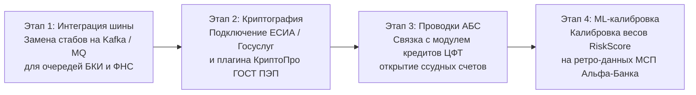

# 06. Реестр допустимых упрощений и спецификация симуляторов

> **Для кого документ:** Эксперты по Enterprise-архитектуре, Системные интеграторы, Члены жюри по комплаенсу.  
> **Цель артефакта:** Зафиксировать и легализовать перечень смоделированных внешних интеграций в соответствии с правилами хакатона «Альфа-Будущее», описать сокращенные JSON-контракты симуляторов, обосновать сохранность бизнес-логики и представить дорожную карту перехода в промышленный контур банка.

---

## Содержание

1. [Принципы легализации упрощений в хакатоне](#1-принципы-легализации-упрощений-в-хакатоне)
2. [Сводный реестр смоделированных контуров](#2-сводный-реестр-смоделированных-контуров)
3. [Спецификация JSON-контрактов симуляторов](#3-спецификация-json-контрактов-симуляторов)
   - [3.1. Шлюз ФНС: ЕГРЮЛ / ЕГРИП](#31-шлюз-фнс-егрюл--егрип)
   - [3.2. Шлюз ФНС: Бухгалтерская отчетность ГИР БО](#32-шлюз-фнс-бухгалтерская-отчетность-гир-бо)
   - [3.3. Бюро кредитных историй (БКИ)](#33-бюро-кредитных-историй-бки)
   - [3.4. Федеральная служба судебных приставов (ФССП)](#34-федеральная-служба-судебных-приставов-фссп)
   - [3.5. Open Banking API (Мультибанк)](#35-open-banking-api-мультибанк)
   - [3.6. Сервис электронной подписи (ПЭП)](#36-сервис-электронной-подписи-пэп)
   - [3.7. Автоматизированная банковская система (АБС)](#37-автоматизированная-банковская-система-абс)
4. [Что НЕ упрощено (Промышленное кредитное ядро)](#4-что-не-упрощено-промышленное-кредитное-ядро)
5. [Дорожная карта перехода в продуктив (Production Roadmap)](#5-дорожная-карта-перехода-в-продуктив-production-roadmap)

---

## 1. Принципы легализации упрощений в хакатоне

В официальном задании кейса «Умный кредитный кабинет» (страницы 10–11 регламента) зафиксированы строгие системные ограничения:
- **Автономность решения:** запрещено подключение к боевым контурам АО «Альфа-Банк» и закрытым государственным базам данных.
- **100% синтетические данные:** запрещено использование персональных данных реальных физических лиц и компаний.
- **Допустимые упрощения:** команда обязана смоделировать внешние интеграции локальными стабами, сохранив архитектурный смысл и семантику контрактов.

Ключевое требование архитектурного жюри: *«Вы имеете полное право сократить контракт внешнего сервиса до 3–5 ключевых полей, но вы обязаны явно отразить это в реестре допущений, указав, почему это сделано и чем закрыт риск»*.

---

## 2. Сводный реестр смоделированных контуров

| Внешний контур | Реальный прототип | Реализация в Only_Alfa | Ключевые поля контракта | Почему упрощено | Как закрыт риск |
|---|---|---|---|---|---|
| **ЕГРЮЛ / ЕГРИП** | СМЭВ 3 / API ФНС РФ | Детерминированный симулятор `seed = hash(inn)` | `is_active`, `reg_date`, `director_name`, `okved` | Боевой СМЭВ требует сертификатов ГОСТ и защищенных каналов. | Полноценная проверка стоп-фактора ликвидации и расчет возраста бизнеса. |
| **ГИР БО (ФНС)** | Открытый API ГИР БО ФНС | Профиль компании в БД (`company_profiles`) | `annual_revenue`, `net_profit`, `assets_total` | Выгрузка XML годовой отчетности избыточна для демонстрации MVP. | Данные выручки и активов напрямую подаются в скоринг и расчет лимита. |
| **БКИ (НБКИ/ОКБ)** | MQ / SOAP-шлюз БКИ | Модуль обогащения `domain/enrichment/bki.py` | `overdue_days`, `active_loans`, `monthly_payment` | Запрос в БКИ требует согласия субъекта и платной тарификации. | Точный расчет текущей долговой нагрузки заемщика (ПДН) и стоп-фактора 90+. |
| **ФССП России** | API Банка данных исполнительных производств | Симулятор проверки контрагента | `fssp_amount`, `has_arrests`, `claims_count` | Капча и нестабильность публичного шлюза ФССП на демо. | Автоматический Hard Stop при долге $> 1.5$ млн ₽ и проверка поставщиков по счету. |
| **Open Banking** | Спецификация API Счета/Транзакции Финтех | Эндпоинт `/verify-multibank` | `external_turnover`, `is_verified`, `bank_name` | Отсутствие открытого боевого контура Open Banking в РФ. | Полноценный доменный пересчет скоринга (+90 баллов) и расширение лимита. |
| **Удостоверяющий центр** | КриптоПро / SMS-шлюз ПЭП | Логический акцепт FSM `/ceo-approve` | `actor_role`, `signed_at`, `legal_form` | Запрет на реальные SMS и внешние звонки по условиям кейса. | Строгая ролевая проверка полномочий подписанта (ИП vs Генеральный директор ООО). |
| **АБС Банка** | ЦФТ-Банк / Инверсия | Событие перехода FSM в статус `FUNDED` | `account_id`, `amount`, `status: FUNDED` | Демо-стенд изолирован от бухгалтерского баланса банка. | Мгновенное обновление остатка расчетного счета в ДНК-профиле компании. |
| **Гео-карты** | OSM Overpass API / Яндекс.Карты | Встроенный Leaflet/OSM iframe + геокэш | `latitude`, `longitude`, `geo_score` | Минимизация зависимости от внешней сети при показе жюри. | Интерактивная карта торговой точки и учет гео-балла в скоринге. |

---

## 3. Спецификация JSON-контрактов симуляторов

### 3.1. Шлюз ФНС: ЕГРЮЛ / ЕГРИП
- **Реальный контракт:** SOAP-контейнер СМЭВ с более чем 140 атрибутами (коды ОКВЭД, филиалы, история изменений устава, доли учредителей).
- **Смоделированный JSON-контракт в Only_Alfa:**
```json
{
  "inn": "7701234567",
  "is_egrul_active": true,
  "registration_date": "2021-04-12",
  "age_months": 36,
  "director_name": "Смирнов Алексей Владимирович",
  "legal_form": "IP",
  "okved_code": "47.11",
  "arbitration_claims_total_rub": 0.0
}
```

### 3.2. Шлюз ФНС: Бухгалтерская отчетность ГИР БО
- **Смоделированный JSON-контракт:**
```json
{
  "inn": "7809876543",
  "fiscal_year": 2025,
  "annual_revenue_rub": 33600000.0,
  "net_profit_rub": 4200000.0,
  "balance_currency_rub": 18500000.0,
  "has_girbo": true
}
```

### 3.3. Бюро кредитных историй (БКИ)
- **Смоделированный JSON-контракт:**
```json
{
  "inn": "7701234567",
  "bki_history_months": 24,
  "bki_active_contracts": 1,
  "bki_monthly_payment_rub": 42000.0,
  "bki_max_overdue_days": 0,
  "is_clean_history": true
}
```

### 3.4. Федеральная служба судебных приставов (ФССП)
- **Смоделированный JSON-контракт:**
```json
{
  "inn": "7705554433",
  "active_enforcements_count": 0,
  "fssp_total_amount_rub": 0.0,
  "has_bank_account_arrests": false,
  "status": "CLEAN"
}
```

### 3.5. Open Banking API (Мультибанк)
- **Контракт вызова `/applications/{id}/verify-multibank`:**
```json
{
  "company_id": "c1a2b3c4-0001-4000-8000-000000000003",
  "verified_at": "2026-10-26T15:30:00Z",
  "partner_banks": ["СберБизнес", "Т-Бизнес"],
  "monthly_revenue_multibank_rub": 1800000.0,
  "is_verified": true,
  "score_boost": 90,
  "limit_multiplier": 1.25
}
```

### 3.6. Сервис электронной подписи (ПЭП)
- **Контракт запроса на подписание `/applications/{id}/ceo-approve`:**
```json
{
  "actor_role": "CEO_OWNER",
  "legal_form": "OOO",
  "confirmation_code": "1234",
  "ip_address": "127.0.0.1",
  "user_agent": "Mozilla/5.0 Chrome/130.0"
}
```

### 3.7. Автоматизированная банковская система (АБС)
- **Событие зачисления средств:**
```json
{
  "event": "ACCOUNT_CREDITED",
  "account_number": "40702810900000123456",
  "amount_rub": 2500000.0,
  "loan_agreement_number": "ALFA-CREDIT-2026-0042",
  "status": "FUNDED",
  "transaction_id": "tx-funded-9988"
}
```

---

## 4. Что НЕ упрощено (Промышленное кредитное ядро)

Несмотря на допустимое моделирование внешних периметров, **внутренняя бизнес-логика реализована по строгим стандартам промышленного конвейера**:
1. **Машина состояний (FSM):** 21 переход, изоляция ролей, невозможность несанкционированного изменения статуса или подписания не той ролью (строгие 403 и 409 ошибки).
2. **Двухступенчатый Decision Engine:** скоринг риска отделен от логики решения и расчета процентной ставки.
3. **Реальный парсер PDF:** обработка произвольных реальных PDF-файлов без хардкода через нативный разбор библиотеки `pdfplumber` с проверкой контрольной суммы ИНН по алгоритму ФНС РФ.
4. **Реальная база данных:** 10 реляционных таблиц в PostgreSQL 16 с внешними ключами, каскадами и ACID-транзакциями.
5. **Неизменяемый журнал аудита:** сохранение всех промежуточных решений и действий участников процесса.

---

## 5. Дорожная карта перехода в продуктив (Production Roadmap)

Для вывода решения в промышленную эксплуатацию потребуется выполнить следующие шаги:


