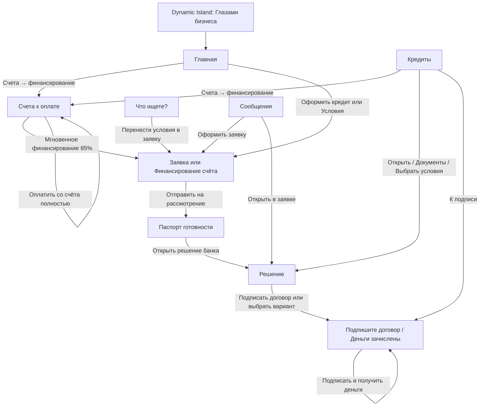
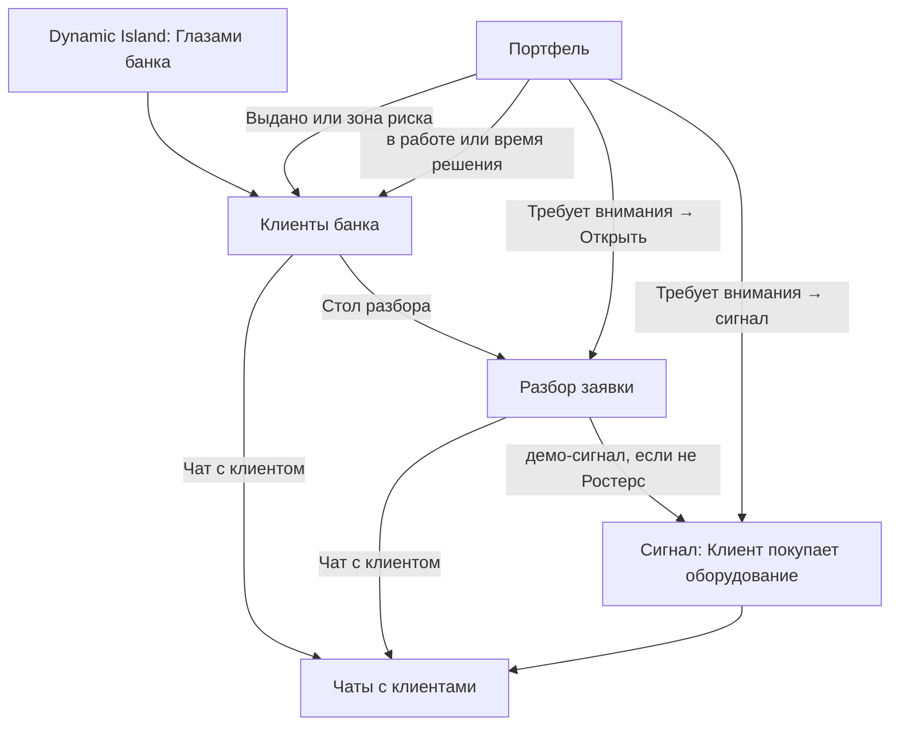

# Пользовательский путь Only_Alfa — как есть в коде

Документ описывает кабинет, который реально монтирует фронтенд сейчас. Источник — `frontend/src/App.tsx`, навигация, экраны и `backend/app/domain/state_machine/application_fsm.py`. Это не предложение Gemini и не wishlist из BRD. Где текст BRD или старый `docs/USER_JOURNEY.md` расходится с кодом, ниже указан код.

Сборка экрана: пока API не ответил, показывается «Поднимаем кредитный кабинет…». Дальше всегда есть Dynamic Island, шапка и футер. Если `viewMode === "bank"` или идентификатор экрана начинается с `bank-`, монтируется только `BankHubScreen`. Иначе монтируется один клиентский экран.

Демо-компании, которые реально сидятся в бэкенде (`backend/app/infra/demo_profiles.py`), в порядке списка: ИП Смирнов А.В. «Кофейня Зерно & Молоко» (`smirnov`), ООО «Ростерс Кафе» (`rosters`), ООО «ТехноСтрой Инжиниринг» (`tekhnostroy`), ИП Ковалев Д.С. «Эспрессо-Бар у Дома» (`kovalev`), ООО «Бодрость Плюс» (`bodrost_plus`). При первом входе берётся первая компания списка.

---

## 1. Как устроен кабинет сейчас

### Dynamic Island

Остров всегда сверху. В свёрнутом виде на пилюле написано:

- бейдж **ДЕМО**;
- режим **Банк** или **Бизнес**;
- короткое имя компании (префикс «ООО» срезается);
- строка статуса;
- значок темы ☀ или ☾;
- шеврон ▾ / ▴.

Строка статуса в режиме бизнеса: подпись статуса текущей заявки (`status_label` с бэкенда), либо «на счёте …», либо «Кабинет». В режиме банка: «Разбор №» + последние 4 символа id заявки, либо «N на разборе» по числу компаний, либо «Очередь пуста». При расчёте — «Считаем…». Ошибка обрезается до 48 символов. Рядом с пилюлей всегда кнопка **Сброс** (то же действие, что «Сброс всех сценариев» внутри).

Разворот острова:

| Элемент | Подпись в UI | Что делает |
|---|---|---|
| Компания | имя + список | Поиск «Компания или ИНН…». Выбор компании сбрасывает заявку и открывает **Главную** (бизнес) или экран с id `bank-queue` (банк). В банке этот id всё равно рисует список клиентов, см. §4. |
| ИНН | поле «ИНН» + **Проверить** | Кнопка активна от 10 цифр. Успех: тост «ИНН найден». Ошибка: «ИНН не найден». |
| Пользователь | имя и роль | Только в режиме бизнеса. Подпись попапа: «Пользователь», поиск «Имя или роль…». Роль меняется локально, без нового запроса скоринга. |
| Тема | **Светлая** / **Тёмная** | |
| Режим | **Глазами бизнеса** / **Глазами банка** | Переключение режима меняет шапку и набор экранов. В банк открывается «Клиенты». Обратно в бизнес — экран по статусу заявки или Главная. |
| Сброс | **Сброс всех сценариев** | Тост «Сценарии сброшены»: заявки, балансы и чаты возвращаются в исходное демо. |

Роли в списке пользователя (подпись `roleLabel`): **Генеральный директор** (`CEO_OWNER`), **Предприниматель** (`IP_OWNER`), **Бухгалтер** (`ACCOUNTANT`). В режиме банка роль шапки фиксирована и не берётся из компании.

### TopNav клиента («Глазами бизнеса»)

Логотип: **Альфа Бизнес**, подзаголовок **Кредитный кабинет**.

Кнопки разделов, слева направо:

1. **Главная**
2. **Кредиты** — подсвечена и на списке заявок, и на шагах заявки, паспорта, решения и подписи. Бейдж: число клиентских уведомлений, иначе `1`, если статус заявки `NEED_MORE_INFO`, `COUNTER_OFFER`, `APPROVED` или `AWAITING_CEO_APPROVAL`.
3. **Сообщения**
4. **Оплатить счёт** — подсвечена только на экране счетов. Бейдж равен числу шаблонов счетов из API (в сиде их три).

Отдельной вкладки «Платежи» в шапке нет. Поле поиска — кнопка **Найти платёж или сервис…** (открывает умный поиск, не фильтрует текущий экран). Дальше колокольчик «Уведомления по кредиту» и профиль: имя пользователя выбранной роли и подпись роли. Пустое имя заменяется на «Пользователь».

### TopNav банка («Глазами банка»)

Подзаголовок логотипа: **Кредитный конвейер МСП**.

Кнопки:

1. **Клиенты** — подсвечена на `bank-clients`, `bank-profile` и `bank-queue`. Все три id рисуют один и тот же экран списка клиентов.
2. **Чаты** — бейдж непрочитанных тредов банка.
3. **Разбор №XXXX** — пункт появляется только если в состоянии уже есть заявка. XXXX — последние 4 символа `application_id` в верхнем регистре. Ведёт на стол разбора (`bank-xray`).
4. **Портфель**

Поле справа: **Найти клиента по ИНН…**. Клик не ищет, а открывает «Клиенты». Колокольчик: «Уведомления кредитного конвейера», заголовок панели «Входящие события конвейера». Профиль всегда **Елена Орлова**, роль **Кредитный инспектор**.

В шапке банка нет пунктов «Очередь», «Сигнал», «Рентген», «360°». Сигнал открывается кнопкой со стола разбора или из блока «Требует внимания» на портфеле.

### Футер

Три строки:

- **Only_Alfa** · хакатон «Альфа-Будущее»
- Демо-данные. Расчёты выполняет бэкенд, фронтенд только отображает ответы API.
- Режим: **глазами банка** или **глазами бизнеса**

Поверх страницы, только в режиме бизнеса, могут висеть тосты кредита (`CreditNoticeToasts`), не больше трёх.

### Экраны, которые есть в типах, но не являются отдельным местом в кабинете

| Id | Файл | Что видит пользователь |
|---|---|---|
| `payments` | `PaymentsScreen` | Сразу вызывает переход на Главную и рисует её же. В шапке пункта нет. |
| `documents` | `DocumentsScreen` | Спиннер «Открываем документы в кредите…» и редирект: на подпись, если заявка есть, иначе на «Кредиты». |
| `bank-queue` | `QueueScreen` импортирован в `BankHubScreen`, но не смонтирован | Клик с портфеля по «Заявок в работе» ставит id `bank-queue`, а хаб рисует **Клиенты банка**. |
| `bank-profile` | `Profile360Screen` не смонтирован | 360° встроено в правую колонку «Клиенты». |
| `bank-xray` как старый рентген | `XrayScreen` не смонтирован | Живой разбор — `ApplicationDeskScreen`. |
| эффект | `EffectScreen` не смонтирован | Живой экран — `BankPortfolioScreen` по кнопке **Портфель**. |

`WaterfallChart` в репозитории есть и ни одним смонтированным экраном не импортируется.

---

## 2. Режим «Глазами бизнеса» — карта экранов

Шаги кредита не являются вкладками шапки. Внутри заявки, паспорта, решения и подписи стоит степпер **Этапы заявки**:

1. **Предложение** (ведёт на Главную, если шаг уже пройден)
2. **Заявка**
3. **Проверки**
4. **Решение**
5. **Подпись**
6. **Выдача** (тот же экран, что подпись, но активен при статусе `FUNDED`)

Вперёд степпер не пускает, пока статус заявки до этого шага не дошёл. Назад по уже пройденным шагам можно.

### Главная

Заголовок: приветствие по времени суток и имя пользователя. Лид: «Счёт, ближайшие платежи и финансирование — без лишних экранов». Крупно: **На счёте сейчас**.

Кнопки героя:

- **Счета → финансирование** → экран «Счета к оплате»
- **Оформить кредит** → форма заявки без счёта

Три KPI: **Выручка в октябре**, **После расходов**, **К оплате до 30.11**. Для `rosters` цифры частично зашиты на фронте (выручка «2,10 млн ₽», расход «−418 600 ₽ за 30 дней на оборудование», обязательства списком: зарплата, ЕНП, аренда на Покровке, зерно). У остальных компаний выручка берётся из API, обязательства — из исходящих операций.

Дальше график периода, колонка **Что важно сейчас** (до трёх `radar_triggers`; если радар пуст — заглушки про кассовый разрыв и рост выручки) и колонка **Ближайшие оплаты**.

Блок **Предложение банка** зашит одинаково для всех компаний: «900 000 ₽ · 24 мес. · ≈ 44 930 ₽ / мес.» и текст «Вернуть деньги за оборудование и закрыть кассовый разрыв». Кнопки **Условия** (та же форма кредита) и **Скрыть**. После скрытия: «Предложения банка скрыты» и **Показать снова**. Скрытие живёт в демо-сторе, это не решение скоринга.

Внизу панель **Движения по счёту** / **Последние операции**. Кнопки рассрочки у клиента нет, пока банк в своём режиме не оставил оффер по операции. Тогда у клиента на строке появляется **Рассрочка** или **На рассмотрении**. Это модалка операции на Главной, не переход в заявку и не вкладка платежей.

### Кредиты (экран списка)

Надзаголовок «Кредитный кабинет · заявки», заголовок **Кредит**. Лид: «Статус, ответы банка и документы — в одном списке, без лишних вкладок». Кнопка справа снова **Счета → финансирование**.

Пустой список: «Заявок пока нет», текст про оплату счёта поставщика, кнопка **Счета → финансирование**. Отдельной кнопки «Оформить кредит» на пустом списке нет — она только на Главной.

Если среди заявок есть статус «Нужны документы», сверху баннер **Сообщение от Альфа-Банка**: «Нужны документы по заявке № …», сумма, текст про выписку из другого банка за 6 месяцев. Кнопки **Прикрепить документы** (чат-модалка) и **Смотреть заявку**.

Карточка заявки: сумма, пилюля `status_label`, продукт, номер, дата. Основная кнопка зависит от статуса:

| Статус | Кнопка |
|---|---|
| `NEED_MORE_INFO` | **Документы** |
| `APPROVED`, `AWAITING_CEO_APPROVAL` | **К подписи** |
| `COUNTER_OFFER` | **Выбрать условия** |
| остальные | **Открыть** |

Вторая кнопка **Чат с банком** есть при `NEED_MORE_INFO`, `COUNTER_OFFER`, `REJECTED`, `AWAITING_CEO_APPROVAL`, `MANUAL_REVIEW`, `ANOMALY_VERIFICATION`. Открытие заявки из списка идёт по `screenForApplication` (см. §3), а не всегда на паспорт.

### Оплатить счёт → «Счета к оплате»

Отдельная вкладка шапки. Надзаголовок содержит «Invoice-to-Credit». Заголовок **Счета к оплате**. Лид: банк профинансирует до 85%, остаток закроется после оплаты контрагентом. Снова блок **На счёте сейчас**.

Кнопки героя:

- **Финансировать выбранный**
- **Загрузить PDF** / **Скрыть PDF**
- **← На главную**

KPI-полоса: **Просрочено**, **К оплате в ближайший месяц**, **Средний срок оплаты** (зашито «12 дней»), справа **Доступно к мгновенному финансированию** и ещё одна кнопка **Финансировать выбранный**. Сумма «доступно» — сумма 85% по всем шаблонам, не лимит скоринга. Константа `INVOICE_INSTANT_FINANCING_RATIO = 0.85` живёт на фронте; комментарий в коде прямо говорит, что решение и лимит считает бэкенд уже при заявке.

Список слева, фильтры: **Все счета**, **Черновики (0)**, **Неоплаченные (N)**. Вкладка черновиков пустая: «Черновиков нет». «Все» и «Неоплаченные» показывают один и тот же набор шаблонов API, без фильтра по текущей компании:

| Код | Поставщик | Сумма | Назначение | Статус на UI (только фронт) | Срок на UI |
|---|---|---|---|---|---|
| `LA_MARZOCCO` | ООО «КофеТехПро» | 900 000 ₽ | Кофемашина La Marzocco Linea PB | Просмотрен | Через 5 дней |
| `ROSTERS_EQUIP` | ООО «РестоОборудование» | 2 500 000 ₽ | Комплект оборудования для кухни | Не отправлен | Через 12 дней |
| `CABLE_VVG` | ООО «КабельТрейд» | 3 200 000 ₽ | Кабель ВВГнг 4×25, 15 км | Просрочен | Просрочен на 3 дня |

Карточка счёта: номер, статус, плательщик (имя текущей компании), строки без НДС / НДС, **Итого по счёту**, **К финансированию (85%)**. Оффер: «Мгновенное финансирование …», «85% суммы счёта на 6 мес. · ≈ … / мес. · 18% · без залога». Кнопка **Мгновенное финансирование 85%**. Ниже **Оплатить со счёта полностью · {сумма}**: это локальный флаг, появляется текст «Демо: платёж со счёта отмечен». Заявка не создаётся, баланс API не меняется, тост «вам одобрено» не ставится.

Раскрытый блок PDF вызывает разбор файла (`InvoicePanel`) и показывает распознанную сводку. Переход к форме кредита делает кнопка финансирования: шаблон парсится на бэкенде (создаётся черновик заявки), в форму подставляется 85% суммы, срок 6 месяцев, цель из счёта, затем открывается экран заявки.

### Заявка

Заголовок зависит от суммы. Если сумма совпала с 85% распознанного счёта: надзаголовок «Invoice-to-Credit», заголовок **Финансирование счёта**, подпись «из счёта (85%)», кнопка **← К счетам**. Иначе: **Проверьте условия кредита**, подпись «из выписки» или «из счёта и выписки», кнопка **← На главную**.

Форма, панель **Счёт поставщика**:

- счёт есть — имя поставщика, ИНН, назначение, полная сумма и строка «В заявку подставлено финансирование 85%»;
- счёта нет — «Счёт ещё не приложен» и кнопка **Разобрать счёт** (на экран счетов).

Поля: **Сумма** (минимум 100 000, подсказка «Банк предлагал …» — из бейджа поиска или зашитые 900 000), **Срок** (3–60 месяцев), **Цель**, **Обеспечение** (Без залога / Недвижимость / Транспорт / Оборудование). Без залога — выбор продукта: Инвест-кредит / лизинг, Возобновляемая кредитная линия, Овердрафт. С залогом продукт уходит как `VKL_SEC` («ВКЛ с залогом») и появляется оценка залога. Блок «Данные компании — из кабинета»: компания, ИНН, подписант, кто подготовил заявку (роль).

Справа: **Почему банк предлагает кредит**, **Нагрузка по платежу** (ориентир аннуитета 18% на фронте, не решение банка), пилюля «Платёж безопасен» или «Платёж выше безопасного», три полосы нагрузки, карточка **Безопасный вариант**. Кнопки:

- **Выбрать безопасный вариант** — подставляет 1 200 000 ₽ и 24 месяца, без отправки;
- **Отправить {сумма} на рассмотрение** или **Отправить {сумма} под залог**.

Отправка вызывает `createApplication` и **всегда** открывает паспорт, даже если бэкенд уже вернул одобрение или отказ. Тост по статусу ставится в этот момент (после отправки формы, не в момент выбора счёта).

### Паспорт готовности

Заголовок **Паспорт готовности**. Четыре карточки: **Юридический профиль**, **Финансы и касса**, **Локация и спрос**, **Документы и поставщик**. Бейджи: **Пройдено** / **Внимание** / **Стоп**. Справа **Готовность**: «N из 4» и «можно смотреть решение», продукт, сумма, срок. Кнопки **Открыть решение банка** и **Задать вопрос в чате**. Если заявки нет: «Паспорт готовности пуст» и **К заявке**.

Мультибанк на паспорте не рисуется. Он появляется на решении, и только при статусе `ANOMALY_VERIFICATION`.

### Решение

Заголовок страницы зависит от статуса:

| Статус API | Подпись статуса | Заголовок экрана |
|---|---|---|
| `APPROVED` | Одобрено | Банк готов выдать деньги |
| `REJECTED` | Отказ | Отказ с планом на 90 дней |
| `ANOMALY_VERIFICATION` | Требуется подтверждение выручки | Нужна сверка выручки |
| `NEED_MORE_INFO` | Нужны документы | Нужны документы |
| `AWAITING_CEO_APPROVAL` | Ожидает подписания ПЭП | Ожидает гендиректора |
| `MANUAL_REVIEW` | На ручном разборе | Заявка на ручной проверке |
| `COUNTER_OFFER` | Есть встречные предложения | Банк готов дать деньги на других условиях |
| иначе, в том числе черновик | Черновик от сотрудника | тот же текст, что у контр-оффера |

На экране: бриф клиента, если API его прислал; компактный гейдж RiskScore; **Лимит**; строка «Статус: …»; кнопка **Что проверяли →** (назад на паспорт).

Дальше по статусу:

- Аномалия выручки: блок «Аномалия выручки: нужно подтверждение из других банков» и кнопка **Подтянуть выписки из других банков**. После успеха: «Выписки из других банков подтверждены», балл и лимит до/после, пилюля **Мультибанк ✓**.
- Нужны документы: «Подтвердите или приложите документы», **Подгрузить документ** (имя файла только в локальный список), **Написать в банк**.
- Одобрено: «Подтвердите условия кредита» и **Подтвердить и перейти к подписи**; KPI одобренной суммы, ставки, платежа, обеспечения.
- Контр-оффер: «Выберите один из вариантов ниже», карточки продуктов. Кнопка карточки: **Выбрать этот вариант**, **Выбрано для подписи** или **Только для ознакомления** (если вариант помечен как демо без индекса API). Рядом тексты «Почему так?» и «Что можно изменить?» и кнопка **Оформить кредит под залог**, если залога не было. Выбор оффера вызывает API и открывает подпись (`COUNTER_OFFER` → `AWAITING_CEO_APPROVAL`).
- Отказ: «Мгновенный отказ по стоп-фактору» или «Заявка отклонена», список **План на 90 дней**.
- Ожидание подписанта: «Ожидает {имя директора}» и **Напомнить сейчас** (открывает чат с готовым черновиком).
- При `APPROVED` и `COUNTER_OFFER` есть письмо к офферу и форма **Условия не подходят — попросить другой продукт** с кнопкой **Отправить запрос в банк**. Если банк уже ответил запросом файла: **Загрузить демо-файл**.

Внизу блок **Все статусы заявки** (`StatusTrack`) и футер. Подписант видит «Дальше — подпись договора» и кнопку **Подписать договор** (на контр-оффере она неактивна, пока вариант не выбран). Бухгалтер видит «Подписать может только руководитель» и кнопку **К экрану подписи** — кнопка для него не заблокирована, но на экране подписи подписать он не сможет.

`StatusTrack` показывает подписи «Черновик», «Сверка выручки», «Проверки и отрасль», «Решение», «Ожидает гендиректора», «Подписание», «Выдано». Шаг «Подписание» завязан на статус `CONTRACT_SIGNING`. Такого статуса в `ApplicationStatus` нет, поэтому шаг на живой заявке не становится текущим. Подпись в продукте — это статусы `APPROVED` и `AWAITING_CEO_APPROVAL` на экране «Подпишите договор».

### Подпись

Заголовок **Подпишите договор** или, после выдачи, **Деньги зачислены**. Степпер на шаге «Подпись» или «Выдача». Если был залог — карточка «Предмет залога».

Слева: продукт, сумма, платёж, срок, ставка, «Счёт зачисления», заёмщик, файлы-заглушки **Кредитный договор** и **График платежей**. Справа заголовок **Простая электронная подпись**.

Кто может нажать **Подписать и получить деньги**: для ООО только генеральный директор, для ИП только предприниматель, и только в статусах `APPROVED` или `AWAITING_CEO_APPROVAL`, и только не в режиме банка. Бухгалтер видит «Подписать может только руководитель» и текст «Бухгалтер не подписывает договор». Код ПЭП на экране — декоративные ячейки `4 8 1 7`, запрос уходит в `ceo-approve` без ввода кода. Успех: статус `FUNDED`, заголовок «Деньги зачислены», остаток счёта из ответа API, тост «Деньги зачислены».

### Сообщения

Заголовок списка **Сообщения**. Треды собираются на клиенте:

- если есть заявка — «Заявка № …» от **Елена Орлова**, кредитный инспектор; непрочитанное `1` при дозапросе или контр-оффере;
- всегда тред **Предложение банка**: «Кредит на развитие · 900 000 ₽ — по сигналу о покупке оборудования», кнопка **Оформить заявку**;
- первый элемент `news_feed`, если он есть. Кнопки перехода у него нет.

В треде заявки показываются письма `correspondence` с бэкенда и кнопка **Открыть в заявке**, если у письма есть оффер. Для дозапроса и контр-оффера добавлен ещё один зашитый пузырь про выписку за 6 месяцев. Дозапрос: карточка **Запрос документов** и **Открыть заявку**. Контр-оффер: карточка **Предложение в чате** (третий оффер массива, если он есть) и **Смотреть варианты**.

Поле ввода и кнопка отправки есть, но `sendDraft` всегда помечает сообщение как «Не отправлено» с ссылкой **Повторить**. Строка «Елена печатает…» висит постоянно. Живая отправка клиентского текста в API из этого экрана не идёт. Чат, который реально открывает переписку по заявке, — модалка с экранов «Кредит», паспорта и решения.

### Умный поиск

Отдельного пункта в ряду вкладок нет. Экран: надзаголовок «Сервис · умный поиск», заголовок **Что ищете?**. Панель **Умный бизнес-поиск**, поле «Что нужно бизнесу? Например, «кофемашина 900 000»», кнопка **Найти**, чипы `search_chips` компании.

Ответ API: класс намерения (`CAPEX`, `WORKING_CAPITAL`, `OVERDRAFT`, `INFO_ONLY`) и его подпись. В режиме тишины — блок **Режим тишины** и причина, без кнопки в заявку. Иначе, если есть кредитный бейдж: продукт, ставка, пилюля **Предодобрено** или **Требует проверки**, сумма, платёж, срок, лимит, дисклеймер и кнопка **Перенести условия в заявку**. Она открывает форму кредита; сумма, срок и продукт подставляются из бейджа, если счёт и сумма финансирования счёта форму ещё не засеяли. Ниже список «Проверенные поставщики» и таблица «Рыночные цены». Поиск не создаёт заявку и не открывает счета.

### Уведомления клиента

Колокольчик и тосты читают один список. Текст ставится функцией `notifyClientAboutStatus` после создания заявки, подписи и части банковских действий. Подписи кнопок:

| Статус | Заголовок тоста | Основная кнопка | Куда ведёт |
|---|---|---|---|
| `APPROVED` | Кредит одобрен — ждёт подписи | Подписать договор | подпись; тост только у подписанта |
| `AWAITING_CEO_APPROVAL` | Ждёт вашей подписи | Подписать | подпись; только подписант |
| `FUNDED` | Деньги зачислены | Смотреть статус | подпись |
| `REJECTED` | По заявке отказ | Смотреть план | решение |
| `NEED_MORE_INFO` | Нужны документы | Прикрепить | решение |
| `COUNTER_OFFER` | Другие условия от банка | Выбрать условия | решение |
| `MANUAL_REVIEW`, `ANOMALY_VERIFICATION` | Заявка на проверке | Смотреть статус | список «Кредиты» |

Вторая кнопка: **Позже**, **Закрыть** или **Понятно**. Строки «Получить деньги» в уведомлениях нет. Фраза «получить деньги» есть только на кнопке подписи **Подписать и получить деньги**.

Стартовые банковские уведомления в демо (до действий пользователя), кнопка и цель:

- Ростерс, «Заявка на 2,5 млн ₽ на ручном разборе», **К разбору** → стол разбора;
- ТехноСтрой, «Аномалия кассы: расхождение -34%», **В чат**;
- Ковалев, «Загружен Договор аренды № 14-А», **Проверить** → чат;
- Смирнов, «Новая заявка: 900 000 ₽ (Инвест-лизинг)», **Открыть** → клиенты.

Бодрость Плюс в стартовом колокольчике банка нет; отказ виден точкой в списке клиентов.

---

## 3. Сценарий пошагово, как пользователь идёт сейчас

### Оплата и финансирование счёта

1. Главная, кнопка **Счета → финансирование**, либо вкладка **Оплатить счёт**. На Главной в момент просмотра операций уведомления «вам одобрено N» нет.
2. Пользователь выбирает счёт в списке. Справа сразу виден оффер 85% и кнопка **Мгновенное финансирование 85%**. Это не тост и не решение скоринга.
3. **Оплатить со счёта полностью** ставит локальную пометку. Кредитный тост не создаётся, заявка не создаётся.
4. **Мгновенное финансирование 85%** парсит шаблон и открывает форму **Финансирование счёта** с суммой 85% и сроком 6 месяцев. Пользователь ещё может поменять сумму, срок, цель и залог.
5. **Отправить … на рассмотрение** создаёт заявку. Бэкенд из черновика сразу проводит скоринг и ставит один из статусов решения. Фронт всё равно открывает **Паспорт готовности**. Тост по этому статусу может всплыть уже здесь, если статус не черновик. Для одобрения текст тоста — «Кредит одобрен — ждёт подписи», кнопка **Подписать договор**, не «Получить деньги».
6. На паспорте пользователь жмёт **Открыть решение банка**, затем подтверждает условия и подписывает, если роль позволяет.

Отдельного экрана «формирование платежа», на котором всплывает одобрение, в смонтированном UI нет. `PaymentsScreen` существует только как редирект на Главную.

### Отдельная заявка на кредит с Главной или из «Кредитов»

С Главной: **Оформить кредит** или **Условия** в блоке предложения на 900 000 ₽. Форма открывается с дефолтом 2 500 000 ₽ / 12 месяцев / инвест-кредит, пока её не перезапишет поиск, счёт или прошлый залог. Счёта нет, пока пользователь не нажмёт **Разобрать счёт**.

Вкладка **Кредиты** сама форму не открывает. Она показывает список. Новая заявка оттуда начинается кнопкой **Счета → финансирование**, то есть через счёт, а не через пустую форму. Пустая форма доступна с Главной, из треда «Предложение банка» (**Оформить заявку**) и из поиска (**Перенести условия в заявку**).

После отправки путь тот же: паспорт → решение → подпись. Повторный вход в уже созданную заявку из списка «Кредиты» пропускает паспорт, если статус уже решение, подпись или выдача:

- `FUNDED` и `AWAITING_CEO_APPROVAL` → подпись;
- `COUNTER_OFFER`, `APPROVED`, `REJECTED`, `NEED_MORE_INFO`, `MANUAL_REVIEW` → решение;
- всё остальное, включая `ANOMALY_VERIFICATION` и `DRAFT_BY_EMPLOYEE` → паспорт.

Переключение «Глазами банка» → «Глазами бизнеса» использует то же правило.

### Трекер статуса

Живые статусы бэкенда и кто имеет право на переход (`application_fsm.py`):

| Откуда | Куда | Кто |
|---|---|---|
| `DRAFT_BY_EMPLOYEE` | `ANOMALY_VERIFICATION`, `APPROVED`, `COUNTER_OFFER`, `MANUAL_REVIEW`, `REJECTED` | система при создании заявки |
| `ANOMALY_VERIFICATION` | `APPROVED`, `COUNTER_OFFER`, `MANUAL_REVIEW`, `REJECTED` | система после мультибанка |
| `APPROVED` | `AWAITING_CEO_APPROVAL` | директор, предприниматель или бухгалтер |
| `APPROVED` | `FUNDED` | только подписант своей формы |
| `COUNTER_OFFER` | `AWAITING_CEO_APPROVAL` | директор, предприниматель или бухгалтер (кнопка «Выбрать этот вариант») |
| `AWAITING_CEO_APPROVAL` | `FUNDED` | только подписант |
| `MANUAL_REVIEW` | `NEED_MORE_INFO`, `APPROVED`, `COUNTER_OFFER`, `REJECTED` | инспектор |
| `NEED_MORE_INFO` | `APPROVED`, `MANUAL_REVIEW`, `REJECTED` | инспектор |

Терминальные статусы: `FUNDED`, `REJECTED`. Повторный дозапрос из `NEED_MORE_INFO` сервис запрещает. Подпись в `FUNDED`: ООО — только `CEO_OWNER`, ИП — только `IP_OWNER`. Чужая роль получает отказ 403. Бухгалтер может довести выбранный оффер до «ожидает подписи», но деньги не выпускает. Экран решения при `AWAITING_CEO_APPROVAL` пишет «Ожидает гендиректора» даже если компания — ИП; имя берётся из пользователя с ролью владельца.

Контр-оффер клиент видит карточками на решении и, если в массиве есть третий оффер, карточкой в сообщениях. Свой продукт, не из четырёх карточек банка, клиент отправляет формой «Отправить запрос в банк» на том же экране решения. Инспектор видит этот запрос карточкой на столе разбора.

Документы: клиент жмёт **Подгрузить документ** на решении (локальное имя файла) или **Прикрепить документы** в списке кредитов (модалка). Дозапрос инспектора с живого кокпита — кнопка **Запросить доп. документы** и **Подписать решение ПЭП**. Отдельного раздела «Документы» в шапке нет.

Мультибанк: кнопка только на решении при `ANOMALY_VERIFICATION`. Типичный профиль в тестах — ТехноСтрой (аномалия выручки, после подтверждения балл около 760). Ростерс в контрольных тестах — 610 и встречные офферы, Смирнов — 815 и одобрение, Ковалев — 495 и ручной разбор, Бодрость Плюс — стоп-фактор. Точки в списке клиентов банка до открытия живой заявки показывают зашитый текст этих сценариев (у ТехноСтроя на точке «5,6 млн», в сценарии открытия стола — 3,2 млн; у Ковалева на точке «600 тыс», в сценарии стола — 200 000). После того как заявка этой компании загружена, подпись точки берётся из живого статуса.

### Умный поиск — куда ведёт

Кнопка шапки **Найти платёж или сервис…** → экран **Что ищете?**. **Найти** или чип вызывают API. Если режим тишины — остаётесь на результате без перехода. Если есть бейдж — **Перенести условия в заявку** открывает форму кредита с продуктом, суммой и сроком бейджа. Отправка формы дальше идёт обычным путём паспорта. Поиск не открывает «Счета к оплате» и не ставит тост одобрения.

---

## 4. Режим «Глазами банка»

Переключатель **Глазами банка** открывает **Клиенты банка**. Подзаголовок шапки кабинета: «Кредитный конвейер МСП».

### Клиенты (очередь в этом продукте — это список, не отдельный экран)

Заголовок **Клиенты банка**. Лид: «Статусные точки показывают входящие заявки клиентов · откройте досье для разбора». Поиск на странице: «Поиск по названию или ИНН».

Слева все компании: имя, ИНН, ИП или ООО, остаток, цветная точка и зашитая или живая подпись заявки. Клик по строке только выбирает компанию и грузит дашборд.

Справа досье: директор, выручка, рост, гео. Кнопки **Чат с клиентом** и, если точка считает что заявка есть, **Стол разбора →**. Баннер дублирует статус и кнопки **К столу разбора →** и **Чат**. Ниже: полоса счетов, ДНК бизнеса, **Прогноз кассы** («Кассовый разрыв» / «Разрыва нет»), радар, операции. В банковском варианте операций у инспектора есть **+ Рассрочка**, **Оффер отправлен** или **Свои условия**. Это оффер рассрочки по транзакции, не кредитная заявка.

**Стол разбора** вызывает `openBankCase`: если у компании уже есть заявка, открывается она (приоритет статусов: дозапрос, ручной разбор, контр-оффер, аномалия, одобрено, ожидание подписи). Если заявок нет, создаётся новая по зашитому сценарию ключа и сразу открывается разбор. В шапке появляется пункт **Разбор №XXXX**.

### Разбор заявки

Пустое состояние: «Нет открытой заявки» и **К списку клиентов**.

Если заявка есть, сверху **← К списку клиентов**, пилюля номера и **Чат с клиентом**. Дальше лента «система решила», карточка встречного запроса клиента, письмо к офферу и bento-кокпит.

На кокпите инспектор двигает сумму, смотрит график выручки и денежного потока, переключает **Базовый поток** / **Стресс-тест -20%** и периоды. Блок **Maker-Checker пульт** / «Резолюция инспектора»:

- **Одобрить лимит {сумма}**
- **Встречный оффер конвейера**
- **Запросить доп. документы**
- **Подписать решение ПЭП**

Кнопки выбора только меняют локальный вариант. В API уходит действие по нажатию «Подписать решение ПЭП»: `APPROVE`, `COUNTER_OFFER` или `NEED_MORE_INFO`. Если статус уже не из набора ручного разбора / дозапроса / контр-оффера, пульт показывает «Решение зафиксировано». Отдельная панель `UnderwriterActions` с кнопками **Одобрить**, **Другие условия**, **Запросить документы**, **Отказать** подключена к старому `XrayScreen` и на живом столе не рисуется. Кнопки **Отказать** на кокпите нет.

Нижний док кокпита прокручивает страницу, это не смена маршрута: **Кокпит**, **CAPEX & Выписка**, **X-Ray & Гео**, при залоге **Залог**, **Аудит-лог**.

Дальше по странице, без смены вкладки шапки:

1. При залоге баннер «Залоговое обеспечение» и пилюля «Покрытие ≥ 50%».
2. **Шаг 2 · Доказательства целевого расходования (CAPEX & Платежи)**. Для `rosters` — панель платежей поставщику оборудования. Для остальных — текст, что сигнал синхронизирован с отчётностью, и кнопка **Посмотреть демо-сигнал Ростерс (оборудование) →**. Кнопка открывает экран сигнала текущей компании, компанию на Ростерс не переключает.
3. **Шаг 3 · Финансовый X-Ray и доходность сделки для банка**. Блок **Экономика сделки для банка**: процентный доход, стоимость риска (PD), маржа и LTV, карточки про PDF-счёт, прогноз кассы 60 дней и вероятность одобрения. Рядом **Калиброванный спидометр RiskScore** с коридорами и блок «Ключевые риск-параметры сделки» (гео и число конкурентов, выручка, безопасный платёж, ставка).
4. Свёрнутый `details`: подпись всё ещё содержит слова «Waterfall 5 факторов риска». Внутри не график `WaterfallChart`, а карта (`GeoPanel`) и блок **Декомпозиция базы 500**: воронка когорты, колонки **Плюсы** и **Минусы** со шкалой из десяти делений и дельтой балла, тепловая карта «Нагрузка · активность платежей».
5. **Шаг 4 · Неизменяемый журнал аудита** — лента событий рентгена, пилюля «SHA-256 Verified».

### Сигнал CAPEX

В шапке банка пункта нет. Экран `bank-signal`: если у компании нет радар-триггеров и это не Ростерс — «Новых сигналов нет». Иначе заголовок **Клиент покупает оборудование** и текст про три платежа поставщику кофейного оборудования и остаток −57% (текст зашит, не собирается из транзакций текущей компании). Кнопка панели уводит в **Чаты**.

### Портфель и показатели

Заголовок **Портфель**, подзаголовок «Октябрь 2026 · N клиентов». Периоды: **30 дней**, **90 дней**, **365 дней**. KPI-кнопки: **Выдано** (ведёт в клиенты), **Заявок в работе** и **Среднее время решения** (ставят `bank-queue` и из-за хаба открывают снова клиентов), **Клиенты в зоне риска** (клиенты). Подписи помечены «демо».

Ниже: **Воронка**, **Требует внимания** (Ростерс, ТехноСтрой, Ковалев, Бодрость Плюс — кнопка **Открыть** выбирает компанию и экран строки: разбор, сигнал или клиенты), **Продукты**, **Риск портфеля**. Секция **Эффект для банка** с зашитыми «38 с», «8 мин», «23 мин», «2 поля» и тремя карточками «Для предпринимателя», «Для банка», «Что измерим в пилоте». Это текст экрана, не расчёт по живым заявкам, кроме одной поправки: если у Ростерс статус `FUNDED`, сумма выдачи в книге периода увеличивается на одобренную сумму.

---

## 5. Что из текста Gemini уже есть, что частично, чего нет

Ниже — только утверждения, которые пользователь просил сверить: разделение платежей и кредитов, контекстное уведомление «Получить деньги», информационная схема из трёх вкладок (Dashboard / Payments / Credits с подвкладками) и рентген банка с waterfall. Новая схема навигации здесь не предлагается.

| Утверждение из текста Gemini | Факт в текущем коде |
|---|---|
| Отдельные зоны «платежи» и «кредиты» | **Частично.** В шапке клиента разные кнопки **Кредиты** и **Оплатить счёт**. Операции и рассрочка живут на **Главной**, не во вкладке платежей. `PaymentsScreen` сразу возвращает на Главную. |
| Контекстное уведомление «Получить деньги» в момент формирования платежа | **Нет.** При выборе счёта есть постоянная кнопка **Мгновенное финансирование 85%**, не тост. «Оплатить со счёта полностью» тост не ставит. Тосты появляются после отправки заявки или смены статуса. Ближайшая фраза — кнопка подписи **Подписать и получить деньги** и тост **Подписать договор**. |
| Уведомление «вам одобрено», пока пользователь ещё на платеже | **Нет.** Одобрение приходит после `createApplication`, когда форма уже отправлена и открыт паспорт. |
| Три верхние вкладки Dashboard / Payments / Credits | **Нет.** Верх клиента: **Главная**, **Кредиты**, **Сообщения**, **Оплатить счёт**, плюс поле поиска. |
| У кредитов свои подвкладки в шапке | **Нет.** Шаги **Предложение → Заявка → Проверки → Решение → Подпись → Выдача** — степпер внутри экрана, не пункты TopNav. Список и шаги подсвечивают одну кнопку **Кредиты**. |
| У платежей свои подвкладки | **Частично и в другом месте.** На счетах есть фильтры **Все счета / Черновики (0) / Неоплаченные**. Черновики пустые. Это не подвкладки «платежей» кабинета. |
| Банковский рентген с waterfall | **Частично.** Стол разбора (`bank-xray`) есть: гейдж RiskScore, экономика сделки (доход, PD, маржа, LTV), геокарта, журнал. Слово Waterfall осталось в подписи свёрнутого блока. График `WaterfallChart` не смонтирован. Внутри блока — **Декомпозиция базы 500** (воронка, плюсы/минусы, тепловая карта). |
| Отдельная вкладка рентгена в шапке банка | **Нет.** Пункт называется **Разбор №XXXX** и появляется только при открытой заявке. Док **Кокпит / CAPEX & Выписка / X-Ray & Гео / Аудит-лог** лишь прокручивает этот же экран. |

Смежные факты, чтобы не принять файл за экран:

- Очередь как отдельный экран в хабе не показывается, хотя файл `QueueScreen.tsx` есть.
- Старый рентген `XrayScreen.tsx` с панелью **Отказать** не подключён к маршруту.
- Статус `CONTRACT_SIGNING` есть только в подписях трекера на решении, в машине состояний его нет.

---

## 6. Фактические переходы

### Клиент

Тост после отправки может сразу звать на решение, подпись или список «Кредиты», даже если экран в этот момент — паспорт.

### Банк

Пункт **Разбор №XXXX** в шапке есть только после того, как заявка уже загружена.
