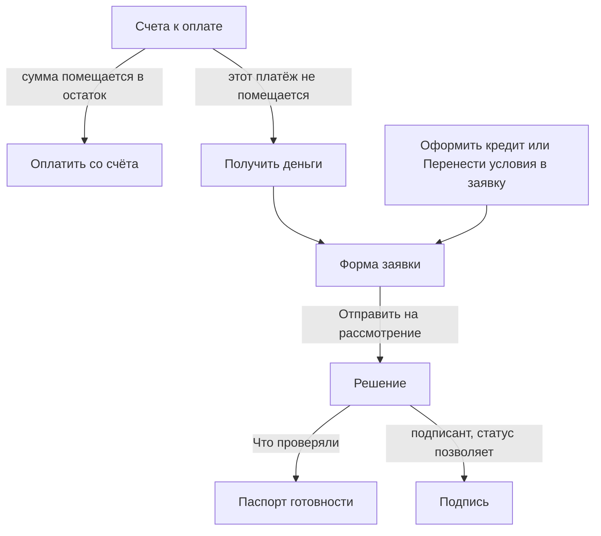

# Целевые сценарии Only_Alfa

Это путь, который должен получиться после сверки кабинета с текстом Gemini. Навигацию не меняем. Новых экранов нет. Как кабинет работает сейчас — в `docs/USER_JOURNEY_AS_IS.md`. Ниже только целевое поведение на уже смонтированных экранах.

Шапка клиента: **Главная**, **Кредиты**, **Сообщения**, **Оплатить счёт**, поле **Найти платёж или сервис…**. Шапка банка: **Клиенты**, **Чаты**, **Разбор №…** (только если заявка уже открыта), **Портфель**. Dynamic Island остаётся: компания, роль, тема, **Глазами бизнеса** / **Глазами банка**. Остров не перерисовываем.

---

## Что меняется и что не трогаем

| Место | Что делаем |
|---|---|
| Dynamic Island, обе шапки, степпер **Этапы заявки** | Уже есть. Не трогаем |
| **Счета к оплате**, форма заявки, решение, подпись, список **Кредиты**, стол разбора | Уже есть |
| **Оплатить со счёта** | Уже есть. Остаётся локальной пометкой: баланс API не меняется |
| Постоянный оффер 85%, надпись Invoice-to-Credit, строки **К финансированию (85%)**, **Мгновенное финансирование 85%**, **Доступно к мгновенному финансированию**, кнопки **Финансировать выбранный** | Убрать со счетов и с формы |
| Одна плашка на конкретном счёте: короткая причина и **Получить деньги** | Добавить вместо баннера 85% |
| Сумма в форме, открытой со счёта | Перенести: не 85% и не срок «6 месяцев как оффер», а недостача. Поставщик и назначение — из того же разбора шаблона |
| После **Отправить … на рассмотрение** всегда открывается паспорт | Убрать. Открывать решение или подпись. Паспорт — кнопка **Что проверяли →** |
| **Счета → финансирование** в списке **Кредиты** и в пустом списке | Переименовать в **Оформить кредит**. Открывать ту же пустую форму, что с Главной |
| **Счета → финансирование** на Главной | Переименовать в ссылку на счета, без слова «финансирование» |
| **Оформить кредит** на Главной, **Перенести условия в заявку** в поиске | Уже есть |
| Блок **Предложение банка** «900 000 ₽ · 24 мес.» и зашитые KPI только у Ростерс | Убрать с Главной |
| Остаток, ближайшие оплаты, график | Уже есть. Оставить |
| Радар **Что важно сейчас**, операции, рассрочка по операции, тосты после смены статуса | Уже есть. Не трогаем. Радар не включает плашку на счёте |
| Тред **Предложение банка** в **Сообщениях** («900 000 ₽») | В этом плане не переписываем. **Оформить заявку** по-прежнему открывает пустую форму |
| Пилюля **Предодобрено** на экране поиска | Уже есть. На плашку счёта и в черновик заявки это слово не переносить |
| Waterfall, аналитика реестра поставщиков у клиента, кнопка **Отказать** на живом столе | Не добавлять |
| CAPEX Ростерс, гейдж RiskScore, экономика сделки, свёрнутая декомпозиция базы 500 | Уже есть. Только у банка |

---

## 1. Оплатить счёт своими деньгами

Тишина: кредит на этом счёте не предлагается.

1. Откройте **Оплатить счёт**. Экран тот же: **Счета к оплате**. Список шаблонов и фильтры **Все счета** / **Черновики** / **Неоплаченные** остаются. Надзаголовка Invoice-to-Credit нет. Полосы «доступно к мгновенному финансированию» нет.
2. Выберите счёт, сумма которого не больше остатка **На счёте сейчас**, и прогноз после вычитания именно этого счёта тоже сходится. На карточке одна кнопка: **Оплатить со счёта**. Кнопки финансирования, строки «85%» и плашки **Получить деньги** нет.
3. Пример из сида. ООО «ТехноСтрой Инжиниринг», остаток 2 400 000 ₽, счёт `LA_MARZOCCO` на 900 000 ₽ (ООО «КофеТехПро», «Кофемашина La Marzocco Linea PB»). 900 000 ≤ 2 400 000. У ТехноСтроя прогноз кассы и без этого счёта уходит в минус около 14-го дня, на радаре уже есть `TRG_CASH_GAP`. Этот триггер плашку не включает.
4. Нажмите **Оплатить со счёта**. На карточке появляется уже существующая пометка «Демо: платёж со счёта отмечен». Заявка не создаётся, тост «вам одобрено» не ставится, остаток в API не меняется и остаётся 2 400 000 ₽. Так и задумано, пока нет списания в API: это предел демо, не новая операция.

---

## 2. Оплатить счёт заёмными деньгами

Плашка одна и только на том счёте, который вы открыли. Она не висит на всём экране и не называется Invoice-to-Credit.

Плашка появляется, потому что **этот** платёж не помещается:

- сумма счёта больше остатка **На счёте сейчас**, или
- прогноз кассы, посчитанный уже после вычитания этого счёта, не сходится.

Уже горящий `TRG_CASH_GAP` сам по себе плашку не включает. Если минус в прогнозе был и без этого счёта, а сумма в остаток помещается, вы остаётесь в сценарии 1.

1. Откройте **Оплатить счёт** и выберите такой счёт. Пример: ИП Смирнов А.В., остаток 420 000 ₽, тот же счёт на 900 000 ₽. Не хватает 480 000 ₽.
2. На карточке этого счёта один короткий текст и одна кнопка. Текст называет факт, без «предодобрено» и без «банк уже решил»: на счёте 420 000 ₽, счёт на 900 000 ₽, не хватает 480 000 ₽. Кнопка — **Получить деньги**. Оффера 85%, платежа «≈ … / мес.» и второй кнопки финансирования нет.
3. **Получить деньги** запускает уже существующий разбор шаблона и открывает уже существующую форму. Заголовок — **Финансирование счёта**, назад — **← К счетам**. В панели **Счёт поставщика** — ООО «КофеТехПро» и назначение «Кофемашина La Marzocco Linea PB». В поле **Сумма** — недостача, 480 000 ₽, не 85% (765 000 ₽) и не полная сумма счёта. Сумму можно изменить. Срок и обеспечение — обычные поля этой формы, их тоже можно изменить до отправки.
4. Пока вы не нажали **Отправить … на рассмотрение**, это черновик. Разбор шаблона по-прежнему может создать черновик на бэкенде — это ещё не скоринг и не решение. Слов «предодобрено» на плашке и на форме нет. Тост по статусу здесь не ставится.
5. **Отправить {сумма} на рассмотрение** (или **Отправить {сумма} под залог**, если выбран залог) создаёт заявку, бэкенд сразу считает статус. Кабинет открывает экран по правилу из раздела 4, а не паспорт. Какой статус выйдет у недостачи 480 000 ₽, этот документ не назначает: контрольные баллы ниже относятся к заявкам чекпоинта, не к сумме недостачи.

Та же плашка, если не хватает остатка, на других шаблонах. ООО «Ростерс Кафе», остаток 600 000 ₽, счёт `ROSTERS_EQUIP` на 2 500 000 ₽ — недостача 1 900 000 ₽. ООО «ТехноСтрой», остаток 2 400 000 ₽, счёт `CABLE_VVG` на 3 200 000 ₽ — недостача 800 000 ₽. Правило одно.

---

## 3. Кредит без счёта

1. Откройте **Кредиты**. Справа в шапке страницы и в пустом списке «Заявок пока нет» вместо **Счета → финансирование** стоит **Оформить кредит**. Текст пустого списка больше не отправляет вас оплачивать счёт поставщика.
2. **Оформить кредит** открывает ту же пустую форму, что кнопка **Оформить кредит** на Главной. Заголовок — **Проверьте условия кредита**. В панели **Счёт поставщика** — «Счёт ещё не приложен» и **Разобрать счёт**. Сумма, срок, цель и обеспечение редактируются как сейчас. Подсказка «Банк предлагал 900 000 ₽» не подставляется: этой цифры больше нет.
3. Поиск по-прежнему отдельно. **Найти платёж или сервис…** → **Что ищете?** → **Перенести условия в заявку** открывает ту же форму и, если бейдж есть, подставляет продукт, сумму и срок бейджа. Поиск заявку не создаёт.
4. На Главной остаются: **На счёте сейчас**, ближайшие оплаты, график периода, ссылка на **Счета к оплате** и **Оформить кредит**. Колонка **Что важно сейчас** остаётся справочной и плашку на счёте не включает.
5. С Главной уходит блок **Предложение банка** «900 000 ₽ · 24 мес. · ≈ 44 930 ₽ / мес.» вместе с **Условия** / **Скрыть**. Уходят зашитые только для Ростерс цифры: выручка «2,10 млн ₽», подпись «−418 600 ₽ за 30 дней на оборудование», список обязательств (зарплата, ЕНП, аренда на Покровке, зерно) и график от зашитых 2,10 млн. Ближайшие оплаты и график у Ростерс берутся так же, как у остальных компаний, из данных API, а не из отдельной заглушки.

Отправка этой формы идёт тем же шагом, что в сценарии 2: решение или подпись, не принудительный паспорт.

---

## 4. Заявка после отправки

Нового экрана трекера нет. Паспорт не вставляется обязательным шагом. Сейчас форма передаёт в `createApplication` экран `"passport"` даже когда бэкенд уже вернул решение — это убирается. Открывается экран, который выбирает `screenForApplication`, с одной поправкой по аномалии ниже.

Куда попадаете сразу после **Отправить**:

| Статус | Экран |
|---|---|
| `APPROVED`, `COUNTER_OFFER`, `REJECTED`, `NEED_MORE_INFO`, `MANUAL_REVIEW` | **Решение** |
| `AWAITING_CEO_APPROVAL`, `FUNDED` | **Подпишите договор** / **Деньги зачислены** |
| `ANOMALY_VERIFICATION` | тоже **Решение** («Нужна сверка выручки») |

`screenForApplication` сегодня для `ANOMALY_VERIFICATION` всё ещё возвращает паспорт. В целевом пути так не оставлять: мультибанк уже нарисован на решении. Паспорт открывается с решения кнопкой **Что проверяли →**. Повторный вход из списка **Кредиты** и переключение **Глазами банка** → **Глазами бизнеса** используют то же правило. Черновик после отправки не остаётся: скоринг проходит в момент создания заявки.

Дальше на уже существующих блоках решения:

- контр-оффер — карточки и **Выбрать этот вариант**;
- аномалия — «Аномалия выручки…» и **Подтянуть выписки из других банков**;
- нужны документы — **Подгрузить документ** и **Написать в банк**, только если статус уже `NEED_MORE_INFO`;
- отказ — **План на 90 дней**.

Подпись. **Подписать и получить деньги** нажимает генеральный директор ООО или сам предприниматель ИП, и только в статусах `APPROVED` или `AWAITING_CEO_APPROVAL`. Бухгалтер видит статус и текст «Подписать может только руководитель». Довести выбранный вариант до «ожидает подписи» бухгалтер может, деньги не выпускает.

Контрольные исходы демо-заявок чекпоинта, не сумма недостачи по счёту:

- Смирнов — 815, одобрение, «Банк готов выдать деньги»;
- Ростерс — 610, встречные предложения;
- ТехноСтрой — аномалия выручки, на решении мультибанк, после подтверждения балл около 760;
- Ковалев — 495, **На ручном разборе**. Документы сами не запрашиваются: `NEED_MORE_INFO` ставит инспектор позже;
- Бодрость Плюс — стоп-фактор, отказ и план на 90 дней.

Тосты остаются функцией `notifyClientAboutStatus` и всплывают после смены статуса: отправка заявки, подпись, действие банка. На экране счёта, в момент плашки и по кнопке **Получить деньги** тоста нет. Тексты тостов те же: «Кредит одобрен — ждёт подписи», «Другие условия от банка», «Нужны документы», «По заявке отказ», «Заявка на проверке», «Деньги зачислены».

---

## 5. Банк: открыть разбор и решить

Хаб банка не меняется. Водопад не добавляется. Аналитику реестра поставщиков клиенту не выносим. Сигнал CAPEX Ростерс остаётся блоком только у банка: на столе это **Шаг 2 · Доказательства целевого расходования**, для остальных компаний — та же кнопка демо-сигнала. В шапке банка пункта «Сигнал» нет.

1. В Dynamic Island выберите **Глазами банка**. Откроются **Клиенты банка**.
2. Выберите компанию справа в досье и нажмите **Стол разбора →**. Если заявки не было, стол по-прежнему создаёт её по зашитому сценарию ключа. В шапке появляется **Разбор №** и последние 4 символа id.
3. На столе вы видите уже собранный разбор: ленту «система решила», калиброванный спидометр RiskScore, **Экономика сделки для банка**, доказательства, свёрнутый блок с **Декомпозицией базы 500** (воронка, плюсы и минусы, тепловая карта — не график `WaterfallChart`), **Чат с клиентом** и журнал аудита. Для Ростерс в блоке CAPEX — платежи поставщику оборудования.
4. В пульте **Резолюция инспектора** выберите **Одобрить лимит {сумма}**, **Встречный оффер конвейера** или **Запросить доп. документы**. Выбор до подписи локальный. В API действие уходит по **Подписать решение ПЭП**: `APPROVE`, `COUNTER_OFFER` или `NEED_MORE_INFO`.
5. Кнопки **Отказать** на смонтированном столе нет. Панель `UnderwriterActions` со старого рентгена к маршруту не подключена. Отказ остаётся отдельным поздним действием банка и в эту смену навигации не входит. Клиент видит отказ, когда статус заявки уже `REJECTED`, на своём экране решения.

---

## Два входа в одну форму

Оба входа открывают одну и ту же форму. Со счёта заголовок **Финансирование счёта** и сумма — недостача. Без счёта заголовок **Проверьте условия кредита**. Дальше общий шаг отправки.

**Оплатить со счёта** форму не открывает и остаток не меняет. Отказ, ручной разбор и аномалия остаются на решении. Подпись — следующий шаг подписанта, не отдельный маршрут шапки.
