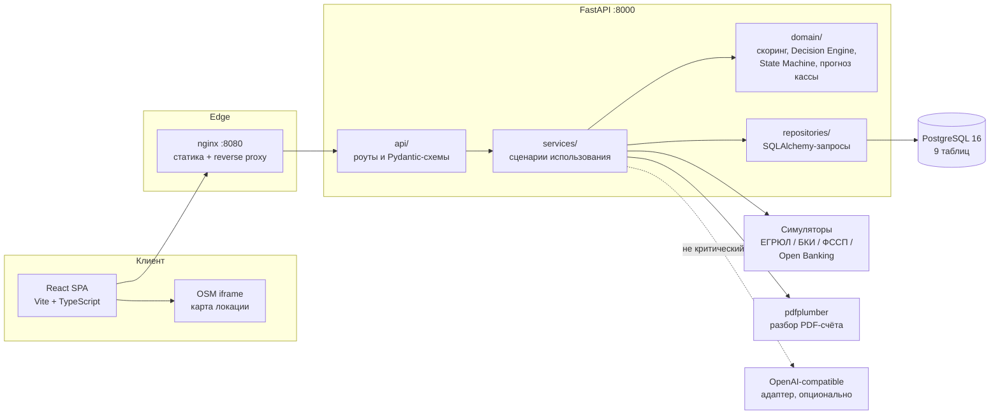
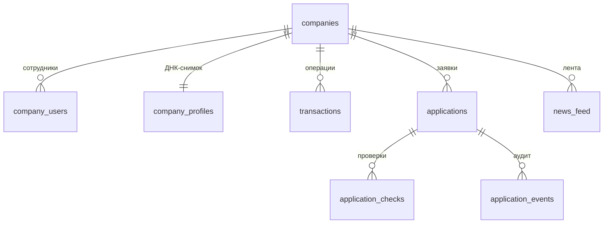
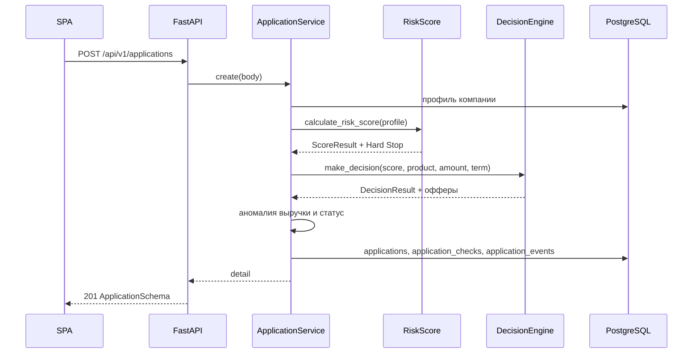

# Архитектура и SLA

Документ описывает устройство «Умного кредитного кабинета предпринимателя» (Only_Alfa), границы слоёв, модель данных и целевые эксплуатационные характеристики. Все технические детали сверены с кодом `backend/app/` и `frontend/src/` по состоянию Чекпоинта-1.

## Содержание

- [1. Назначение и границы](#1-назначение-и-границы)
- [2. Компонентная схема](#2-компонентная-схема)
- [3. Слои и правила зависимостей](#3-слои-и-правила-зависимостей)
- [4. Стек и размещение](#4-стек-и-размещение)
- [5. Модель данных: 9 таблиц](#5-модель-данных-9-таблиц)
- [6. Поток заявки](#6-поток-заявки)
- [7. Матрица SLA Tier-0/1/2](#7-матрица-sla-tier-012)
- [8. Бюджеты задержки](#8-бюджеты-задержки)
- [9. Память и ресурсы](#9-память-и-ресурсы)
- [10. Деградация и фолбэки](#10-деградация-и-фолбэки)
- [11. Безопасность, роли и аудит](#11-безопасность-роли-и-аудит)
- [12. Эксплуатационная проверка](#12-эксплуатационная-проверка)

## 1. Назначение и границы

Система проводит предпринимателя от 360°-портрета бизнеса до заявки на кредит: считает дискретный RiskScore, применяет Decision Engine, проводит заявку через State Machine, подписывает ПЭП и показывает банку экономику сделки. Отдельный контур — умный поиск и Invoice-to-Credit: запрос на покупку или PDF-счёт превращаются в предварительное кредитное предложение.

Границы демо-контура:

- один FastAPI-монолит, одна PostgreSQL-база, одна SPA;
- внешние реестры (ЕГРЮЛ, БКИ, ФССП, Open Banking) заменены детерминированными симуляторами;
- ИИ-обогащение опционально и не участвует в критическом пути;
- аутентификация и юридически значимая криптографическая подпись не реализованы; это ограничение демо-контура.

Подробный перечень упрощений — в [simplifications-registry.md](./simplifications-registry.md).

## 2. Компонентная схема



Сплошные стрелки — обязательный путь запроса. Пунктир — опциональное обогащение: при ошибке или таймауте 1,5 с адаптер возвращает `None`, ответ собирается детерминированно.

## 3. Слои и правила зависимостей

Поток вызовов: `api → services`; `services` вызывает `domain` и `repositories`; `repositories` обращается к БД. Домен не зависит от `repositories` и ничего не знает о способе хранения. Слой `infra` содержит адаптеры и модели, `core` — общие константы, конфигурацию и исключения.

| Слой | Что содержит | Может импортировать | Не должен импортировать |
|---|---|---|---|
| `api/` | FastAPI-роуты, Pydantic-схемы, коды ответов | `services`, `core` | `repositories`, SQLAlchemy-модели напрямую |
| `services/` | Сценарии: создание заявки, Мультибанк, ПЭП, действия инспектора, поиск, PDF, Xray | `domain`, `repositories`, `infra`, `core` | FastAPI-роуты |
| `domain/` | RiskScore, Decision Engine, State Machine, прогноз кассы, аномалии, финансовые формулы, типы | `core.constants`, `core.config` (ставка ЦБ), чистый Python | FastAPI, SQLAlchemy, HTTP, `services`, `repositories` |
| `repositories/` | Запросы к БД, сборка доменных профилей | `infra.models`, `infra.demo_content`, `domain`, `core` | `services`, `api` |
| `infra/` | Движок БД, 9 ORM-моделей, сидер, симуляторы реестров, PDF-парсер, ИИ-адаптер, демо-контент | SQLAlchemy, pdfplumber, httpx, `domain`, `core`; `repositories` — только в сидере | `api`, `services` |
| `core/` | Константы, настройки из окружения, исключения домена | стандартная библиотека, `core.constants` | бизнес-логика |

`infra/seed.py` — отдельное исключение: сидер вызывает репозиторий компаний, чтобы заполнить демо-данные. Это не путь обработки запроса.

Практические следствия:

- домен не знает, откуда пришли данные — из PostgreSQL, SQLite или симулятора;
- решение по коридорам принимает только `domain/decision/decision_engine.py`, балл считает только `domain/scoring/risk_score.py`;
- переходы статусов описаны в одном месте — `domain/state_machine/application_fsm.py`;
- API-слой переводит доменные исключения в HTTP-коды через единый обработчик `DomainError` в `main.py`.

## 4. Стек и размещение

| Компонент | Технология | Порт | Роль |
|---|---|---|---|
| SPA | React 18, Vite 5, TypeScript 5.6 | `8080` (nginx) / `5173` (dev) | Три экрана, Demo Control Bar |
| Edge | nginx 1.27 | `8080` | Статика, gzip, прокси `/api/`, `/health`, `/docs` |
| API | Python 3.12, FastAPI 0.115, Uvicorn 0.30 | `8000` | REST `/api/v1`, Swagger `/docs` |
| БД | PostgreSQL 16 | `5432` внутри Docker-сети | 9 таблиц, JSONB |
| ORM | SQLAlchemy 2.0 | — | Модели, сессии, `create_all` |
| PDF | pdfplumber 0.11 | — | Извлечение ИНН, суммы, НДС, назначения |
| HTTP-клиент | httpx 0.27 | — | Опциональный OpenAI-compatible вызов |

Запуск: `docker compose up --build`. Локально без Docker: Uvicorn + Vite с прокси `/api → http://localhost:8000`. Подробные команды — в [README.md](../README.md).

## 5. Модель данных: 9 таблиц



`search_catalog` — справочник поставщиков и товаров, связан с компанией только логически через ОКВЭД-кластер. `application_events.company_id` также хранится строкой без внешнего ключа, чтобы фиксировать события уровня компании (например, рассрочку по транзакции).

| # | Таблица | Назначение | Ключевые поля |
|---|---|---|---|
| 1 | `companies` | Профиль компании: реквизиты, ОКВЭД, финансы, БКИ, ФССП, гео, Мультибанк | `id`, `inn` (unique), `legal_form`, `business_model`, `monthly_revenue_alfa`, `monthly_revenue_multibank`, `fcf`-компоненты, `geo_score`, `buyer_score`, `is_multibank_verified`, `demo_key` |
| 2 | `company_users` | Пользователи компании и их роли | `id`, `company_id`, `full_name`, `role`, `role_label` |
| 3 | `company_profiles` | Снимок ДНК для Экран 1 | `company_id` (unique), `dna_json`, `updated_at` |
| 4 | `transactions` | Выписка по счёту, рассрочка | `id`, `company_id`, `occurred_at`, `amount_rub`, `direction`, `category`, `can_installment`, `installment_taken` |
| 5 | `applications` | Заявка и результат скоринга | `id`, `company_id`, `status`, `product_type`, `requested_amount_rub`, `term_months`, `risk_score`, `raw_score`, `is_hard_stop`, `outcome`, `approved_amount_rub`, `final_rate_pct`, `monthly_payment_rub`, `fcf_rub`, `max_payment_rub`, `factors_breakdown_json`, `counter_offers_json`, `invoice_json`, `selected_offer_index` |
| 6 | `application_checks` | Проверки по заявке | `application_id`, `check_code`, `status`, `message`, `details_json` |
| 7 | `application_events` | Audit trail | `application_id`, `company_id`, `event_type`, `actor_role`, `previous_status`, `new_status`, `details`, `created_at` |
| 8 | `search_catalog` | Каталог поставщиков и позиций | `okved_cluster`, `cluster_code`, `item_name`, `amount_rub`, `supplier_name`, `supplier_inn`, `fssp_clean`, `keywords`, `news_insight` |
| 9 | `news_feed` | Лента News-to-Action | `company_id`, `title`, `text`, `cta`, `cluster`, `source`, `created_at` |

Особенности хранения:

- `JSONType` использует `JSONB` в PostgreSQL и обычный `JSON` в SQLite;
- схема создаётся через `Base.metadata.create_all` при старте приложения; миграций Alembic в демо нет;
- сидер идемпотентен: повторный запуск не создаёт дубликаты компаний и каталога;
- пять демо-компаний и каталог поставщиков заполняются при старте, если их ещё нет.

## 6. Поток заявки



Порядок обработки в `ApplicationService._run_pipeline`:

1. Считать RiskScore: база 500 плюс пять дискретных факторов, `clamp(0..1000)`.
2. Проверить Hard Stop: ЕГРЮЛ не `ACTIVE`, возраст меньше 3 месяцев, просрочка БКИ больше 30 дней, ФССП больше 20% месячного оборота.
3. Применить Decision Engine: FCF, `MaxPayment = 0.5 × FCF × K_sector`, ставка, лимит, коридоры 650 / 520 / 450.
4. Проверить аномалию заявленной выручки: отклонение от подтверждённого оборота (Альфа, а после Мультибанка — Альфа + другие банки) больше 50% переводит заявку в `ANOMALY_VERIFICATION`.
5. Зафиксировать статус, проверки и событие аудита.
6. Для `ANOMALY_VERIFICATION` — подтвердить Мультибанк; для `COUNTER_OFFER` — выбрать оффер; для `MANUAL_REVIEW` — действие инспектора; для `APPROVED`/`COUNTER_OFFER`/`AWAITING_CEO_APPROVAL` — подписать ПЭП.

Разделение ответственности:

- `RiskScore` отвечает только за балл и Hard Stop, не за коридор и ставку;
- `DecisionEngine` получает готовый `ScoreResult` и не пересчитывает балл;
- `ApplicationService` — единственное место, где доменный результат превращается в строку БД и событие аудита;
- `XrayService` только читает заявку и собирает P&L, Waterfall, геоданные и журнал.

## 7. Матрица SLA Tier-0/1/2

Значения ниже — целевые для пилотного контура, а не измеренные показатели хакатонного стенда. Проверка доступности — Docker healthcheck, задержек — тесты и логи `total_ms` / `classification_ms` / `parsing_ms`.

| Tier | Функции | Целевая доступность | RTO | RPO | Поведение при сбое | Контроль |
|---|---|---|---|---|---|---|
| **Tier-0** | RiskScore, Decision Engine, State Machine, ПЭП, API заявки, аудит | 99,9% в месяц | ≤ 5 мин | 0 (синхронная транзакция) | **Fail-closed**: заявка не получает решение, переход не выполняется, возвращается 409/403/5xx. Недопустимо выдавать случайный или «примерный» балл | `pytest`, healthcheck, события `application_events`, коды 403/409/422 |
| **Tier-1** | Дашборд, умный поиск, PDF-счёт | 99,5% в месяц | ≤ 30 мин | ≤ 15 мин | Деградация без влияния на Tier-0: поиск отдаёт детерминированный результат, PDF — 422 и демо-шаблон, дашборд — последние сохранённые данные | `classification_ms ≤ 50`, `parsing_ms < 5000`, тесты поиска и PDF |
| **Tier-2** | Новости, ИИ-обогащение, карта OSM | 99,0% в месяц | ≤ 4 ч | ≤ 24 ч | Блок скрывается или остаётся детерминированный текст; решение по заявке не меняется | Таймаут 1,5 с, `ai_enrichment = null`, `map_url` как внешняя ссылка |

Правила приоритета:

- если недоступен Tier-2, Tier-0 и Tier-1 работают штатно;
- если недоступен Tier-1, заявку можно создать и подписать вручную через API;
- если недоступен Tier-0, демонстрация останавливается: обход State Machine или подмена балла запрещены.

## 8. Бюджеты задержки

| Операция | Бюджет | Где измеряется | Деградация |
|---|---:|---|---|
| Умный поиск: классификация интента и подбор | **≤ 50 мс** | `classification_ms` в ответе; тест `test_smart_search_returns_three_suppliers_and_badge` | При недоступном каталоге — пустой список поставщиков, плашка формируется по сумме запроса |
| Скоринг одной заявки | **≤ 200 мс** | Локальный вызов `calculate_risk_score`; синхронный путь `POST /applications` | Нет фолбэка: ошибка домена возвращает ошибку, а не «средний» балл |
| `lookup-inn` | **≤ 2 с** | Полный ответ API с проверкой ИНН и записью в БД | Без сети: симулятор работает детерминированно; для нового ИНН при неверной контрольной сумме — 422 |
| Разбор PDF-счёта | **≤ 5 с** | `parsing_ms` в ответе; тест `test_parse_real_pdf_extracts_inn_amount_vat` | При ошибке парсинга — 422 и предложение выбрать один из 3 шаблонов |
| Дашборд компании | ≤ 300 мс (цель) | Логи API; 60 точек прогноза, 5 блоков ДНК, транзакции и новости | Показ последних сохранённых данных |
| ИИ-обогащение поиска | ≤ 1500 мс, только при включённом режиме | `OPENAI_TIMEOUT_MS`, поле `latency_ms` | Жёсткий таймаут, при любой ошибке `None`, ответ уже собран детерминированно |

Бюджет 50 мс относится к детерминированному пути. Если включён `OPENAI_COMPATIBLE`, полный ответ может добавить до 1,5 с, но это Tier-2 и не блокирует кредитную плашку.

## 9. Память и ресурсы

Норматив трёх контейнеров — **≤ 4 ГБ ОЗУ**. В `docker-compose.yml` заданы жёсткие лимиты; их сумма ниже норматива.

| Контейнер | Лимит compose | Что ограничивает |
|---|---:|---|
| `db` (PostgreSQL 16) | 512 МБ | Кэш страниц, соединения, JSONB |
| `backend` (FastAPI + pdfplumber) | 1 ГБ | Парсинг PDF, SQLAlchemy-сессии, Python-рантайм |
| `frontend` (nginx) | 256 МБ | Статика и прокси |
| **Итого** | **1,75 ГБ** | Запас до 4 ГБ — на пики PDF и ОС хоста |

Проверка:

```bash
docker stats --no-stream
docker compose ps
```

Если `docker stats` показывает устойчивое превышение, сначала ограничивают размер загружаемых PDF (nginx `client_max_body_size 10m`) и число одновременных парсингов, затем — пул соединений БД.

## 10. Деградация и фолбэки

| Зависимость | Сбой | Текущее поведение | Влияние |
|---|---|---|---|
| PostgreSQL | Контейнер недоступен | Backend не стартует без healthy `db`; при падении БД после старта запросы к данным завершаются ошибкой, `/health` сам БД не проверяет | Tier-0 недоступен, демонстрация останавливается; данные — в volume `alfa_pgdata` |
| Симуляторы ЕГРЮЛ / БКИ / ФССП / Open Banking | Нет внешней сети | Симулятор не требует сети: `seed = sha256(INN)`, один ИНН — один профиль | Демо работает автономно; достоверность ограничена симулятором |
| OpenAI-compatible | Нет ключа, таймаут, 5xx, пустой ответ | `enrich_search_result` возвращает `None`; поле `ai_enrichment` пустое | Tier-2 деградирует, поиск и плашка работают |
| PDF-счёт | Битый файл, скан без текстового слоя, нет ИНН | `InvoiceParseError` → 422; в UI доступны 3 демо-шаблона | Заявку можно создать вручную или по шаблону |
| OSM iframe | Нет доступа к openstreetmap.org | Карта не загружается; координаты, GeoScore и адрес остаются в ответе `xray` | Tier-2, решение не блокируется |
| Каталог поставщиков | Пустая таблица `search_catalog` | Поиск возвращает пустой список поставщиков; сумма берётся из запроса или дефолта | Плашка формируется, но без подсказок поставщиков |
| ИИ-провайдер | Включён, но недоступен | Жёсткий таймаут 1,5 с, затем `None` | Ответ не становится медленнее бюджета Tier-0 |
| State Machine | Недопустимый переход | `InvalidTransition` → 409 | Заявка остаётся в прежнем статусе |
| ПЭП | Не та роль | `RoleViolation` → 403 | Подписание не происходит, аудит не искажается |

Принцип: **Tier-0 не имеет «мягкого» фолбэка**. Если скоринг или переход не могут быть выполнены корректно, система возвращает ошибку. Это лучше, чем выдать предпринимателю недостоверное одобрение.

## 11. Безопасность, роли и аудит

- Роли: `CEO_OWNER`, `IP_OWNER`, `ACCOUNTANT`, `UNDERWRITER`. Роль приходит в теле запроса; аутентификации в демо нет.
- ООО подписывает только `CEO_OWNER`, ИП — только `IP_OWNER`. Остальные роли получают 403.
- Действия инспектора доступны только `UNDERWRITER` и только из `MANUAL_REVIEW` / `NEED_MORE_INFO`.
- Каждое значимое действие пишет строку в `application_events`; проверки — в `application_checks`.
- ПЭП в демо — логическая подпись: проверка роли, статуса и запись события `PES_SIGNED`. Криптографическая подпись и юридическая значимость не реализованы.
- Аудит доступен только на чтение через `GET /applications/{id}/xray`; отдельных эндпоинтов изменения или удаления событий нет.
- Секреты не хранятся в репозитории: `.env` в `.gitignore`, значения приходят из окружения.

## 12. Эксплуатационная проверка

```bash
# Поднять стенд с нуля
docker compose up --build

# Проверить API
curl http://localhost:8000/health
curl http://localhost:8000/api/v1/companies

# Тесты домена и API
cd backend && ../.venv/bin/python -m pytest -q

# Сборка SPA
cd frontend && npm ci && npm run build

# Память трёх контейнеров
docker stats --no-stream
```

Ожидаемые ориентиры Чекпоинта-1: `pytest` — 35 passed; `npm run build` — успешная сборка; health возвращает `status: ok`, `cbr_key_rate: 14.0`, `ai_provider_mode: DETERMINISTIC`.

Связанные документы:

- [State Machine: ИП и ООО](./state-machine-ip-vs-ooo.md)
- [Реестр упрощений](./simplifications-registry.md)
- [Банковская ценность PDF и прогноза кассы](./bank-value-pdf-cash-forecast.md)
- [Контракт API](../openapi.yaml)
