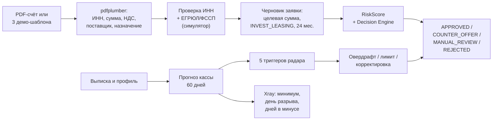

# Банковская ценность PDF-счёта и 60-дневного прогноза кассы

Документ объясняет, зачем банку распознавать ИНН из PDF-счёта и прогнозировать кассовый разрыв на 60 дней. Все формулы и цифры взяты из кода `backend/app/`; где оценка является демонстрационной, это указано явно.

## Содержание

- [1. Коротко](#1-коротко)
- [2. Два продукта в одном конвейере](#2-два-продукта-в-одном-конвейере)
- [3. Экономика распознавания PDF-счёта](#3-экономика-распознавания-pdf-счёта)
- [4. Экономика 60-дневного прогноза кассы](#4-экономика-60-дневного-прогноза-кассы)
- [5. P&L банка по сделке](#5-pl-банка-по-сделке)
- [6. Антифрод и целевое назначение](#6-антифрод-и-целевое-назначение)
- [7. Метрики пилота](#7-метрики-пилота)
- [8. Ограничения](#8-ограничения)
- [9. Где смотреть в коде](#9-где-смотреть-в-коде)

## 1. Коротко

PDF-счёт и прогноз кассы решают две разные задачи банка:

1. **PDF-счёт** превращает документ о покупке в черновик заявки: поставщик, ИНН, сумма, НДС и назначение уже извлечены, ИНН проверен, контрагент проверен по симулятору ЕГРЮЛ/ФССП. Банк получает не «прошу денег», а конкретную сделку с целевым назначением.
2. **Прогноз кассы на 60 дней** показывает, когда именно у бизнеса закончатся деньги и сколько нужно, чтобы дожить до поступления выручки. Банк видит основание для овердрафта или корректировки лимита до выдачи, а не после просрочки.

Оба инструмента работают на одном наборе данных и не меняют кредитное ядро: RiskScore, Decision Engine и State Machine остаются единственным источником решения.

## 2. Два продукта в одном конвейере



Практический вывод: PDF даёт **целевое назначение**, прогноз кассы — **время и размер потребности**. Вместе они снижают неопределённость сделки, не подменяя скоринг.

## 3. Экономика распознавания PDF-счёта

### 3.1. Что извлекается

`ParsedInvoice` содержит пять реквизитов, которые сотрудник обычно вводит руками:

| Поле | Как извлекается | Проверка |
|---|---|---|
| Поставщик | Регулярное выражение по строке «Поставщик» | Если нет — «Не указан» |
| ИНН | 10 или 12 цифр после «ИНН» | Контрольная сумма ФНС; иначе 422 |
| Итоговая сумма | Число после «Итого» | Обязательное поле; иначе 422 |
| НДС | Число после «НДС» | Если нет — 0 |
| Назначение | Строка после «Назначение» | Если нет — «Оплата по счёту» |

Дополнительно проверяется сигнатура `%PDF`; файл не-PDF отклоняется. Для сканов без текстового слоя OCR не применяется — это ограничение, а не скрытая деградация.

### 3.2. Снижение ручного ввода

В демо-тексте Xray заложена оценка: **12 минут ручного ввода → 40 секунд** на заявку. Это продуктовое допущение, а не измерение пилота. Арифметика:

```text
Экономия на заявку = 12 мин − 40 с = 680 с = 11,33 мин = 0,189 ч
При 1 000 заявок/мес: 0,189 × 1 000 = 189 ч/мес
При 160 рабочих часах в месяц: ≈ 1,18 FTE
```

Расчёт показывает порядок величины, а не фактическую численность штата. Для пилота нужно замерить:

- медианное время от загрузки PDF до отправки заявки;
- долю полей, которые сотрудник исправил вручную;
- долю PDF, которые не распознались с первого раза.

### 3.3. Что это даёт банку

| Эффект | Механизм | Ограничение |
|---|---|---|
| Меньше ручных ошибок | ИНН проверяется по контрольной сумме, сумма и НДС извлекаются из документа, а не переносятся глазами | Нестандартная вёрстка может не разобраться |
| Быстрее вход в заявку | Черновик создаётся сразу, сотрудник подтверждает данные | Черновик всё равно проходит скоринг |
| Целевое назначение | В заявке сохраняются `supplier_inn`, `purpose`, `amount_rub`, `invoice_json` | Банк не контролирует фактическую оплату после выдачи |
| Антифрод до оплаты | Проверка ИНН, статуса ЕГРЮЛ и ФССП поставщика | В демо ЕГРЮЛ/ФССП — симуляторы |
| Меньше «серых» кредитов | Сумма заявки привязана к счёту, а не к произвольной цифре | Требуется юридическая проверка контрагента |

Ограничение модели: **PDF не меняет PD напрямую**. В формуле `probability_of_default` нет отдельного коэффициента за распознанный счёт. Эффект идёт через качество данных, целевое назначение и антифрод; численный вклад должен измеряться на пилоте.

## 4. Экономика 60-дневного прогноза кассы

### 4.1. Формула

`backend/app/domain/cash_forecast.py`:

```text
daily_flow = (выручка Альфа + выручка Мультибанк − закупки − платёж БКИ) / 30
rent_and_taxes = аренда/ФОТ + налоги
balance(t) = balance(t−1) + daily_flow − rent_and_taxes, если t ∈ {14, 44}
```

Прогноз строится на 60 дней. Аренда/ФОТ и налоги списываются двумя событиями — на 14-й и 44-й день. Это упрощение календаря платежей, но оно воспроизводит типичный кассовый разрыв в середине месяца.

Метрики прогноза:

- `min_day` — день минимального остатка;
- `min_balance_rub` — минимальный остаток;
- `days_negative` — число дней с отрицательным остатком;
- `has_gap` — признак разрыва.

### 4.2. Пять профилей

| Профиль | FCF, ₽/мес. | Минимум, ₽ | День минимума | Дней в минусе | Разрыв |
|---|---:|---:|---:|---:|---|
| ИП Смирнов | 280 000 | +390 666,67 | 14 | 0 | Нет |
| ООО «Ростерс Кафе» | 260 000 | +474 933,33 | 14 | 0 | Нет |
| ООО «ТехноСтрой» (до Мультибанка) | −3 250 000 | −4 100 000 | 60 | 47 | Есть |
| ИП Ковалев | 95 000 | −139 666,67 | 14 | 14 | Есть |
| ООО «Бодрость Плюс» | −110 000 | −218 000 | 44 | 47 | Есть |

Пример «Ковалев»: остаток 0 ₽, ежедневный поток положительный, но на 14-й день списываются аренда/ФОТ и налоги — баланс уходит в минус на 139 666,67 ₽. Это ровно тот разрыв, который банк видит **до** выдачи кредита.

### 4.3. Ценность для банка

| Ценность | Как используется | Что это меняет |
|---|---|---|
| Раннее выявление разрыва | `min_day`, `min_balance_rub`, `days_negative` | Банк предлагает овердрафт или корректирует лимит до просрочки |
| Размер овердрафта | Ориентир — абсолютный минимум остатка | Лимит привязан к реальной потребности, а не к запросу клиента |
| Честная переплата | `abs(min_balance) × rate × days_negative / 365` | Клиент видит стоимость короткого овердрафта |
| Снижение риска просрочки | Разрыв закрывается до наступления | Меньше оснований для penalty и реструктуризации |
| Контекстный кросс-селл | Триггеры радара показывают повод | Предложение приходит в момент потребности |
| Целевое использование лимита | Прогноз связан с закупками и арендой | Меньше риск «деньги на всё» |

Пример честной переплаты для «Ковалева»: разрыв 139 666,67 ₽, 14 дней, ставка овердрафта по умолчанию 17,5% (`CBR_KEY_RATE 14,0 + SPREAD_OVERDRAFT 3,5`) — около **938 ₽**. Это не доход банка, а ориентир стоимости короткого финансирования для клиента.

### 4.4. Пять триггеров радара

| Код | Условие | Что показывает |
|---|---|---|
| `TRG_CASH_GAP` | Минимум остатка < 0 | День и сумма разрыва, размер переплаты за овердрафт |
| `TRG_SCALE_UP` | Рост выручки > 15% | Повод для инвест-кредита на масштабирование |
| `TRG_CAPEX_EXP` | Закупки > 45% оборота | Высокая доля закупок, лизинг снижает нагрузку на кассу |
| `TRG_ANTI_SPAM` | ≥ 2 активных договора или платежи > 4% оборота | Несколько обязательств, повод для рефинансирования |
| `TRG_LOAN_PROTECT` | Остаток < аренда/ФОТ + налоги + платёж БКИ | Низкий резервный буфер, нужен резервный овердрафт |

Радар не является решением по заявке. Он объясняет клиенту и банку, почему продукт уместен сейчас.

## 5. P&L банка по сделке

`backend/app/services/xray_service.py` считает упрощённый P&L:

```text
expected_income = amount × rate / 100 × months / 12
funding_cost    = amount × CBR_KEY_RATE / 100 × months / 12 × 0.55
PD              = min(15%, max(1%, (1000 − score) / 1000 × 15%))
risk_cost       = amount × PD
opex            = amount × 0,5%
margin          = expected_income − funding_cost − risk_cost − opex
LTV             = expected_income × 1,4
```

Пояснения:

- `0,55` — допущение о среднем остатке при аннуитетном погашении;
- `PD` — модельная эвристика, а не калиброванная вероятность дефолта;
- `LTV` — упрощённый LTV по процентному доходу, а не полная пожизненная ценность клиента;
- `approval_probability_pct = clamp(score / 10, 2, 99)` — экранная эвристика, не статистическая вероятность одобрения.

### 5.1. Три сделки

| Параметр | Смирнов | Ростерс, оффер 1 | ТехноСтрой после МБ |
|---|---:|---:|---:|
| Сумма, ₽ | 900 000 | 1 205 279,33 | 3 200 000 |
| Ставка | 14,5% | 18,0% | 15,5% |
| Срок | 24 мес. | 12 мес. | 24 мес. |
| Процентный доход, ₽ | 261 000 | 216 950,28 | 992 000 |
| Стоимость фондирования, ₽ | 138 600 | 92 806,51 | 492 800 |
| PD | 2,77% | 5,85% | 3,60% |
| Стоимость риска, ₽ | 24 975 | 70 508,84 | 115 200 |
| OPEX, ₽ | 4 500 | 6 026,40 | 16 000 |
| Маржа, ₽ | 92 925 | 47 608,53 | 368 000 |
| Маржа к сумме | 10,32% | 3,95% | 11,50% |
| LTV, ₽ | 365 400 | 303 730,39 | 1 388 800 |
| LTV к сумме | 40,6% | 25,2% | 43,4% |

Выводы:

- сделка «ТехноСтрой» после подтверждения Мультибанка даёт наибольшую абсолютную маржу, потому что сумма и срок больше;
- «Ростерс» после снижения суммы до 1 205 279,33 ₽ имеет тонкую маржу 3,95%: риск-корректировка 2,5 п.п. и высокая PD 5,85% съедают доход;
- «Смирнов» — качественная сделка: PD 2,77%, маржа 10,32%, LTV 365 400 ₽;
- для банка важна не только ставка, но и стоимость риска: разница PD между 815 и 610 баллами даёт более чем двукратную разницу в risk cost при прочих равных.

### 5.2. Что это значит для продукта

- **Цена риска видна до выдачи.** Xray показывает, сколько банк заработает и сколько закладывает на риск.
- **Мультибанк меняет экономику.** Подтверждение выручки не только повышает балл, но и увеличивает лимит на 25%, а значит — процентный доход.
- **Снижение суммы сохраняет платёж в MaxPayment.** Оффер 1 «Ростерса» снижает сумму до 1 205 279,33 ₽; аннуитет 110 500 ₽ ровно укладывается в MaxPayment. Лимит выводится из обратного аннуитета (`calculate_max_principal`), поэтому сумма и платёж согласованы.
- **PD и LTV — ориентиры, не отчётность.** Для продукта нужна калибровка на исторических данных банка.

## 6. Антифрод и целевое назначение

### 6.1. Цепочка проверки

1. Пользователь загружает PDF или выбирает шаблон.
2. Парсер извлекает ИНН поставщика и сумму.
3. `validate_inn` проверяет длину и контрольную сумму.
4. `simulate_company` отдаёт статус ЕГРЮЛ и сумму ФССП.
5. `run_antifraud` возвращает `is_verified`, `egrul_status`, `fssp_amount_rub`, сообщение.
6. Черновик заявки сохраняет `invoice_json` и проверку `INVOICE_PARSED`.

Если контрольная сумма неверна, `run_antifraud` возвращает `is_verified: false` и сообщение «оплата заблокирована». Если у поставщика есть исполнительные производства, требуется ручная проверка.

### 6.2. Целевое назначение

Черновик создаётся с параметрами:

- продукт `INVEST_LEASING`;
- сумма равна сумме счёта;
- срок 24 месяца;
- `invoice_json` содержит поставщика, ИНН, сумму, НДС, назначение и результат антифрода.

Это привязывает кредит к конкретной закупке. Банк видит, что деньги нужны на оборудование или партию товара, а не на общие расходы. Ограничение: фактическое перечисление поставщику и контроль оплаты в демо не реализованы.

### 6.3. Что не заявляется

- PDF-распознавание **не снижает PD на фиксированный процент** — в модели такого коэффициента нет;
- антифрод **не заменяет** реальные ЕГРЮЛ/ФССП и юридическую проверку;
- «12 минут → 40 секунд» — продуктовая оценка из демо-текста, а не замер пилота;
- `approval_probability_pct` — не вероятность одобрения, а производная балла для интерфейса.

## 7. Метрики пилота

| Метрика | Определение | Сейчас в демо | Что мерить в пилоте |
|---|---|---|---|
| Время разбора счёта | От загрузки до черновика | `parsing_ms < 5 000` в тесте; шаблон — миллисекунды | Медиана и p95 по реальным PDF |
| Доля успешных PDF | Успешный парсинг / все загрузки | 3 шаблона + текстовый PDF | Отдельно текстовые и сканы |
| Точность полей | Совпадение с эталоном | Не измеряется | Поставщик, ИНН, сумма, НДС, назначение |
| Ручные исправления | Доля полей, изменённых сотрудником | Не измеряется | По каждой заявке |
| Снижение ручного ввода | 12 мин → 40 с (допущение) | 0,189 ч на заявку | Замер до/после |
| Раннее выявление разрыва | День минимума и сумма | 14-й день у Ковалева, 44-й у Бодрости | Сравнение прогноза с фактом |
| Точность прогноза | MAPE или отклонение минимума | Не измеряется | Нужны фактические остатки |
| Конверсия PDF → заявка | Доля черновиков, дошедших до скоринга | Не измеряется | Воронка |
| PD | Модельная вероятность дефолта | 2,77% / 5,85% / 3,60% | Калибровка на исторических данных |
| LTV | Процентный доход × 1,4 | 365 400 / 334 152 / 1 388 800 ₽ | Полный LTV с кросс-продажами |
| Маржа | Доход − фондирование − риск − OPEX | 92 925 / 52 377 / 368 000 ₽ | Фактическая маржа после выдачи |
| Антифрод-блокировки | Доля счетов с `is_verified: false` | Демо-кейсы | False positive / false negative |

## 8. Ограничения

- ЕГРЮЛ, БКИ, ФССП и Open Banking — симуляторы, а не реальные сервисы.
- PDF-парсер работает с текстовым слоем; OCR нет.
- Прогноз кассы не учитывает сезонность, графики платежей и задержки поступлений.
- PD, LTV и `approval_probability_pct` — упрощённые эвристики.
- ПЭП — логическая подпись без криптографии.
- Антифрод не контролирует фактическую оплату поставщику.
- Экономические оценки в демо-тексте Xray — иллюстрация, а не отчёт банка.

Для продукта нужны: реальные реестры, OCR, калибровка PD на исторических данных, контроль целевого использования и юридически значимая подпись.

## 9. Где смотреть в коде

| Что | Файл |
|---|---|
| Прогноз кассы и триггеры | `backend/app/domain/cash_forecast.py` |
| Формулы FCF, MaxPayment, аннуитета | `backend/app/domain/finances.py` |
| PDF-парсер и антифрод | `backend/app/infra/invoice_parser.py` |
| Черновик из счёта | `backend/app/services/invoice_service.py`, `application_service.create_draft` |
| P&L, Waterfall, Geo, аудит | `backend/app/services/xray_service.py` |
| Константы ставок, PD, LTV, OPEX | `backend/app/core/constants.py` |
| Демо-профили и сценарии | `backend/app/infra/demo_profiles.py` |

Связанные документы:

- [Архитектура и SLA](./architecture-and-sla.md)
- [State Machine: ИП и ООО](./state-machine-ip-vs-ooo.md)
- [Реестр упрощений](./simplifications-registry.md)
