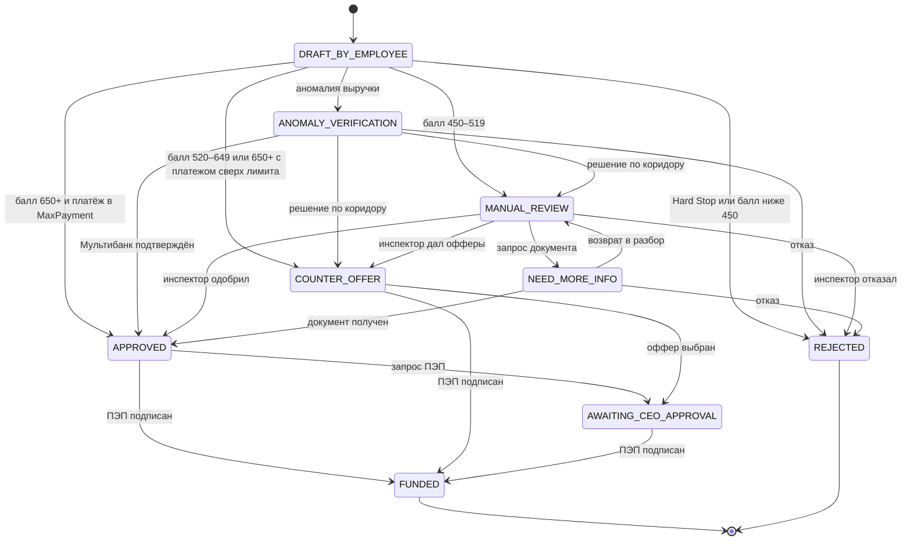

# State Machine заявки: ИП и ООО

Документ описывает жизненный цикл заявки, права ролей, различия ИП и ООО и место аудита. Источник истины — `backend/app/domain/state_machine/application_fsm.py`; API-слой только вызывает переходы и переводит доменные исключения в HTTP-коды.

## Содержание

- [1. Где живёт логика](#1-где-живёт-логика)
- [2. Статусы](#2-статусы)
- [3. Диаграмма переходов](#3-диаграмма-переходов)
- [4. Таблица переходов](#4-таблица-переходов)
- [5. HTTP-коды при нарушении](#5-http-коды-при-нарушении)
- [6. ИП и ООО: различия](#6-ип-и-ооо-различия)
- [7. Сценарии пяти профилей](#7-сценарии-пяти-профилей)
- [8. Audit trail](#8-audit-trail)
- [9. Проверка](#9-проверка)

## 1. Где живёт логика

| Компонент | Файл | Ответственность |
|---|---|---|
| Домен | `domain/state_machine/application_fsm.py` | Список разрешённых пар `(from, to)`, роли, проверка подписанта, терминальные статусы |
| Домен | `domain/types.py` | `ApplicationStatus`, `LegalForm`, `UserRole` |
| Сервис | `services/application_service.py` | Вызов переходов, запись статуса, проверок и событий, commit |
| API | `api/applications.py` | Эндпоинты `verify-multibank`, `accept-offer`, `underwriter-action`, `ceo-approve` |
| Ошибки | `core/exceptions.py` | `InvalidTransition` → 409, `RoleViolation` → 403, `InvalidRequest` → 400 |

Домен не импортирует FastAPI, SQLAlchemy и HTTP. Проверка перехода ничего не мутирует: `validate_transition` возвращает решение, `apply_transition` — новый статус, а запись в БД делает сервис.

## 2. Статусы

| Статус | Подпись в API | Смысл | Терминальный |
|---|---|---|---|
| `DRAFT_BY_EMPLOYEE` | Черновик от сотрудника | Заявка создана, скоринг ещё не завершён или ждёт отправки | Нет |
| `ANOMALY_VERIFICATION` | Требуется подтверждение выручки | Заявленная выручка отклоняется от подтверждённого оборота более чем на 50% (Альфа; после Мультибанка — Альфа + другие банки) | Нет |
| `APPROVED` | Одобрено | Решение APPROVED, можно подписывать ПЭП | Нет |
| `COUNTER_OFFER` | Есть встречные предложения | Решение COUNTER_OFFER, доступны 4 варианта | Нет |
| `AWAITING_CEO_APPROVAL` | Ожидает подписания ПЭП | Оффер выбран, ждём владельца | Нет |
| `MANUAL_REVIEW` | На ручном разборе | Балл 450–519 или решение передано инспектору | Нет |
| `NEED_MORE_INFO` | Нужны документы | Инспектор запросил документ | Нет |
| `REJECTED` | Отказ | Hard Stop или отказ по коридору | **Да** |
| `FUNDED` | Профинансировано | ПЭП подписан, сумма зачислена | **Да** |

## 3. Диаграмма переходов



Пояснения к диаграмме:

- коридор — не единственное условие: при балле ≥ 650 Decision Engine всё равно вернёт `COUNTER_OFFER`, если платёж превышает `MaxPayment` или локация слабая (`geo_score < 45` для `B2C_OFFLINE`);
- переходы из `DRAFT_BY_EMPLOYEE` и `ANOMALY_VERIFICATION` выполняет сервис по результату скоринга и решения, а не пользователь;
- `APPROVED → AWAITING_CEO_APPROVAL` и `NEED_MORE_INFO → MANUAL_REVIEW` разрешены State Machine, но отдельных кнопок/эндпоинтов для них в демо нет;
- `COUNTER_OFFER → FUNDED` технически возможно прямым вызовом `ceo-approve`, но в демо используется путь через выбор оффера;
- из `FUNDED` и `REJECTED` переходов нет.

## 4. Таблица переходов

Роли указаны для пар с ограничением. «Сервис» означает системный переход с пустым множеством ролей: право проверяется бизнес-сценарием, а не ролью пользователя.

| № | From | To | Кто может | Триггер / эндпоинт | Код при нарушении |
|---:|---|---|---|---|---|
| 1 | `DRAFT_BY_EMPLOYEE` | `ANOMALY_VERIFICATION` | Сервис | Аномалия выручки при создании | 409 |
| 2 | `DRAFT_BY_EMPLOYEE` | `APPROVED` | Сервис | Балл ≥ 650, платёж ≤ `MaxPayment`, локация не слабая | 409 |
| 3 | `DRAFT_BY_EMPLOYEE` | `COUNTER_OFFER` | Сервис | Балл 520–649 или платёж сверх `MaxPayment` / слабая локация при балле ≥ 650 | 409 |
| 4 | `DRAFT_BY_EMPLOYEE` | `MANUAL_REVIEW` | Сервис | Балл 450–519 | 409 |
| 5 | `DRAFT_BY_EMPLOYEE` | `REJECTED` | Сервис | Hard Stop или балл < 450 | 409 |
| 6 | `ANOMALY_VERIFICATION` | `APPROVED` | Сервис | `POST /verify-multibank`, решение APPROVED | 409 |
| 7 | `ANOMALY_VERIFICATION` | `COUNTER_OFFER` | Сервис | `POST /verify-multibank`, решение COUNTER_OFFER | 409 |
| 8 | `ANOMALY_VERIFICATION` | `MANUAL_REVIEW` | Сервис | `POST /verify-multibank`, решение MANUAL_REVIEW | 409 |
| 9 | `ANOMALY_VERIFICATION` | `REJECTED` | Сервис | `POST /verify-multibank`, решение REJECTED | 409 |
| 10 | `APPROVED` | `AWAITING_CEO_APPROVAL` | `CEO_OWNER`, `IP_OWNER`, `ACCOUNTANT` | Запрос подписания; отдельного эндпоинта в демо нет | 403 / 409 |
| 11 | `APPROVED` | `FUNDED` | Подписант: `CEO_OWNER` для ООО, `IP_OWNER` для ИП | `POST /ceo-approve` | 403 / 409 |
| 12 | `COUNTER_OFFER` | `AWAITING_CEO_APPROVAL` | `CEO_OWNER`, `IP_OWNER`, `ACCOUNTANT` | `POST /accept-offer` | 403 / 409 |
| 13 | `COUNTER_OFFER` | `FUNDED` | Подписант: `CEO_OWNER` / `IP_OWNER` | `POST /ceo-approve` | 403 / 409 |
| 14 | `AWAITING_CEO_APPROVAL` | `FUNDED` | Подписант: `CEO_OWNER` / `IP_OWNER` | `POST /ceo-approve` | 403 / 409 |
| 15 | `MANUAL_REVIEW` | `NEED_MORE_INFO` | `UNDERWRITER` | `underwriter-action` → `NEED_MORE_INFO` | 403 / 409 |
| 16 | `MANUAL_REVIEW` | `APPROVED` | `UNDERWRITER` | `underwriter-action` → `APPROVE` | 403 / 409 |
| 17 | `MANUAL_REVIEW` | `COUNTER_OFFER` | `UNDERWRITER` | `underwriter-action` → `COUNTER_OFFER` | 403 / 409 |
| 18 | `MANUAL_REVIEW` | `REJECTED` | `UNDERWRITER` | `underwriter-action` → `REJECT` | 403 / 409 |
| 19 | `NEED_MORE_INFO` | `APPROVED` | `UNDERWRITER` | `underwriter-action` → `APPROVE` + `document_name` | 400 / 403 / 409 |
| 20 | `NEED_MORE_INFO` | `MANUAL_REVIEW` | `UNDERWRITER` | FSM допускает; отдельного действия в API нет | 403 / 409 |
| 21 | `NEED_MORE_INFO` | `REJECTED` | `UNDERWRITER` | `underwriter-action` → `REJECT` | 403 / 409 |

Дополнительные правила, которые не видны в таблице пар:

- `POST /ceo-approve` сначала проверяет статус, потом роль. Поэтому из `REJECTED` даже владелец получит **409**, а не 403.
- `POST /underwriter-action` сначала проверяет роль. Не-инспектор получит **403**, даже если статус неподходящий.
- Для одобрения из `NEED_MORE_INFO` обязателен `document_name`; без него — **400**.
- `POST /accept-offer` принимает индекс 1–4. Индекс вне диапазона — **400**, неверный статус — **409**, роль вне множества — **403**.
- Повторный `verify-multibank` из `APPROVED` — **409**.
- Любая пара, которой нет в `_TRANSITIONS`, — **409**. Терминальные статусы не имеют исходящих переходов.

## 5. HTTP-коды при нарушении

| Код | Исключение | Когда возникает | Пример |
|---:|---|---|---|
| **400** | `InvalidRequest` | Неверный индекс оффера, неизвестное действие инспектора, отсутствует документ, рассрочка недоступна | `APPROVE` из `NEED_MORE_INFO` без `document_name` |
| **403** | `RoleViolation` | Роль не входит в разрешённое множество или не является подписантом | Бухгалтер подписывает ПЭП за ООО |
| **404** | `EntityNotFound` | Нет компании, заявки или транзакции | `GET /applications/unknown` |
| **409** | `InvalidTransition` | Пары статусов нет в State Machine; повторный Мультибанк; подписание из терминального статуса | `ceo-approve` для `REJECTED` |
| **422** | `InvalidINN`, `InvoiceParseError`, Pydantic | Неверная контрольная сумма ИНН, битый PDF, нарушение схемы запроса | `{"inn":"1234567890"}` |
| **201** | — | Успешное создание заявки | `POST /applications` |
| **200** | — | Успешный переход или чтение | `POST /ceo-approve` |

Порядок проверок в `ceo_approve`:

1. заявка существует — иначе 404;
2. статус входит в `SIGNING_STATUSES` (`APPROVED`, `COUNTER_OFFER`, `AWAITING_CEO_APPROVAL`) — иначе 409;
3. роль является подписантом для организационно-правовой формы — иначе 403;
4. переход в `FUNDED` разрешён — иначе 409.

## 6. ИП и ООО: различия

| Параметр | ИП | ООО |
|---|---|---|
| `LegalForm` | `IP` | `OOO` |
| Длина ИНН | 12 цифр | 10 цифр |
| Роль владельца | `IP_OWNER` | `CEO_OWNER` |
| Кто подписывает ПЭП | Только `IP_OWNER` | Только `CEO_OWNER` |
| Бухгалтер | Может создать заявку, выбрать оффер; не подписывает и не действует как инспектор | То же |
| Инспектор | Только `UNDERWRITER`, независимо от ОПФ | Только `UNDERWRITER` |
| Демо-профили | Смирнов, Ковалев | Ростерс, ТехноСтрой, Бодрость Плюс |
| Определение ОПФ в симуляторе | 12 цифр ИНН | 10 цифр ИНН |
| Событие подписания | `PES_SIGNED`, `actor_role = IP_OWNER` | `PES_SIGNED`, `actor_role = CEO_OWNER` |
| Зачисление | Сумма прибавляется к `account_balance` | Сумма прибавляется к `account_balance` |

Ключевая функция:

```python
required = UserRole.CEO_OWNER if legal_form == LegalForm.OOO else UserRole.IP_OWNER
```

Следствия:

- `ACCOUNTANT` не может подписать ПЭП ни для ИП, ни для ООО — 403;
- `UNDERWRITER` не может подписать ПЭП — 403;
- для ООО `IP_OWNER` не подходит, для ИП `CEO_OWNER` не подходит;
- роль приходит в теле запроса; аутентификации в демо нет, поэтому это проверка бизнес-правила, а не защита от подмены личности.

## 7. Сценарии пяти профилей

| Профиль | ОПФ | Балл | Путь | Итог |
|---|---|---:|---|---|
| ИП Смирнов | ИП | 815 | `DRAFT → APPROVED → FUNDED` | 900 000 ₽, 14,5%, ПЭП `IP_OWNER` |
| ООО «Ростерс Кафе» | ООО | 610 | `DRAFT → COUNTER_OFFER → AWAITING_CEO_APPROVAL → FUNDED` | оффер №1 — 1 205 279,33 ₽, 18,0%, ПЭП `CEO_OWNER` |
| ООО «ТехноСтрой» | ООО | 295 → 760 | `DRAFT → ANOMALY_VERIFICATION → APPROVED → FUNDED` | 3 200 000 ₽, 15,5%, ПЭП `CEO_OWNER` |
| ИП Ковалев | ИП | 495 | `DRAFT → MANUAL_REVIEW → NEED_MORE_INFO → APPROVED → FUNDED` | 300 000 ₽, 20,0%, ПЭП `IP_OWNER` |
| ООО «Бодрость Плюс» | ООО | 0 (raw −30) | `DRAFT → REJECTED` | терминальный отказ |

### 7.1. ИП Смирнов — прямой путь

1. Заявка: `INVEST_LEASING`, 900 000 ₽, 24 мес., заявленная выручка 1 450 000 ₽.
2. Балл 815: база 500 + БКИ 130 + денежный поток 65 + DSCR 25 + профиль 20 + гео 75.
3. Решение APPROVED, ставка 14,5%, платёж 43 424,49 ₽, FCF 280 000 ₽, MaxPayment 161 000 ₽.
4. `ceo-approve` с ролью `IP_OWNER` переводит сразу в `FUNDED`; баланс 420 000 → 1 320 000 ₽.
5. Событие `PES_SIGNED` фиксирует сумму и оба значения баланса.

Переход `APPROVED → AWAITING_CEO_APPROVAL` в этом сценарии не используется, хотя FSM его допускает.

### 7.2. ООО «Ростерс Кафе» — встречные предложения

1. Заявка: 2 500 000 ₽, 12 мес.
2. Балл 610: база 500 + БКИ 130 + стабильный FCF 50 + DSCR 0 + профиль 20 + слабая локация −90.
3. Решение COUNTER_OFFER, ставка 18,0%, MaxPayment 110 500 ₽, лимит 1 205 279,33 ₽, 4 оффера.
4. `accept-offer` с индексом 1 и ролью `ACCOUNTANT` переводит в `AWAITING_CEO_APPROVAL`; сумма 1 205 279,33 ₽, платёж 110 500 ₽.
5. `ceo-approve` с ролью `CEO_OWNER` переводит в `FUNDED`; бухгалтер на этом шаге получил бы 403.

### 7.3. ООО «ТехноСтрой» — аномалия и Мультибанк

1. Заявка: `VKL`, 3 200 000 ₽, 24 мес., заявленная выручка 6 000 000 ₽ при обороте в Альфе 1 800 000 ₽.
2. Отклонение 233% → `ANOMALY_VERIFICATION`, балл 295.
3. `verify-multibank` добавляет 4 200 000 ₽ внешней выручки, балл 760, статус `APPROVED`, ставка 15,5%.
4. `ceo-approve` с ролью `CEO_OWNER` → `FUNDED`; сумма 3 200 000 ₽, баланс 2 400 000 → 5 600 000 ₽.
5. События: `MULTIBANK_VERIFIED` (actor `SYSTEM`) и `PES_SIGNED` (actor `CEO_OWNER`).

### 7.4. ИП Ковалев — ручной разбор

1. Заявка: `OVERDRAFT`, 200 000 ₽, 12 мес.
2. Балл 495: база 500 − 85 за техническую просрочку + 50 FCF + 0 DSCR + 10 профиль + 20 гео.
3. `MANUAL_REVIEW`; ставка 20,0%, MaxPayment 47 500 ₽. Прогноз кассы показывает разрыв на 14-й день — −139 666,67 ₽.
4. Инспектор: `NEED_MORE_INFO` → загрузка «Договор аренды.pdf» → `APPROVE`.
5. Лимит по лестнице: `min(750 000, max(200 000, 300 000)) = 300 000 ₽`; ставка 20,0%.
6. `ceo-approve` с ролью `IP_OWNER` → `FUNDED`; баланс 0 → 300 000 ₽.

### 7.5. ООО «Бодрость Плюс» — Hard Stop

1. Заявка: 1 500 000 ₽, 12 мес.
2. Балл: база 500 − 180 БКИ − 200 денежный поток − 150 DSCR + 0 профиль + 0 отрасль = −30, после clamp — 0.
3. Hard Stop: просрочка БКИ 45 дней > 30; ФССП 320 000 ₽ > 20% от 400 000 ₽ (80 000 ₽).
4. Статус `REJECTED`, сумма 0, ставка 0. Любой `ceo-approve` → 409; заявка терминальна.

## 8. Audit trail

Аудит хранится в двух таблицах:

| Таблица | Что фиксирует | Ключевые поля |
|---|---|---|
| `application_events` | Действия и переходы статусов | `application_id`, `company_id`, `event_type`, `actor_role`, `previous_status`, `new_status`, `details`, `created_at` |
| `application_checks` | Результаты проверок | `application_id`, `check_code`, `status`, `message`, `details_json`, `created_at` |

Где пишется:

| Действие | Метод сервиса | Событие | Проверки |
|---|---|---|---|
| Создание заявки | `create` | `APPLICATION_CREATED` | `REVENUE_ANOMALY`, `RISK_SCORE`, при Hard Stop — `HARD_STOP` |
| Отправка черновика из PDF | `create` + `create_draft` | `APPLICATION_SUBMITTED`, `DRAFT_CREATED` | `INVOICE_PARSED`, затем те же проверки |
| Мультибанк | `verify_multibank` | `MULTIBANK_VERIFIED` | `MULTIBANK`; `REVENUE_ANOMALY` переводится в `RESOLVED` |
| Выбор оффера | `accept_offer` | `OFFER_ACCEPTED` | — |
| Подписание ПЭП | `ceo_approve` | `PES_SIGNED` | — |
| Действие инспектора | `underwriter_action` | `UNDERWRITER_APPROVE`, `UNDERWRITER_REJECT`, `UNDERWRITER_NEED_MORE_INFO`, `UNDERWRITER_COUNTER_OFFER` | `DOCUMENT_REQUEST`, `CLIENT_DOCUMENT`, `UNDERWRITER_DECISION` |
| Рассрочка по транзакции | `installment` | `TRANSACTION_INSTALLMENT` (company-level, `application_id = null`) | — |

Пример для «Ростерс»:

```text
APPLICATION_CREATED  ACCOUNTANT  → COUNTER_OFFER   RiskScore=610, outcome=COUNTER_OFFER, requested=2 500 000 ₽
OFFER_ACCEPTED       ACCOUNTANT  COUNTER_OFFER → AWAITING_CEO_APPROVAL  Выбран вариант 1
PES_SIGNED           CEO_OWNER   AWAITING_CEO_APPROVAL → FUNDED  Зачислено 1 205 279,33 ₽, баланс 600 000 → 1 805 279,33 ₽
```

Чтение аудита: `GET /api/v1/applications/{application_id}/xray` возвращает `events` и `checks`. Отдельных эндпоинтов обновления или удаления событий нет. При этом аудит не является WORM-хранилищем: администратор БД теоретически может изменить строки, для продукта нужен неизменяемый журнал.

## 9. Проверка

```bash
cd backend && ../.venv/bin/python -m pytest -q
```

Ключевые тесты:

- `test_signature_for_ip_and_ooo` — ИП подписывает `IP_OWNER`, ООО — только `CEO_OWNER`; бухгалтер получает 403; оффер переводит в `AWAITING_CEO_APPROVAL`;
- `test_manual_review_flow_need_more_info` — `ceo-approve` из `MANUAL_REVIEW` даёт 409; `NEED_MORE_INFO` без документа — 400; одобрение — 300 000 ₽; подписание ИП — `FUNDED`;
- `test_rejected_application_cannot_be_signed` — из `REJECTED` только 409;
- `test_negative_codes_422_403_409` — неверный ИНН 422, не-инспектор 403, повторный Мультибанк 409;
- `test_multibank_restores_anomaly_and_boosts_score` — 295 → 760, повторный вызов 409;
- `test_underwriter_counter_offer_can_be_selected_and_funded` — инспектор формирует офферы, клиент выбирает, владелец подписывает;
- `test_repeated_tekhnostroy_is_not_stuck_in_anomaly` — повторная заявка после Мультибанка сразу APPROVED 760.

Ожидаемо: 35 passed.

Связанные документы:

- [Архитектура и SLA](./architecture-and-sla.md)
- [Реестр упрощений](./simplifications-registry.md)
- [Банковская ценность PDF и прогноза кассы](./bank-value-pdf-cash-forecast.md)
